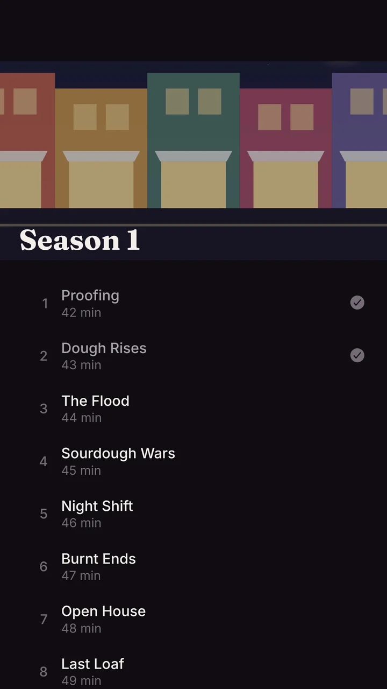
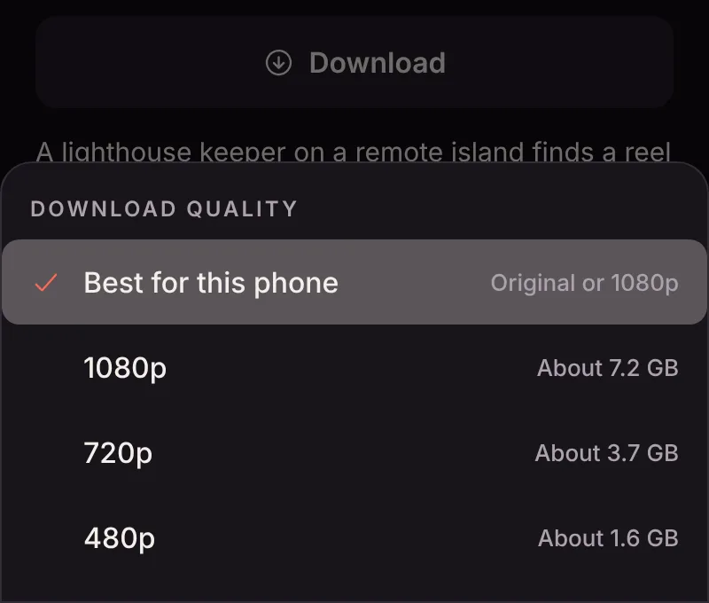
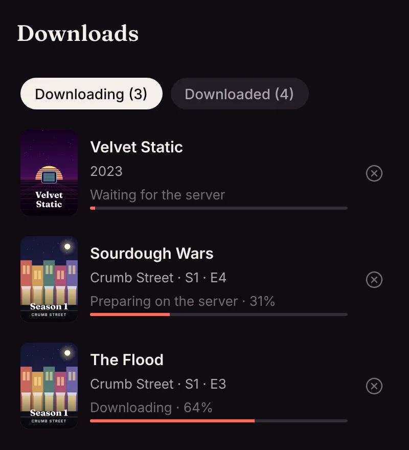
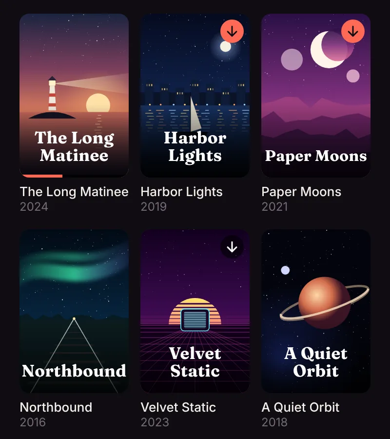
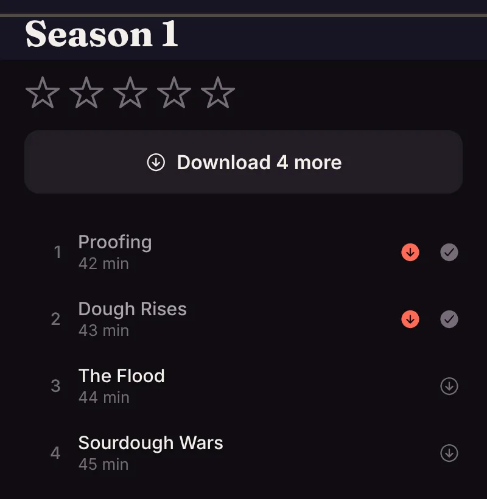

The phone and tablet apps can download a movie, an episode, a whole season or an album to watch with no connection: on a plane, on a train, or anywhere the signal gives up.

<!-- since: v0.1.6 -->

Watches can have their own downloads of albums and audiobooks too: see [Wear OS watches](/docs/apps/wear-os/#listening-on-the-watch) and [Apple Watch](/docs/apps/apple-watch/#listening-on-the-watch).

<!-- /since -->

Downloads need you to be [signed in](/docs/apps/phone-and-tv/#at-home-and-away), so they're yours and not the shared Home account's. They aren't offered on TVs.

## How downloads work

A download is a job on the server, not a stream, which is what makes it reliable:

1. **The server prepares the file** in the background: the original file if your phone can play it, otherwise a single MP4 at the quality you picked in the app's settings (1080p, 720p or 480p).
2. **Your phone fetches it** through the system's own background downloads, so it keeps going with the app closed and carries on after a dropped connection.
3. **The file is checked** against the server's size and checksum before it counts. A broken download is tried again, up to three times.

Downloads wait for Wi-Fi unless the app's settings allow mobile data.

<!-- since: v0.1.10 -->

## Picking a quality

**Settings → Downloads** sets the quality every download uses. **Best for this phone** takes the original file when the phone plays it as it is, and 1080p otherwise. 1080p, 720p and 480p trade picture for space: a two-hour movie comes to about 7, 3.6 and 1.5 GB.

From app version 1.0.22 you can choose for one title too:

- **Hold Download** on a movie, an episode or a season to pick its quality, with roughly how much room it takes.
- Pick **Ask each time** in Settings to see the choices whenever you download a video.

Music and audiobooks always download as the original file.

<!-- /since -->

## Watching offline

Downloaded titles are on the **Downloads** tab. The app remembers where you stopped, and tells the server when the phone is back online: your progress joins what you watched elsewhere, and the most recent change wins.

<!-- since: v0.1.10 -->

From app version 1.0.22:

- The **Downloads** tab opens on **Downloading**: what's still on its way, or waiting for you to try again. **Downloaded** lists what's ready to watch, with how much room it takes. When nothing is downloading, the tab opens on **Downloaded**.
- The tab shows how many downloads are still going.
- Downloaded titles carry a small **arrow badge** wherever they appear: on posters in Home, libraries, search and collections, and next to episodes, songs and podcast episodes. A season, show, album or audiobook has it once any of its downloads is on the phone. The badge is an outline while a download is on its way.
- On a tablet, the Downloads tab shows two columns.

<!-- /since -->

Signing out removes downloads from the phone.

## For admins

Prepared downloads take room in the server's data folder (or the downloads volume in the [Helm chart](/docs/server/kubernetes/)) until the phone has them. Matinee deletes the files it made once every device has had them for a while, and when a download is removed.
