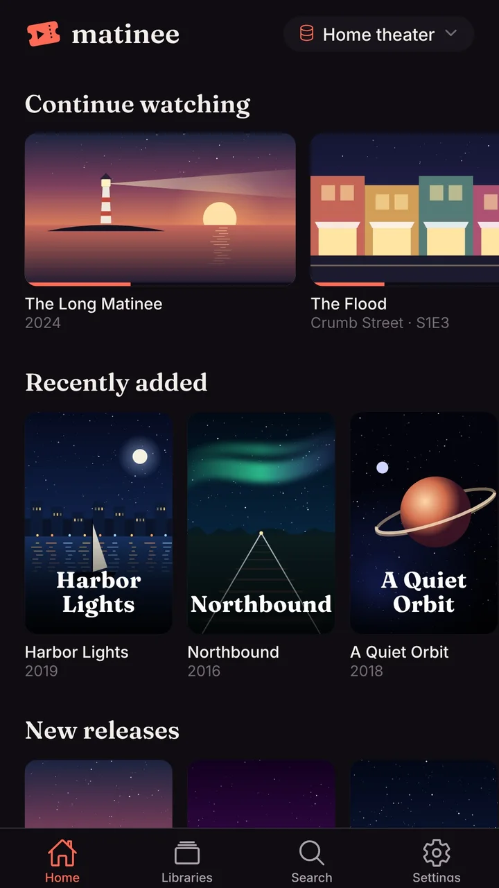
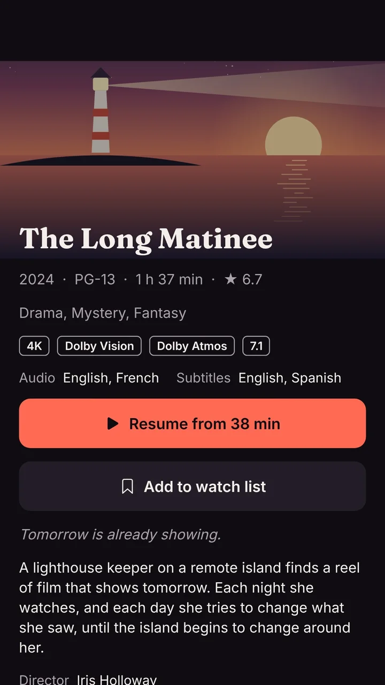
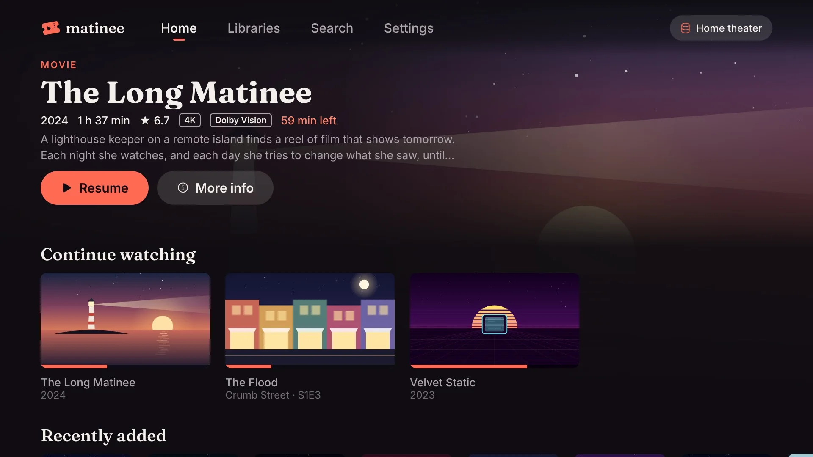
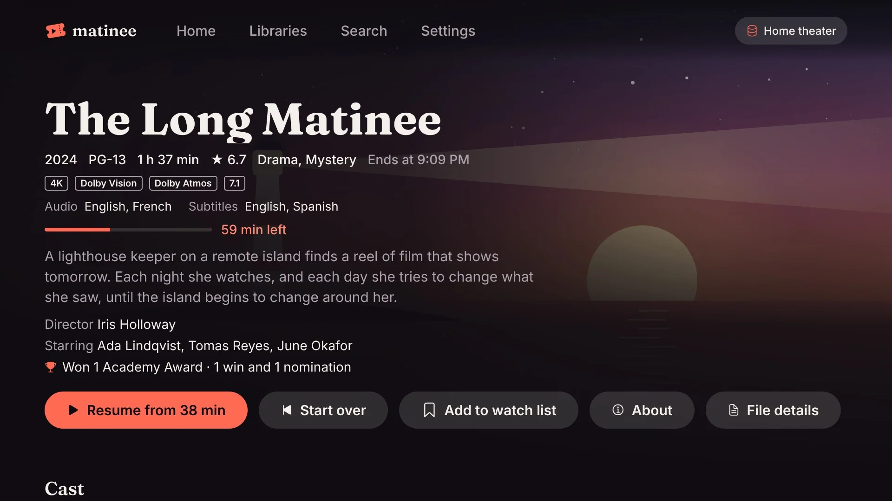
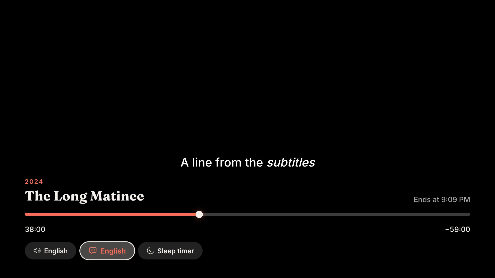
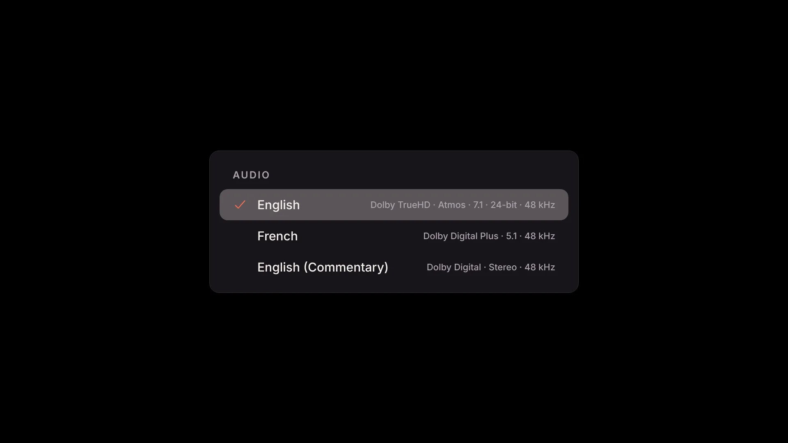
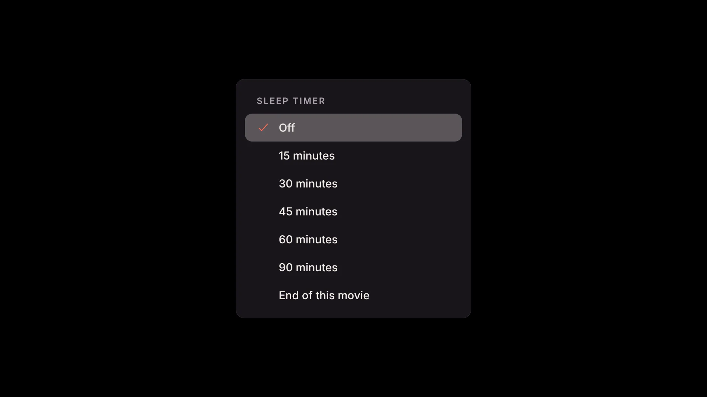

The Matinee apps bring your library to phones, tablets and TVs, with the device's own video player so most files play exactly as they are.

| App | Runs on |
| --- | --- |
| Matinee for phones and tablets | iPhone, iPad, Android phones and tablets |
| Matinee for TV | Apple TV, Android TV and Google TV |

<!-- since: v0.1.1 -->
On any other TV with AirPlay or Chromecast, [cast from your phone](/docs/apps/casting/).
<!-- /since -->

The apps are a one-time purchase in the App Store and Google Play. The server stays free and open source; buying an app is how the project is funded.

## Connecting to your server

On your home network, open the app and it finds Matinee by itself: the server announces itself on the network, so nobody needs to know its address. With one server, the app goes straight to it. With several, it lists them.

If the app doesn't find it (for example, Matinee runs in Docker without host networking), type the address, such as `192.168.1.20:7171` or `https://matinee.example.com`. [Your home network](/docs/server/home-network/) explains discovery.

## At home and away

At home, the apps can watch [without signing in](/docs/server/home-network/#watching-without-signing-in), as the server's shared Home account. Sign in for your own watch history, watch list and downloads, and to watch away from home. Once you're signed in, the app uses the server's home address at home and its outside address (from [remote access](/docs/server/remote-access/) or your own domain) away, switching by itself.

On a TV, sign-in starts with a code instead of a password: see [Signing in a device](/docs/apps/signing-in/).

## What's in the apps

- **Home, libraries, search, and every title's page**, as in the browser, with cast and crew, trailers, file details and the [filters](/docs/watching/browsing/#filters).
- **Your profile and theme.** The [profile picker](/docs/household/profiles/) and [your theme](/docs/household/themes/) follow you from the server.
- **Playback that picks up where you left off**, with the [Up next](/docs/watching/playing/#up-next) countdown, picture in picture on phones, and music that keeps playing in the background.
<!-- since: v0.1.1 -->
- **Music on phones** with its own player: artists, albums and songs, a player above the tabs that keeps going while you browse, and a full player with the queue. See [Music](/docs/watching/music/#on-the-phone-apps).
<!-- /since -->
<!-- since: v0.1.3 -->
- **Music on a TV** too: the library's tabs, album and artist pages, a player with the queue, and music that keeps playing while you browse, with what's playing at the top of the screen. See [Music](/docs/watching/music/#on-a-tv).
- **The music visualizer** on phones and TVs, in time with the song. See [The visualizer](/docs/watching/music/#the-visualizer).
<!-- /since -->
<!-- since: v0.1.2 -->
- **Audiobooks** on phones with a player made for books: chapters, back and ahead, the speed and a sleep timer that can stop at the end of a chapter. See [Audiobooks](/docs/watching/audiobooks/#in-the-apps).
<!-- /since -->
<!-- since: v0.1.5 -->
- **Audiobooks on a TV** with the same kind of player: the chapters in a row, back 15 and ahead 30 seconds, the speed and the sleep timer, and the book playing on while you browse. See [Audiobooks](/docs/watching/audiobooks/#on-a-tv).
<!-- /since -->
- **Downloads** on phones and tablets, to [watch offline](/docs/apps/downloads/).
<!-- since: v0.1.5 -->
- **Android Auto**: music and audiobooks in the car, from the car's screen, its buttons or by voice. See [Android Auto](/docs/apps/android-auto/).
- **Wear OS watches**: a remote on your wrist for whatever Matinee plays on your phone, TV or computer, with a tile and a complication. See [Wear OS watches](/docs/apps/wear-os/).
<!-- /since -->
<!-- since: v0.1.6 -->
- **Apple Watch**: the same remote on your wrist, with a complication for your watch face. See [Apple Watch](/docs/apps/apple-watch/).
<!-- /since -->
- **Coming soon**, with [Radarr or Sonarr](/docs/server/radarr-and-sonarr/#coming-soon) connected: a row at the end of Home, and the next two months day by day. On a phone, the calendar along the top jumps to a day; on a TV, each day is a row.

## On a TV

The TV app has a layout made for the couch and a remote: tabs along the top, big type, and a coral outline on whatever's selected.

On Apple TV, the **top shelf** (the banner above Matinee's icon on the home screen) shows your Continue watching, watch list and Recently added. Select one to open it, or press Play to start it.

Android TV and Google TV install the same app as Android phones, from Google Play.

<!-- since: v0.1.4 -->
## Watching on a TV

The remote works the way it does in your TV's own player:

| Press | While something plays |
| --- | --- |
| Select, or Play/Pause | Pause, and play again |
| Left or right | Back or forward 10 seconds (hold for a minute); rewind and fast forward on remotes that have them do the same |
| Up | Show the bar: where you are, the time left and when it ends |
| Down | Show the bar and go to the buttons under it: **Audio**, **Subtitles** and **Sleep timer** |
| Up or Back, on the buttons | Back to the bar |
| Back | Leave the player |

On the buttons, left and right move between them and select opens one. **Audio** lists every sound track in the file, by language, with commentaries and audio description marked and the format of each (such as Dolby TrueHD · Atmos · 7.1). **Subtitles** lists the subtitles in the file and the [files next to it](/docs/getting-started/organizing-media/#subtitles), and **Off**. The one in use has a check, and the button says what's on.

The app remembers the subtitle language you pick for the next episode and the next film, as the browser does. Picture subtitles from Blu-rays and DVDs, and another sound track in a file the TV can't play as it is, need the server to convert the video again from where you are, so the picture pauses for a moment.

On a phone or tablet, the audio and subtitles buttons are at the top of the player, next to the title.
<!-- /since -->

<!-- since: v0.1.1 -->
## Sleep timer

The apps have the same [sleep timer](/docs/watching/playing/#sleep-timer) as the browser: a set number of minutes, or the end of this episode or movie, then the sound fades out and playback pauses.

- **On a phone or tablet**, tap the moon at the top of the player, next to the title.
- **On a TV**, press down on the remote while something plays to reach the sleep timer, then pick a time. The moon at the bottom of the controls shows the time left.

Once the timer pauses playback, the phone or TV is free to lock or go to sleep by itself.

<!-- /since -->

<!-- since: v0.1.1 -->
## Controlled from Home Assistant

While the app is open, [Home Assistant](/docs/server/home-assistant/) can see what it plays and control it: pause, seek, start a film, set the sleep timer. The app says **Controlled from Home Assistant** for a moment when that happens. On a TV, the volume stays with the TV.
<!-- /since -->
