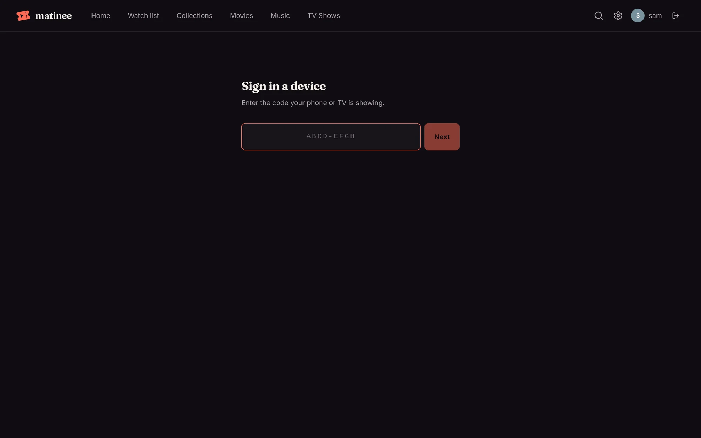
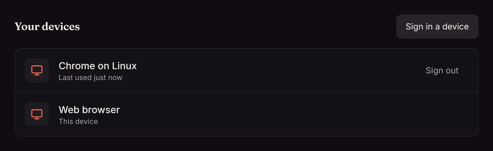

Typing a password with a TV remote is no fun, so the apps can sign in with a code instead.

1. In the app, choose to sign in with a code. It shows a code such as `ABCD-EFGH`.
2. On a phone or computer that's already signed in to Matinee, go to `<your server>/link`, or **Settings → Your devices → Sign in a device**.
3. Type the code and click **Next**, then approve the device.

The app signs in by itself a moment later, as you.

## Your devices

**Settings → Your devices** lists everywhere you're signed in: browsers, phones and TVs, with each one's name. Sign out one you don't use any more, or one you've lost.

Changing your password signs out all your other devices. An admin [resetting someone's password](/docs/household/people/) signs that person out everywhere.
