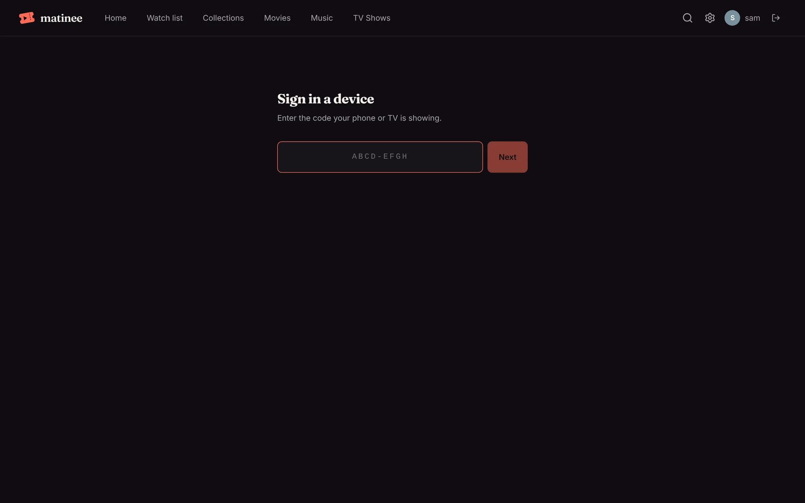
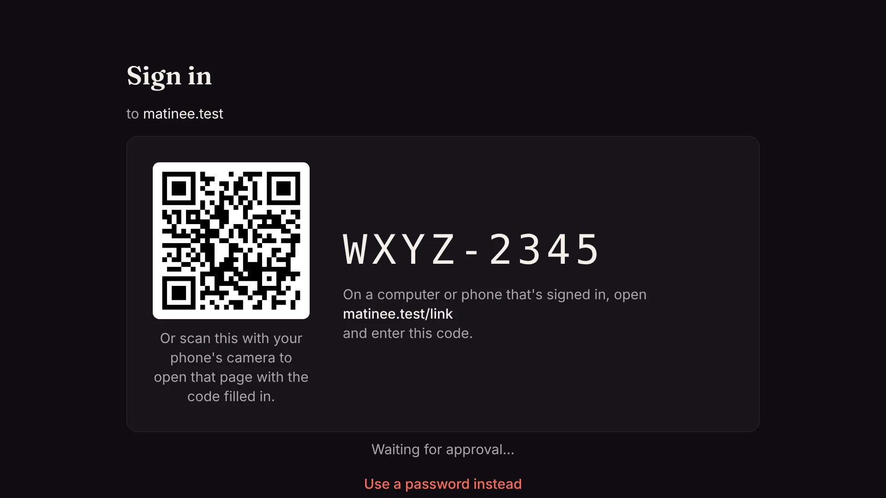
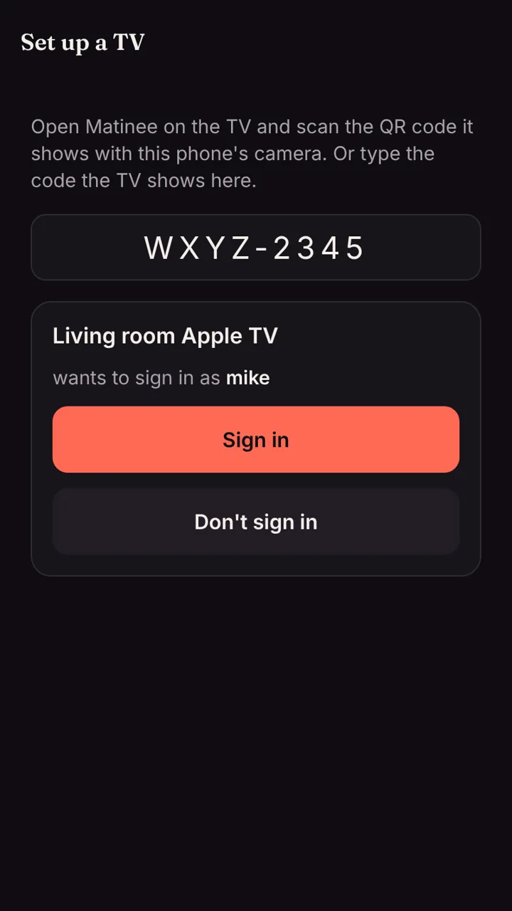
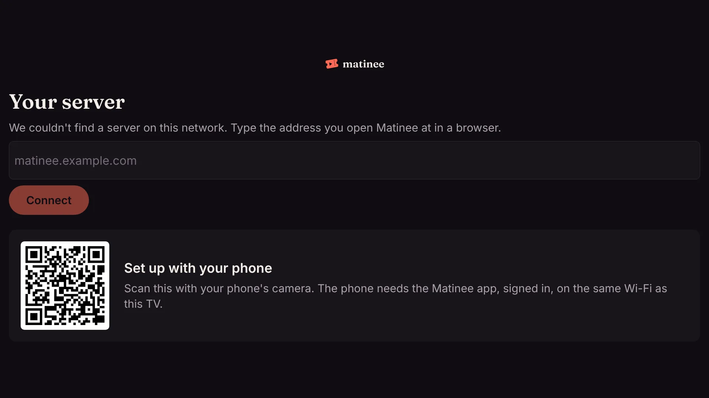
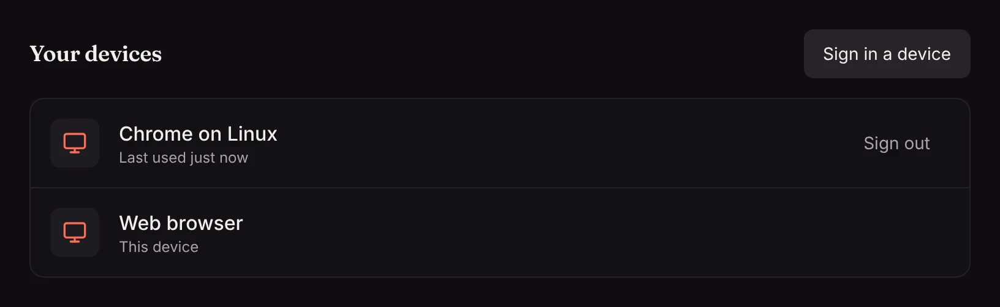

Typing a password with a TV remote is no fun, so the apps can sign in with a code instead. <!-- since: v0.1.9 -->So does Matinee on [cars with Android built in](/docs/apps/android-automotive/), which also shows a QR code you can scan with your phone's camera to open the page with the code filled in.<!-- /since -->

1. In the app, choose to sign in with a code. It shows a code such as `ABCD-EFGH`.
2. On a phone or computer that's already signed in to Matinee, go to `<your server>/link`, or **Settings → You → Your devices → Sign in a device**.
3. Type the code and click **Next**, then approve the device.

The app signs in by itself a moment later, as you.

<!-- since: v0.1.13 -->
## Scan the TV's QR code

The Apple TV, Android TV and Google TV apps, and Matinee on Samsung and LG TVs, show a QR code next to the code. Point your phone's camera at it: it opens `<your server>/link` on your phone with the code filled in. Sign in there if your phone's browser isn't already, then approve the TV.

## Approve from the phone app

You don't need a browser if Matinee is on your phone. In the phone app, go to **Settings → Set up a TV**, type the code the TV shows and tap **Next**, then **Sign in**. The TV is signed in as whoever is signed in on the phone.

## Set up a new TV with your phone

A TV that has never connected to your server, such as a friend's TV at their home, would otherwise need the server's address typed with the remote. Instead, when the Apple TV or Android TV app doesn't find a server on its network, it shows **Set up with your phone** with a QR code.

1. On the phone, sign in to the Matinee app with the account the TV should use. A friend signs in with the account from [their invite](/docs/household/friends/).
2. Put the phone on the same Wi-Fi as the TV.
3. Scan the TV's QR code with the phone's camera. It opens the Matinee app on **Set up a TV**.
4. Tap **Set up TV**.

The phone tells the TV your server's address over the home network, the TV connects to your server, and the phone approves its sign-in. Nothing goes through Yeix or any other server: the phone and TV talk only to each other and to your server. The QR code holds a one-time secret, and only a phone that scanned it can approve the TV.

If the phone says the TV didn't answer, check that both are on the same Wi-Fi (not a guest network that keeps devices apart) and that the TV still shows its QR code, then tap **Try again**. Setting up with your phone needs the TV to reach your server at the address the phone uses, so for a TV away from your home that needs [remote access](/docs/server/remote-access/) on.
<!-- /since -->

## Your devices

**Settings → You → Your devices** lists everywhere you're signed in: browsers, phones and TVs, with each one's name. Sign out one you don't use any more, or one you've lost.

Changing your password signs out all your other devices. An admin [resetting someone's password](/docs/household/people/) signs that person out everywhere.
