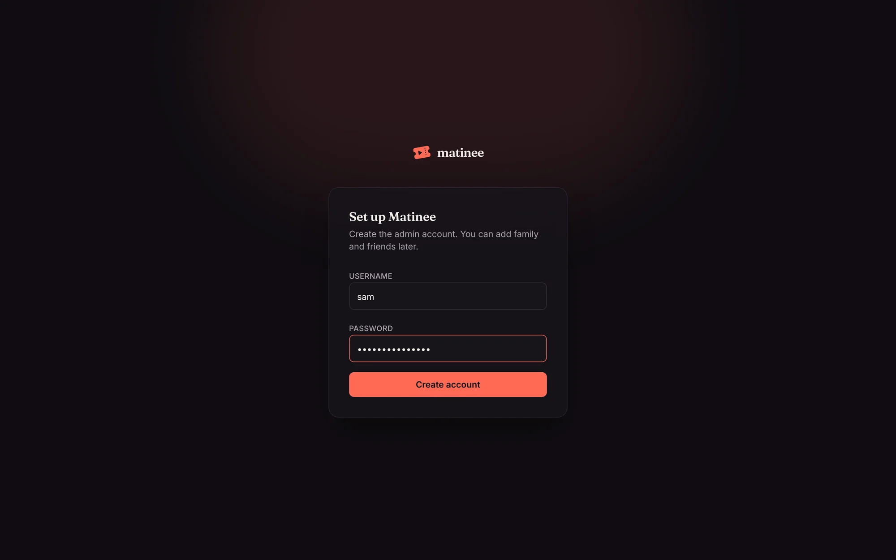
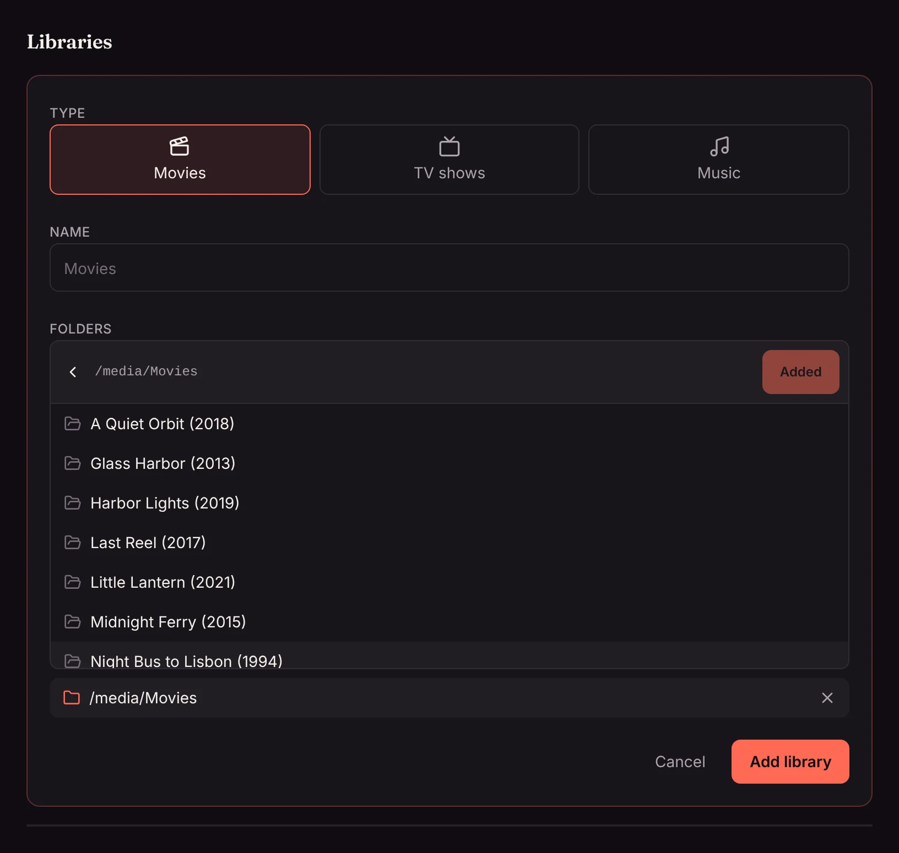
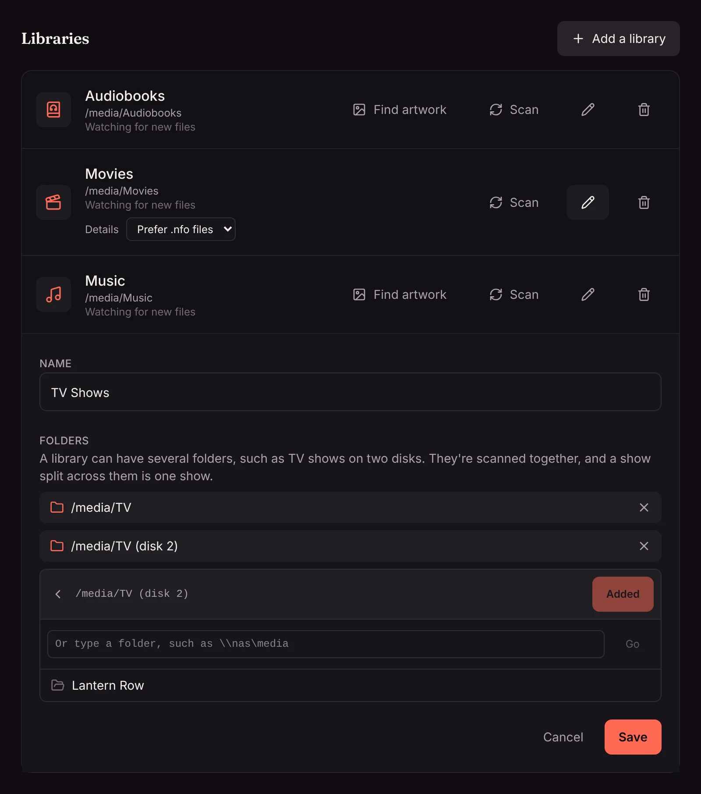

The first time you open Matinee (`http://<your server>:7171`), it asks you to create the admin account. The admin can change settings, add libraries and invite everyone else.

Pick a username and a password of at least 8 characters, then **Create account**. You're signed in straight away.

## Add your libraries

A library is a set of folders holding one kind of media: movies, TV shows, music or audiobooks. Most people have three or four, one of each.

<!-- since: v0.1.7 -->
A podcast library is the one kind without folders: its shows come from their feeds on the internet. See [Podcasts](/docs/watching/podcasts/).
<!-- /since -->

1. Open **Settings** (the gear at the top right; **Settings** in the tab bar on a phone) and pick **Libraries**.
2. Click **Add a library** and pick the type.
3. Give it a name, or keep the suggested one. This is the name in the top bar.
4. Browse to a folder and click **Use this folder**. A library can have several folders, for example movies on two disks: pick each one before you click **Add a library**, or add more later (see below).
5. Click **Add a library**.

<!-- since: v0.2.11 -->
### Several folders in one library

Keep each kind of media in one library, even when it's on several disks or shares. To add a folder to a library you already have, or take one out:

1. In **Settings → Libraries**, click the pencil next to the library.
2. The folder picker opens next to the library's folders. Click **Add** beside the folder you want, or open it and click **Use this folder**. To take a folder out, click the **×** next to it.
3. Click **Save**.

Matinee scans the library again straight away. Its folders are scanned together as one library, so a show with seasons on two disks is one show, and a movie on both is one movie with two versions. When you take a folder out, its titles leave the library; the files themselves stay where they are.

A folder can be in only one library. The picker marks folders another library has with that library's name, and if you pick one, Matinee offers to combine that library into this one instead. It also says so if you pick a folder that holds, or sits inside, a folder the library already has.

#### Two libraries that should be one

If you added a second library for the same kind of media, for example **TV Shows** and **TV Shows 2**, Settings points it out under the list. To make them one:

1. Click the pencil next to the library to keep.
2. Under **Combine with another library**, pick the other one and click **Combine**.

The other library's folders and titles move into the one you kept, and the other library goes. A show that was in both becomes one show with all its episodes. What everyone watched, how far they got, their watch lists and ratings stay. Profiles and friends that could see either library can see the combined one.
<!-- /since -->

The folder picker shows folders on the **server**, not on the computer you're using, since that's where Matinee reads your media. It opens in the folder set by `MATINEE_MEDIA_ROOT` (`/media` in the Docker image).

<!-- since: v0.1.8 -->
To jump to a folder, type its path into the box under the picker and press **Go**. On a Windows server, go up to **Drives** to switch drives, and type a network share as `\\nas\media`. See [Windows](/docs/getting-started/windows/#folders-and-network-shares).
<!-- /since -->

## Matinee takes it from there

As soon as a library is added, Matinee:

- **Scans the folders** and names each movie, show, season, episode, artist and album from the folder and file names. [Organizing your media](/docs/getting-started/organizing-media/) explains what it expects.
- **Looks up artwork and details** (posters, backdrops, descriptions, cast, crew, age ratings) on TMDB, if the server has a [TMDB key](/docs/getting-started/posters-and-details/), or through Radarr and Sonarr once they're connected. Artwork files next to your media always win.
- **Starts watching the folders**, so files you add later show up by themselves within seconds. See [New files](/docs/server/new-files/).
- **Analyzes each file** slowly in the background for its resolution, HDR, audio and subtitles. See [Media analysis](/docs/server/media-analysis/).

A movie shows up a few seconds after its folder is scanned, and its artwork follows shortly after. A big library takes a while to look up the first time; you can start watching right away.

## Next steps

- [Invite your household](/docs/household/people/) and set up [profiles](/docs/household/profiles/).
- Get the [phone and TV apps](/docs/apps/phone-and-tv/). On your home network they find the server by themselves.
- Decide whether to [reach Matinee away from home](/docs/server/remote-access/).
