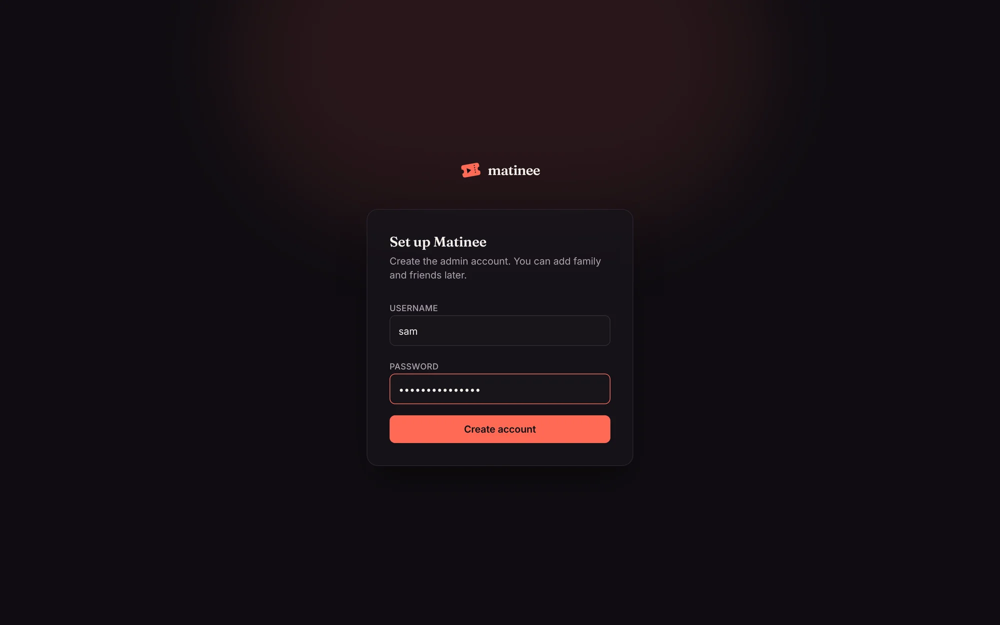
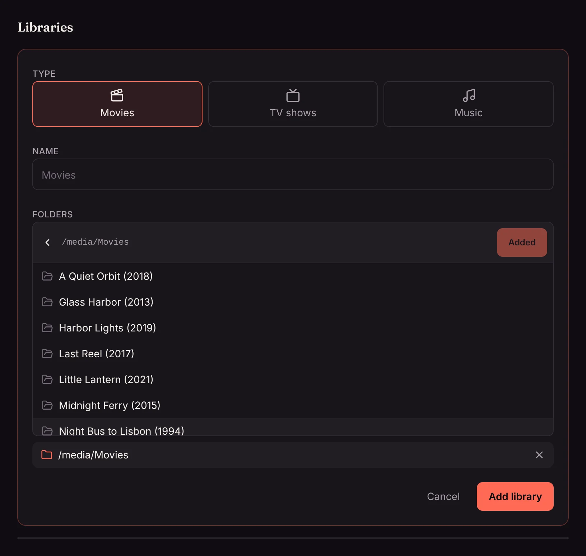

The first time you open Matinee (`http://<your server>:7171`), it asks you to create the admin account. The admin can change settings, add libraries and invite everyone else.

Pick a username and a password of at least 8 characters, then **Create account**. You're signed in straight away.

## Add your libraries

A library is a set of folders holding one kind of media: movies, TV shows, music or audiobooks. Most people have three or four, one of each.

<!-- since: v0.1.7 -->
A podcast library is the one kind without folders: its shows come from their feeds on the internet. See [Podcasts](/docs/watching/podcasts/).
<!-- /since -->

1. Open **Settings** (the gear at the top right) and find **Libraries**.
2. Click **Add a library** and pick the type.
3. Give it a name, or keep the suggested one. This is the name in the top bar.
4. Browse to a folder and click **Use this folder**. A library can have several folders, for example movies on two disks; add each one.
5. Click **Add a library**.

The folder picker shows folders on the **server**, not on the computer you're using, since that's where Matinee reads your media. It opens in the folder set by `MATINEE_MEDIA_ROOT` (`/media` in the Docker image).

## Matinee takes it from there

As soon as a library is added, Matinee:

- **Scans the folders** and names each movie, show, season, episode, artist and album from the folder and file names. [Organizing your media](/docs/getting-started/organizing-media/) explains what it expects.
- **Looks up artwork and details** (posters, backdrops, descriptions, cast, crew, age ratings) on TMDB, if the server has a [TMDB key](/docs/getting-started/posters-and-details/). Artwork files next to your media always win.
- **Starts watching the folders**, so files you add later show up by themselves within seconds. See [New files](/docs/server/new-files/).
- **Analyzes each file** slowly in the background for its resolution, HDR, audio and subtitles. See [Media analysis](/docs/server/media-analysis/).

A movie shows up a few seconds after its folder is scanned, and its artwork follows shortly after. A big library takes a while to look up the first time; you can start watching right away.

## Next steps

- [Invite your household](/docs/household/people/) and set up [profiles](/docs/household/profiles/).
- Get the [phone and TV apps](/docs/apps/phone-and-tv/). On your home network they find the server by themselves.
- Decide whether to [reach Matinee away from home](/docs/server/remote-access/).
