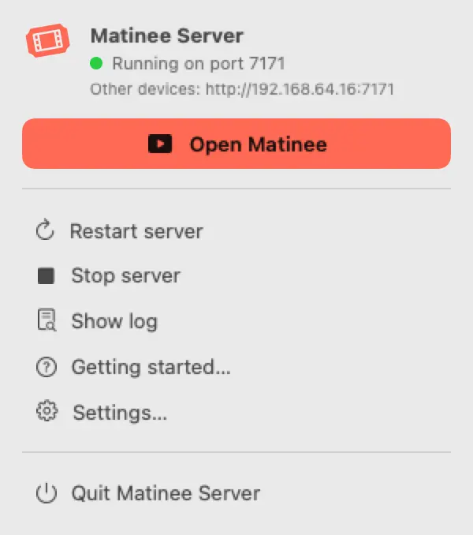
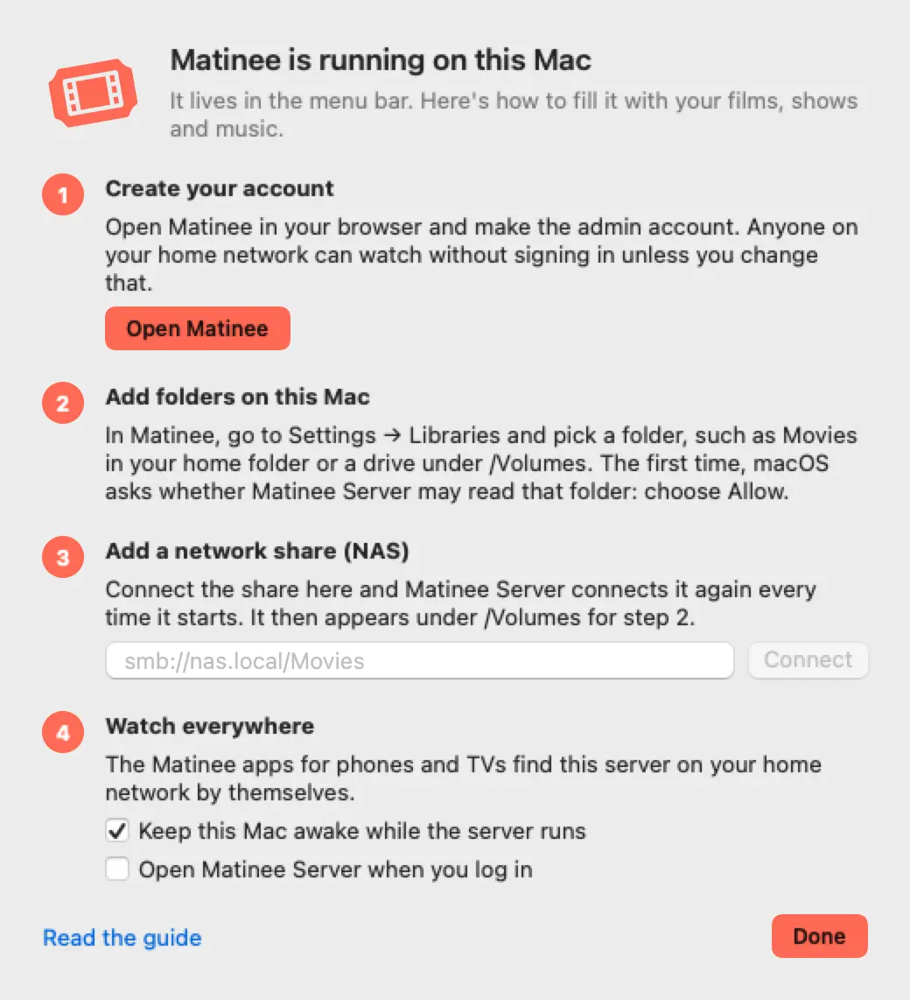
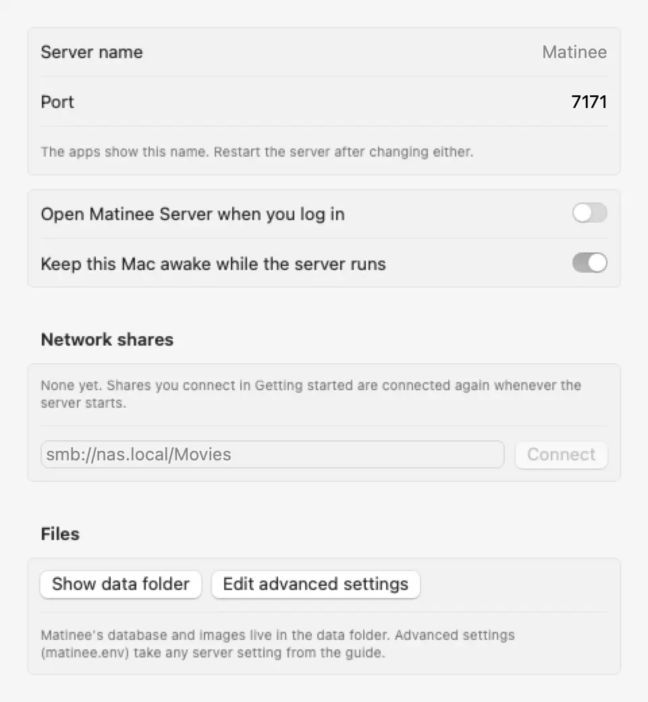

**Matinee Server** is a Mac app that runs the whole Matinee server from your menu bar. FFmpeg comes inside it, so there's nothing else to install: download it, open it, and your Mac is a media server for every phone, tablet and TV in the house.

It needs macOS 13 Ventura or later and runs on Apple silicon and Intel Macs.

## Install

1. [Download Matinee Server](https://github.com/yeixio/matinee/releases/latest/download/Matinee-Server.dmg).
2. Open the disk image and drag **Matinee Server** to **Applications**.
3. Open it from Applications. A ticket appears in the menu bar and the server starts.

The app is signed and notarized by Apple, so it opens like any other app you download.



## Getting started

The first time it opens, Matinee Server shows **Getting started**:



1. **Create your account.** **Open Matinee** opens the server in your browser, where you [make the admin account](/docs/getting-started/first-run/).
2. **Add folders on this Mac.** In Matinee, go to **Settings → Libraries** and pick a folder, such as **Movies** in your home folder, or a drive under `/Volumes`. The first time Matinee reads a folder in your home folder or on another drive, macOS asks whether **Matinee Server** may: choose **Allow**. If you said no by mistake, turn it back on in **System Settings → Privacy & Security → Files and Folders** under Matinee Server.
3. **Add a network share.** If your films live on a NAS, type the share's address, such as `smb://nas.local/Movies`, and press **Connect**. macOS asks for the share's user and password once (tick **Remember this password in my keychain**). The share then appears under `/Volumes`, and you add it in Matinee like any other folder. Matinee Server connects its shares again every time it starts, so they're there after a restart.
4. **Watch everywhere.** The Matinee apps find this Mac on your home network by themselves. When macOS asks whether Matinee Server may find devices on your local network, choose **Allow**.

You can open Getting started again from the menu at any time.

## The menu

| | |
| --- | --- |
| **Open Matinee** | Opens the server in your browser. |
| **Other devices** | The address other devices on your network can type in, such as `http://192.168.1.20:7171`. |
| **Restart**, **Stop**, **Start server** | Control the server. Quitting Matinee Server stops it too, after letting players know it's going away. |
| **Show log** | Opens the server's log in Console. |
| **Settings** | The server's name and port, open at login, keeping the Mac awake, updates and network shares. |
| **Check for updates** | Looks for a new version now. |

If the server stops on its own, Matinee Server starts it again. If it keeps stopping, the menu says why and the log has the details.

## Settings



- **Server name** is the name the apps show for this server. **Port** is where it listens, `7171` unless you change it. Restart the server after changing either.
- **Open Matinee Server when you log in** adds it to your login items, so the server comes back after the Mac restarts. To start the Mac itself after a power cut, turn on **Start up automatically after a power failure** in System Settings → Energy, where your Mac has it.
- **Keep this Mac awake while the server runs** stops the Mac from going to sleep by itself, so nobody's film stops halfway. The screen can still turn off. It's on unless you turn it off.
- **Network shares** lists the shares that are connected again at every start. Remove one you no longer use.
- **Show data folder** opens `~/Library/Application Support/Matinee Server`, which holds Matinee's database and images. [Back it up](/docs/getting-started/updating/#what-to-back-up) like any other install's data folder.
- **Edit advanced settings** opens `matinee.env` in that folder. Any setting from the [settings reference](/docs/server/configuration/) goes there, one per line, such as `MATINEE_TMDB_KEY=your-key`. Restart the server afterwards.

## Updates

Matinee Server checks for new versions by itself and offers to install them. Each one includes the matching server and FFmpeg, and players [wait through the restart](/docs/watching/playing/#when-the-server-restarts-or-updates). Turn automatic checks off in Settings, or check now from the menu.

## Moving from Homebrew

If you ran Matinee with Homebrew before, stop that one first, because only one server can use port 7171 (Matinee Server says **Another Matinee is using port 7171** otherwise):

```sh
brew services stop matinee
```

To keep your library, accounts and watch history, quit Matinee Server, copy the Homebrew data folder over, and open it again:

```sh
cp -R "$(brew --prefix)/var/matinee/" ~/Library/Application\ Support/Matinee\ Server/
```

Then `brew uninstall matinee` if you like.

## Hardware transcoding

When a device can't play a file as it is, Matinee converts it with the Mac's own video hardware (VideoToolbox), which it finds by itself. **Settings → Streaming → Transcoding** in Matinee shows it in use. See [Hardware transcoding](/docs/server/transcoding/).
