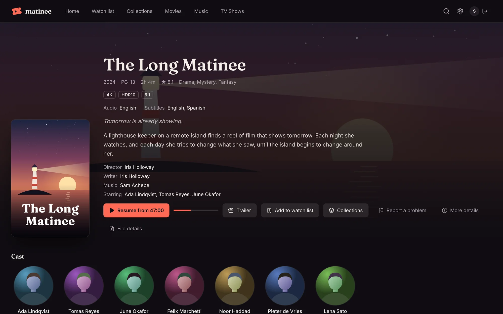

Matinee looks up posters, backdrops, descriptions, genres, cast and crew, age ratings and trailers for movies and TV on [TMDB](https://www.themoviedb.org/), a community-built film and TV database. Each server uses its own free TMDB key. Getting one takes about two minutes.

## Get a key

1. Sign up at [themoviedb.org](https://www.themoviedb.org/signup) and confirm your email.
2. Open [Settings → API](https://www.themoviedb.org/settings/api), click **Create**, and answer **Yes** to "personal use". Your own server is personal use.
3. Fill in the short form. For example, use "Matinee" as the name and "Self-hosted media server for my household" as the summary.
4. Copy the **API Key**. The longer **API Read Access Token** works too.

## Give it to Matinee

| How you installed | Where the key goes |
| --- | --- |
| Docker | add `-e MATINEE_TMDB_KEY=your-key` to `docker run` (or `environment:` in Compose) |
| apt or dnf | add `MATINEE_TMDB_KEY=your-key` to `/etc/matinee/matinee.env` |
| Homebrew | add `MATINEE_TMDB_KEY=your-key` to `$(brew --prefix)/etc/matinee/matinee.env` |
| Kubernetes | `kubectl create secret generic matinee-tmdb --from-literal=tmdb-api-key=your-key`, then `tmdb.existingSecret: matinee-tmdb` in your values |

Restart Matinee. The next scan fills in what's missing; you can start one from **Settings → Libraries → Scan**.

## Why isn't a key built in?

TMDB's free keys are for personal use, and a key shipped inside Matinee would be shared by every server in the world. Once donations and app sales reach $150 a month, Matinee will license a commercial TMDB key and build it into the official images and packages, so new servers get artwork with no setup. Until then, each server brings its own.

You can help get there by [donating to Matinee](https://yeix.io/matinee/donate), once or monthly, or by buying the [phone and TV apps](/docs/apps/phone-and-tv/).

## Without a key

Everything else works without one. Titles are named from your files, and any [artwork files](/docs/getting-started/organizing-media/#artwork-files) next to your media are used.

## Music and awards

Two more sources need no key and are on by default:

- **MusicBrainz** fills in artists and albums, with covers from the Cover Art Archive and artist photos from Wikidata. Set `MATINEE_MUSICBRAINZ=false` to use only your own files.
- **Wikidata** adds the awards a movie or show won or was nominated for. Set `MATINEE_WIKIDATA=false` to skip them.

## Age ratings in your country

Kids profiles go by age ratings, which differ by country. Set `MATINEE_RATING_COUNTRY` to yours (`GB`, `CA`, `AU`, `DE`…; the default is `US`). Titles pick up the new country's ratings the next time their details are refreshed.
