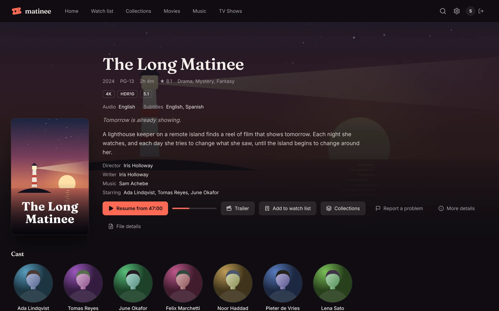
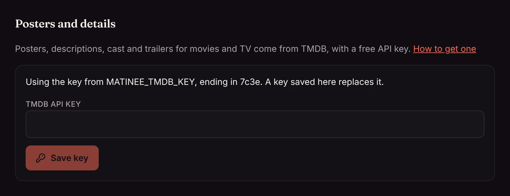

Matinee looks up posters, backdrops, descriptions, genres, cast and crew, age ratings and trailers for movies and TV on [TMDB](https://www.themoviedb.org/), a community-built film and TV database. Each server uses its own free TMDB key. Getting one takes about two minutes.

<!-- since: v0.2.2 -->
## Without a key: through Radarr and Sonarr

If you've connected Radarr or Sonarr (or Box Office, which stands in for both) in **Settings → Add-ons → Radarr and Sonarr** ([how](/docs/server/radarr-and-sonarr/)), Matinee gets posters, backdrops, descriptions, ratings and genres for movies and shows from them, with no TMDB key. They already have them for every title they manage, and they look up the rest the way their own **Add New** page does. Matinee fills these in as soon as you connect one.

A TMDB key adds the rest: season and episode details, cast and crew, age ratings, trailers and translations. When you add one, titles matched through Radarr or Sonarr keep their match and get the rest of their details from TMDB.
<!-- /since -->

## Get a key

1. Sign up at [themoviedb.org](https://www.themoviedb.org/signup) and confirm your email.
2. Open [Settings → API](https://www.themoviedb.org/settings/api), click **Create**, and answer **Yes** to "personal use". Your own server is personal use.
3. Fill in the short form. For example, use "Matinee" as the name and "Self-hosted media server for my household" as the summary.
4. Copy the **API Key**. The longer **API Read Access Token** works too.

## Give it to Matinee

<!-- since: v0.1.1 -->
The easiest way is in the web player. As an admin, open **Settings → Content → Posters and details**, paste the key and click **Save key**. Matinee checks the key with TMDB, starts using it right away and fills in posters and details for your libraries, with no restart.

A key saved in Settings replaces one set on the server (below). **Remove saved key** goes back to the server's key.

Or set it on the server, where it goes depends on how you installed Matinee:
<!-- /since -->

| How you installed | Where the key goes |
| --- | --- |
| Docker | add `-e MATINEE_TMDB_KEY=your-key` to `docker run` (or `environment:` in Compose) |
| apt or dnf | add `MATINEE_TMDB_KEY=your-key` to `/etc/matinee/matinee.env` |
| Homebrew | add `MATINEE_TMDB_KEY=your-key` to `$(brew --prefix)/etc/matinee/matinee.env` |
| Kubernetes | `kubectl create secret generic matinee-tmdb --from-literal=tmdb-api-key=your-key`, then `tmdb.existingSecret: matinee-tmdb` in your values |

After changing it on the server, restart Matinee. The next scan fills in what's missing; you can start one from **Settings → Libraries → Scan**.

<!-- since: v0.2.0 -->
## Fix a wrong match

Now and then a title is matched with the wrong one: a remake, two shows with the same name, or a film known by another title. Admins can fix it on the title's page:

1. Open the movie or show and click **Fix match**.
2. Matinee searches TMDB for the title and year from your file. Change the title or year and click **Search** to look again, or paste the title's TMDB or IMDb link (or its IMDb id, such as `tt0113277`).
3. Click the right poster. The description, artwork, genres, cast and crew and translations are fetched again, and for a show every season and episode is looked up again under the new match.

A match you pick stays: scans and refreshes leave it alone. Artwork files next to your media and a cover you picked by hand are kept.

In the same window:

- **Refresh details** fetches the title's details, artwork and cast again, for when TMDB has changed since. It's also how to give an unmatched title another try.
- **Unmatch** clears the match, so the title goes by its file name without a description, cast or online artwork, and isn't matched again until you pick one.

When someone reports a title as **Wrong title** with **Report a problem**, the report has a **Fix match** button that opens this window. For an episode or season, Fix match opens on its show.
<!-- /since -->

## Why isn't a key built in?

TMDB's free keys are for personal use, and a key shipped inside Matinee would be shared by every server in the world. Once donations and app sales reach $150 a month, Matinee will license a commercial TMDB key and build it into the official images and packages, so new servers get artwork with no setup. Until then, each server brings its own.

You can help get there by [donating to Matinee](https://yeix.io/matinee/donate), once or monthly, or by buying the [phone and TV apps](/docs/apps/phone-and-tv/).

## Without a key

Everything else works without one. Titles are named from your files, and any [artwork files](/docs/getting-started/organizing-media/#artwork-files) next to your media are used.

## Music and awards

Two more sources need no key and are on by default:

- **MusicBrainz** fills in artists and albums, with covers from the Cover Art Archive and artist photos from Wikidata. Set `MATINEE_MUSICBRAINZ=false` to use only your own files.
<!-- since: v0.1.3 -->
- **Open Library** fills in audiobook covers and author photos for books without their own. Set `MATINEE_OPENLIBRARY=false` to use only your own files.
<!-- /since -->
- **Wikidata** adds the awards a movie or show won or was nominated for. Set `MATINEE_WIKIDATA=false` to skip them.
<!-- since: v0.2.7 -->
- **Wikipedia** adds a summary to each game in a Games library, and Wikidata its genres. Set `MATINEE_WIKIPEDIA=false` to skip them.
<!-- /since -->

## Age ratings in your country

Kids profiles go by age ratings, which differ by country. Set `MATINEE_RATING_COUNTRY` to yours (`GB`, `CA`, `AU`, `DE`…; the default is `US`). Titles pick up the new country's ratings the next time their details are refreshed.
