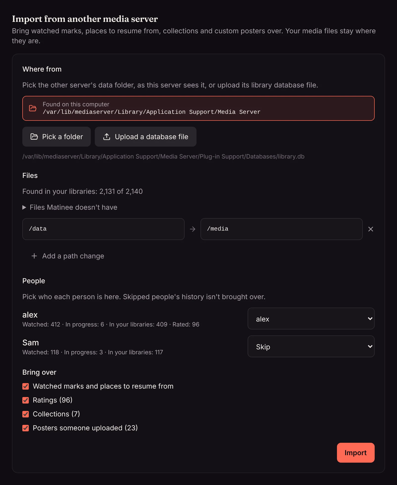

Moving from another media server? Matinee can read that server's data folder and bring over what people watched, where they stopped, the collections you made and the posters you uploaded. Your films and shows stay where they are: Matinee only reads the other server's data and never changes it.

## Before you start

1. [Add your libraries](/docs/getting-started/first-run/) in Matinee, pointing at the same folders the other server uses, and let the first scan finish. History can only be brought over for files Matinee already knows.
2. Make sure Matinee's server can read the other server's data folder. On the same computer it already can. If the other server runs somewhere else, copy its data folder (or just its library database, see below) somewhere Matinee can see, such as a folder on your media share.

The data folder is the one that holds folders called `Plug-in Support`, `Metadata` and `Media`. The library database is in `Plug-in Support` → `Databases`, and its name ends in `library.db`.

## Import

Open **Settings → Import from another media server** and press **Start**.

1. **Where from.** Matinee looks in the usual places on the computer it runs on and lists any data folder it finds. Otherwise press **Pick a folder** and browse to the data folder, or a folder above it. You can also **Upload a database file** from your own computer; that brings over history and collections, but not posters, which live in the data folder beside it.
2. **Files.** Matinee matches the other server's files to its own by path, and says how many it found. If the two servers see the same share under different folders (say `/data` there and `/media` here, which is common with Docker), Matinee spots the difference and suggests a path change: press **Use it**. You can add your own changes too, then press **Check again**. **Files Matinee doesn't have** lists a few that still don't match, so you can see why.
3. **People.** Each person who watched on the other server is listed with how much they watched. Pick who they are in Matinee: an account or a [profile](/docs/household/profiles/). Matinee suggests a match when the names are the same, and the other server's owner goes to you. Anyone set to **Skip** isn't brought over.
4. **Bring over.** Untick anything you don't want:
   - **Watched marks and places to resume from.** Films and episodes you finished show as watched, and ones you stopped partway pick up where you left off, on Continue watching. Songs you played count as played, and audiobooks pick up in the right part.
   - **Collections.** Each becomes a shared collection everyone can see, with the films and shows Matinee has. If a shared collection with that name already exists, the titles are added to it.
   - **Posters someone uploaded.** Posters you uploaded by hand for a film, show, season or album replace Matinee's. Posters the other server found online are left out, since Matinee finds its own.
5. Press **Import**. It runs on the server, so you can leave the page; come back to see what it brought over.

## Running it again

It's safe to import more than once, for example after fixing a path or adding a library. Nothing is brought over twice, and a watched mark or place only replaces Matinee's when it's newer, so anything you've watched in Matinee since is kept. The summary says how many were left as they were.

## Undoing a poster

An imported poster stays through rescans, like a [cover picked by hand](/docs/watching/music/). To go back to the automatic one, open the film or show as an admin and press **Use the automatic poster**.

## What isn't brought over

Ratings, playlists, watch lists kept online, and the other server's accounts and passwords stay behind. People sign in to Matinee with their [Matinee accounts](/docs/household/people/).
