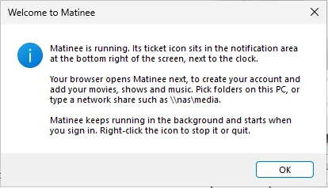
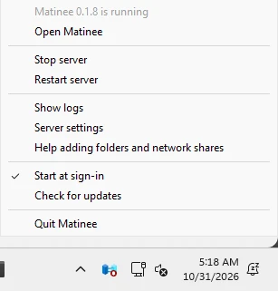

Matinee has an installer for Windows 10 and 11. It brings everything Matinee needs, FFmpeg included, and runs the server from an icon in the notification area, next to the clock.

## Install

1. Download the installer for your PC:
   - [**Matinee-Setup-x64.exe**](https://github.com/yeixio/matinee/releases/latest/download/Matinee-Setup-x64.exe) for most PCs (Intel and AMD).
   - [**Matinee-Setup-arm64.exe**](https://github.com/yeixio/matinee/releases/latest/download/Matinee-Setup-arm64.exe) for Arm PCs, such as Snapdragon laptops. **Settings → System → About** says which one you have under **System type**.
2. Open it and follow the steps. Windows asks for permission to install, since Matinee goes in Program Files for everyone on the PC.
3. Leave **Start Matinee** ticked on the last page and click **Finish**.

Matinee says hello, then opens in your browser to [create the admin account and add your libraries](/docs/getting-started/first-run/).

:::note[If Windows says it protected your PC]
Until the Matinee installer is signed, Microsoft Defender SmartScreen may stop it with **Windows protected your PC**. Click **More info**, check that the app is Matinee, then **Run anyway**. Only download Matinee from this site or [GitHub](https://github.com/yeixio/matinee/releases).
:::

## The Matinee icon

Matinee's ticket sits in the notification area. If you don't see it, click the **^** arrow next to the clock, and drag it out to keep it in view. The ticket is coral while the server runs and gray while it's stopped. Click it for the menu:

| | |
| --- | --- |
| **Open Matinee** | Opens Matinee in your browser, at `http://localhost:7171`. |
| **Stop server**, **Start server** | Stops the server without quitting, or starts it again. Phones and TVs can't reach it while it's stopped. |
| **Restart server** | Stops and starts it, for example after changing its settings. |
| **Show logs** | Opens the server's log, which helps when something's wrong. |
| **Server settings** | Opens `matinee.env`, the [settings file](#settings). |
| **Start at sign-in** | Starts Matinee whenever you sign in to Windows. It's on to begin with. |
| **Check for updates** | Looks for a newer Matinee. See [Updates](#updates). |
| **Quit Matinee** | Stops the server and removes the icon. Open **Matinee** from the Start menu to start it again. |

If the server stops by itself, Matinee starts it again. If it keeps stopping, the menu says **Matinee stopped: see the logs**, and **Show logs** says why. Most often another program already uses port 7171; change `MATINEE_ADDR` in the settings to use another one.

## Folders and network shares

The server runs as you, so it reads the same folders you can open in File Explorer.

- **Folders on this PC and USB drives**: in the folder picker, go up to **Drives** and pick a drive, then the folder.
- **Network drives** (a share mapped to a letter, like `M:`): they're listed with the other drives.
- **Network shares without a letter**: type the share's address into the box under the folder picker, such as `\\nas\media` or `\\192.168.1.20\movies`, and press **Go**. Browse from there.

If a share asks for a password, open it once in File Explorer and tick **Remember my credentials**. Matinee uses the passwords Windows remembers for you.

Matinee only runs while you're signed in to Windows. On a PC that stays on for the household, use **Settings → Accounts → Sign-in options** to sign back in automatically after an update restarts it, or install Matinee on a NAS or Linux box with the [other installs](/docs/getting-started/install/).

## Phones, TVs and other computers

The installer lets Matinee through Windows Firewall on **private** networks, so the apps on your home Wi-Fi find it. Windows treats new networks as public, which keeps Matinee closed on them. If the apps don't see the server, open **Settings → Network & internet**, click your network, and pick **Private network**.

To reach Matinee away from home, see [Remote access](/docs/server/remote-access/).

## Settings

Server settings live in `%LOCALAPPDATA%\Matinee\matinee.env` (**Server settings** in the menu opens it). Put one setting per line, like `MATINEE_SERVER_NAME=Living room PC`, then choose **Restart server**. [Configuration](/docs/server/configuration/) lists them all.

| | |
| --- | --- |
| Program | `C:\Program Files\Matinee`, with FFmpeg in its `ffmpeg` folder |
| Library, accounts, artwork | `%LOCALAPPDATA%\Matinee` |
| Log | `%LOCALAPPDATA%\Matinee\Logs\matinee.log` |
| Settings | `%LOCALAPPDATA%\Matinee\matinee.env` |

To back up Matinee, quit it and copy `%LOCALAPPDATA%\Matinee`, as in [Updating and backups](/docs/getting-started/updating/).

## Updates

Matinee checks for a new version when it starts and once a day. When there is one, the menu shows **Install Matinee** and the new version. Click it, say **Yes**, and allow the installer: Matinee stops for a minute, updates, and starts again. Players pick up where they were.

You can also download the newest installer from this page and run it over the old one. Your library and settings stay.

## Uninstall

Open **Settings → Apps → Installed apps**, find **Matinee**, and choose **Uninstall**. It asks whether to delete your library, accounts and settings too; say **No** to keep them for a later install. Your media files are never touched.
