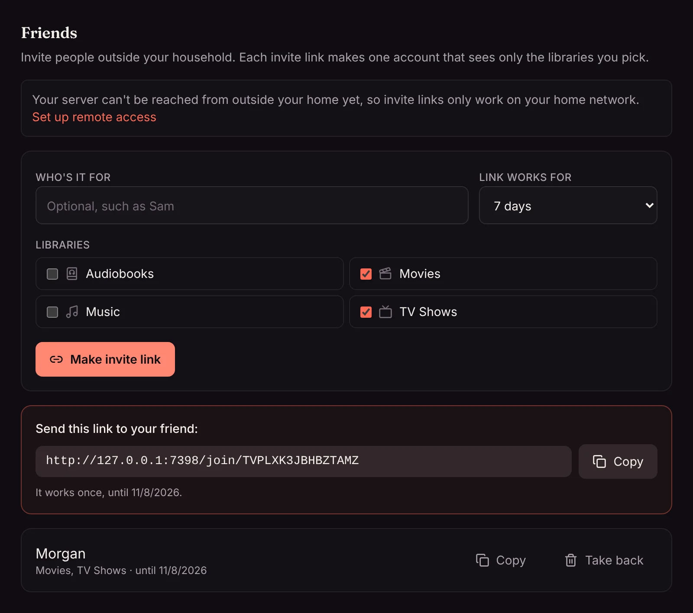
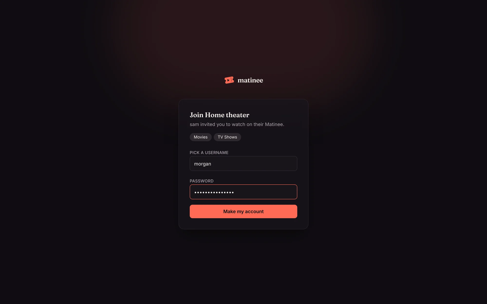

Friends are people outside your household who watch on your server: your parents across town, a friend you watch a show with. You send them an invite link, they pick their own username and password, and their account sees only the libraries you chose for them.

## Invite someone

1. Go to **Settings → People and profiles → Friends**.
2. Type who it's for (only you see this), and pick how long the link works: a day, a week or a month.
3. Tick the libraries to share. Movies and TV are ticked to start with; home videos, music and anything else stay private until you tick them.
4. Press **Make invite link**, then **Copy** or **Share** and send it however you like.

Each link works once. Links you haven't sent yet are listed under the form: **Copy** gets the link again, and **Take back** stops it working. Used and expired links are kept below for a month, so you can see who joined and when.

## What your friend sees

The link opens a page that says whose server it is and what you've shared. Your friend picks a username and password, and they're in, watching in their browser straight away.

The page after that has the address to type into the [phone and TV apps](/docs/apps/phone-and-tv/) under **Add server**, and they sign in there with the same username and password.

Friends need to reach your server from outside your home, so turn on [remote access](/docs/server/remote-access/) first, or use your own domain. Until the server can be reached from outside, the Friends settings say so, and links only work on your home network.

Your server streams to friends directly. Nothing your friends watch goes through Yeix or anyone else.

## What friends can and can't do

A friend's account works like any other account: their own watch history, watch list, ratings, playlists and theme, and their own [profiles](/docs/household/profiles/) if you make some for them. They can [watch together](/docs/watching/watch-together/) with you and anyone else on your server.

They see only the libraries you shared: those libraries' titles on Home, in search, in collections and on people's pages, and nothing else. A library you add later stays hidden from friends until you share it with them. Friends can't be admins.

## Change what a friend sees

In **Settings → People and profiles → People**, friends have a **Friend** label. Press **Libraries** next to a friend to tick or untick libraries, then **Save**. **Let them see everything** turns them into a regular account that sees every library, like everyone in your household.

To stop someone watching, **Remove** them like any other account.
