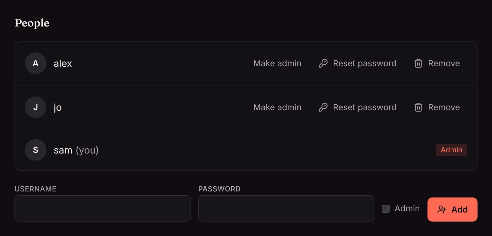
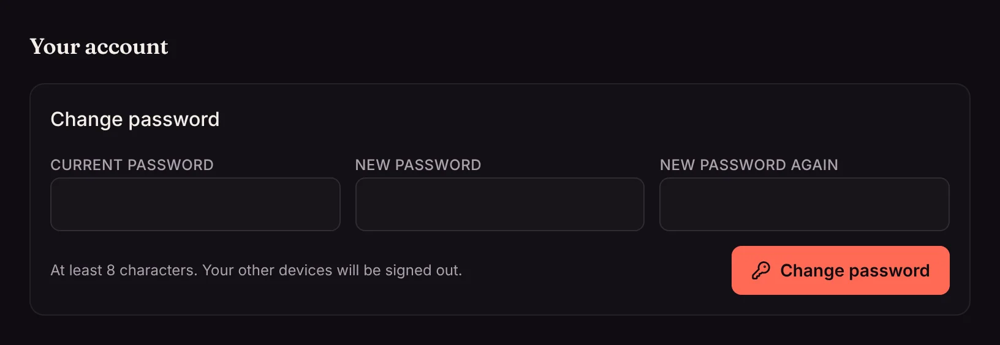

Everyone in your household can have their own account, with their own watch history, watch list, collections and theme. Admins add accounts under **Settings → People and profiles → People**.

## Add someone

Type a username and a password (at least 8 characters), tick **Admin** if they should be able to change settings, and click **Add**. Give them the username and password; they can change the password themselves.

## Admins and everyone else

| | Admins | Everyone else |
| --- | --- | --- |
| Watch, keep a watch list, make their own collections | ✓ | ✓ |
| Ask for movies and shows (with [Radarr or Sonarr](/docs/server/radarr-and-sonarr/)) | ✓, added straight away | ✓, if the server allows it |
| Change settings, add libraries, manage people and profiles | ✓ | |
| Share collections with everyone | ✓ | |

## Manage accounts

Next to each person:

- **Make admin** or **Remove admin**.
- **Reset password** sets a new password and signs them out on every device.
- **Remove** deletes the account with its watch history, watch list and profiles. Their devices are signed out.

You can't remove yourself, and a server always keeps at least one admin.

## Change your own password

**Settings → You → Your account → Change password**. Changing it signs you out on your other devices.

## People who don't want an account

On your home network, phones, TVs and browsers can [watch without signing in](/docs/server/home-network/#watching-without-signing-in), sharing one Home account. That's often enough for guests. For a family sharing one account, [profiles](/docs/household/profiles/) are lighter than separate accounts.

<!-- since: v0.1.10 -->
## People outside your household

For friends and family who live elsewhere, send an [invite link](/docs/household/friends/) instead of making their account yourself. They pick their own username and password, and see only the libraries you share with them.
