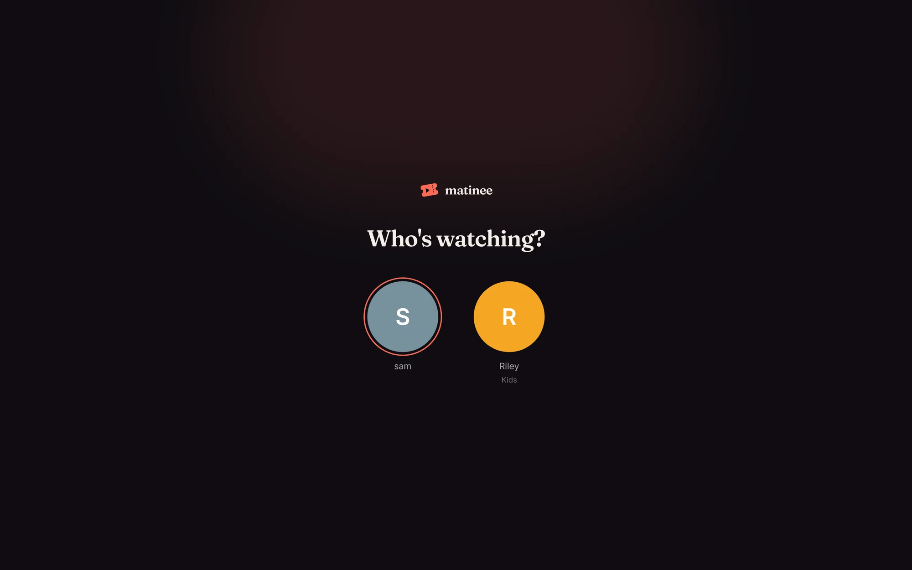
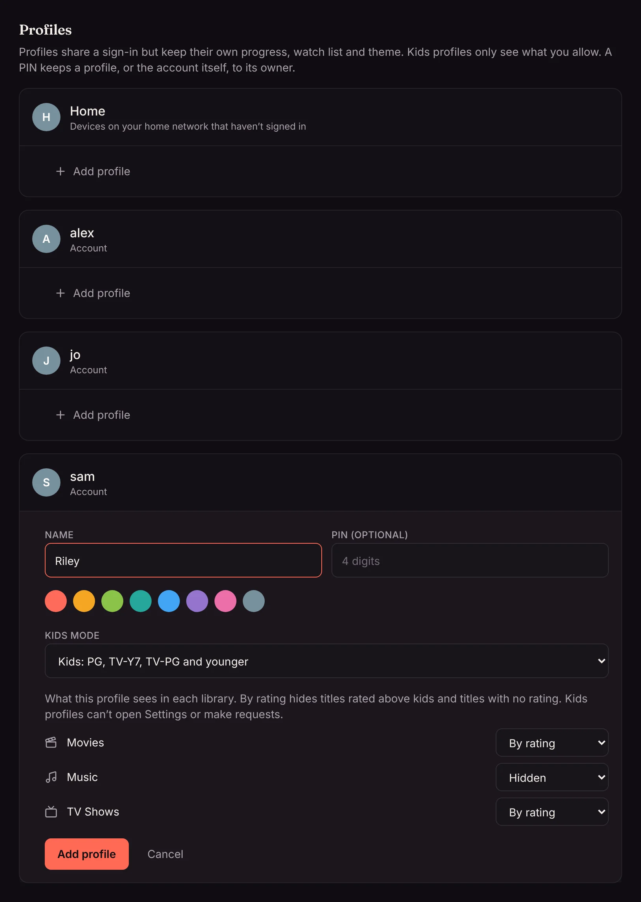
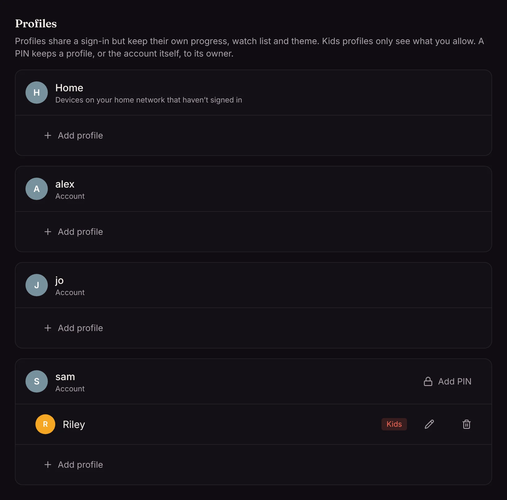

A profile is a person on a shared sign-in: one account (or the Home account on your network), several people, each with their own place in every show, their own watch list and their own theme. When an account has profiles, Matinee asks **Who's watching?** when it opens.

## Add a profile

Admins manage profiles under **Settings → Profiles**. Every account is listed, plus **Home** for devices on your home network that haven't signed in.

1. Click **Add profile** under the account it belongs to.
2. Type a name and pick a color.
3. Add a 4-digit **PIN** if you want to keep the profile to its owner.
4. For a child, pick a **Kids mode** level (below).
5. Click **Add profile**.

Switch profiles any time from the avatar at the top right, or from the profile picker in the apps.

## Kids mode

A kids profile only sees titles rated for its age, in the libraries you choose:

| Level | Sees (US ratings) |
| --- | --- |
| Little kids | G, TV-Y, TV-G |
| Kids | PG, TV-Y7, TV-PG and younger |
| Teens | PG-13, TV-14 and younger |

For each library, pick **By rating** (only titles at or below the level, and nothing without a rating), **Everything**, or **Hidden**. A kids profile can't open Settings, ask for titles, or report problems.

Ratings come from TMDB for your country. Set `MATINEE_RATING_COUNTRY` to use your country's ratings instead of the US ones: see [Posters and details](/docs/getting-started/posters-and-details/#age-ratings-in-your-country).

## PINs

A PIN on a profile stops others from picking it. To stop a child switching back to the grown-up profile, put a PIN on the account itself too, with **Add PIN** next to the account. After five wrong tries, the profile locks for a minute.

## Profiles at home

The **Home** account, used by devices on your network that haven't signed in, can have profiles too. That way the living-room TV can ask **Who's watching?** without anyone signing in.
