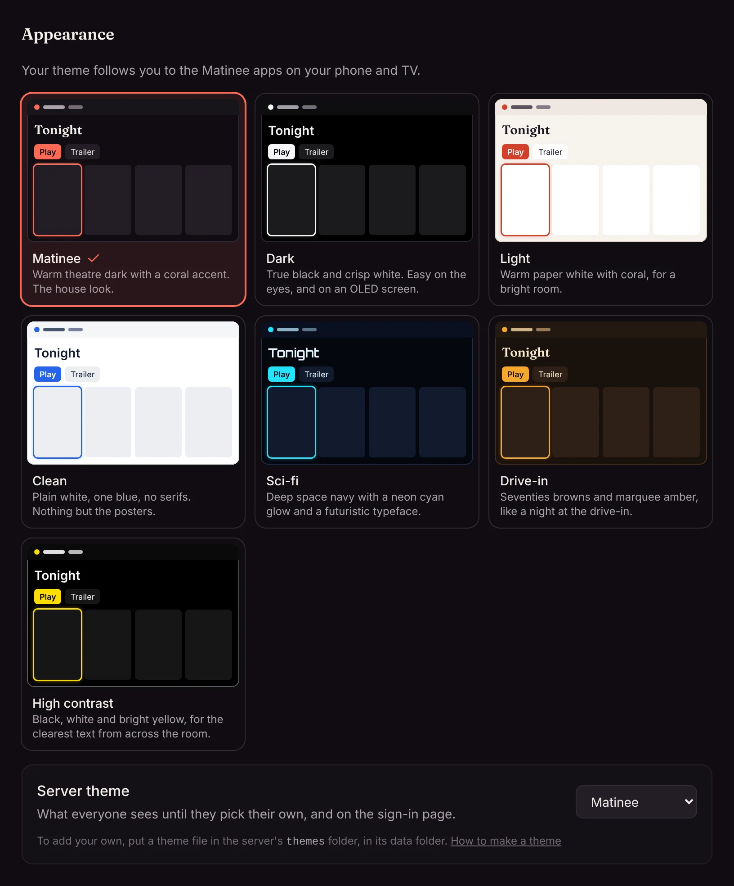
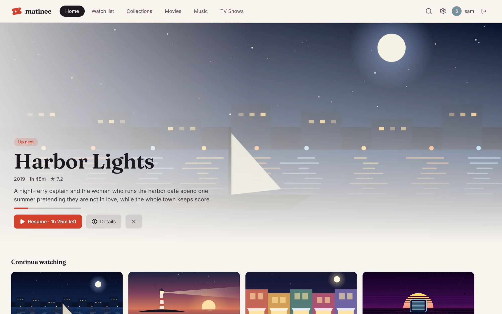
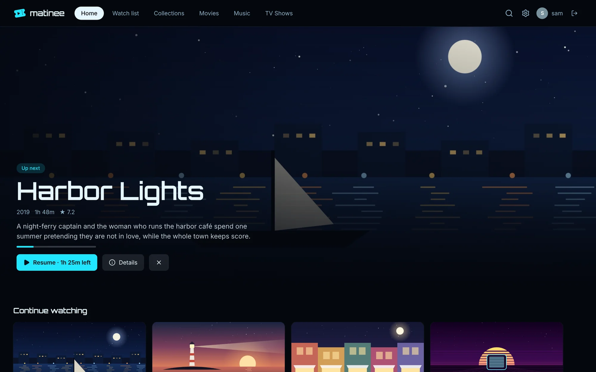

Matinee has seven built-in themes. Everyone picks their own under **Settings → Appearance**, and their pick follows them to the phone and TV apps.



| Theme | Look |
| --- | --- |
| Matinee | Warm theatre dark with a coral accent. The default. |
| Dark | True black and crisp white, easy on an OLED screen. |
| Light | Warm paper white with coral, for a bright room. |
| Clean | Plain white, one blue, no serifs. |
| Sci-fi | Deep space navy, neon cyan glow, Orbitron headings. |
| Drive-in | Seventies browns and marquee amber. |
| High contrast | Black, white and bright yellow, for the clearest text. |

<div class="pair">





</div>

## The server theme

An admin also picks the **Server theme**: what people see until they choose their own, and on the sign-in page.

## Add your own theme

A theme is a small JSON file of colors and font names. It holds no code, so it's safe to share and to install from someone else.

1. Make a `themes` folder in the server's data folder (`/data/themes` in Docker).
2. Save a theme file in it, such as `themes/mint.json`:

   ```json
   {
     "id": "mint",
     "name": "Mint",
     "description": "Cool green on near-black.",
     "scheme": "dark",
     "fonts": { "display": "inter", "body": "inter" },
     "colors": {
       "ink": "#0b1210",
       "surface": "#101a17",
       "raised": "#18241f",
       "line": "#25352f",
       "text": "#eafff6",
       "muted": "#9cc4b4",
       "faint": "#6c8e81",
       "accent": "#3ddc97"
     }
   }
   ```

3. Open **Settings → Appearance**. The new theme is there straight away; the apps pick it up the next time they open.

If a file has a mistake, admins see it under **Server theme**. Every field is described in the [theme file reference](https://github.com/yeixio/matinee/blob/main/docs/themes.md).
