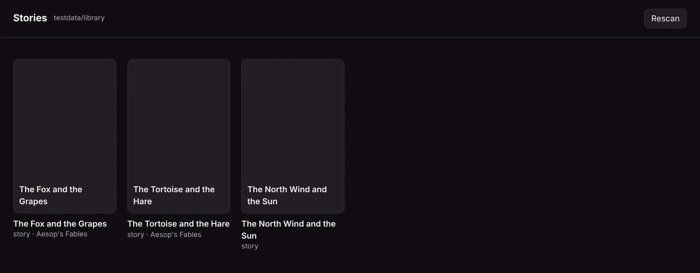
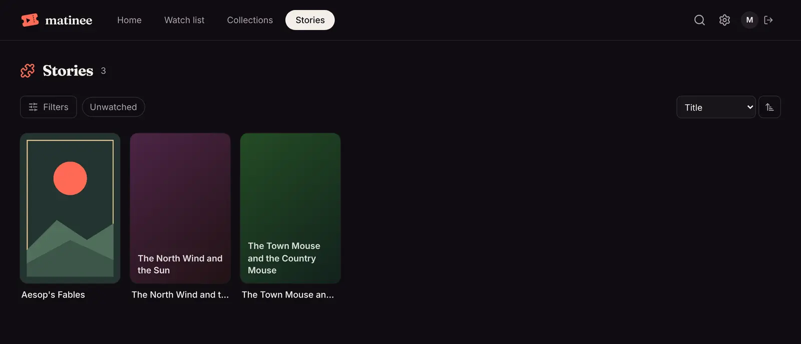
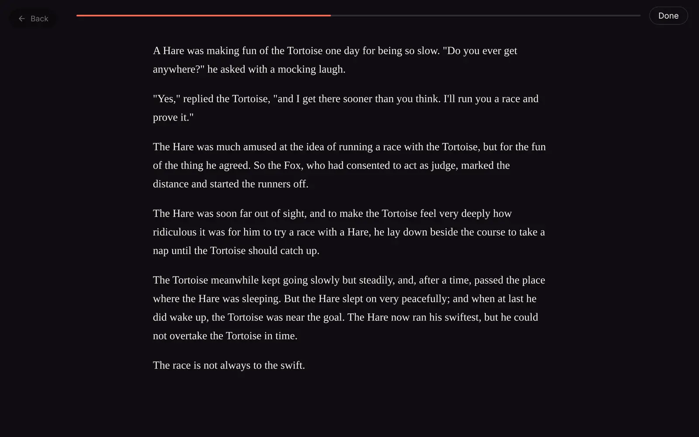

This page builds **Stories**, a plugin for short stories kept as text and Markdown files. A *Stories* library shows each story with its title, opening lines and reading time. Playing one opens a reader that remembers where you got to. It takes about half an hour. The finished plugin is in [`pluginsdk/examples/stories`](https://github.com/yeixio/matinee/tree/main/pluginsdk/examples/stories) if you want to compare.

You need:

- [Go](https://go.dev/dl/) 1.24 or later.
- A browser.
- A Matinee server, v0.1.1 or later, to install the plugin in at the end. You can do everything before that without one.

## 1. Install the tool

```sh
go install github.com/yeixio/matinee/cmd/matinee-plugin@latest
```

This puts `matinee-plugin` in your Go bin folder (`~/go/bin` unless you changed it). Make sure that folder is on your `PATH`.

## 2. Start the plugin

```sh
matinee-plugin new -name Stories -ext .txt,.md -item story stories
cd stories
```

That makes a folder with a plugin that already works. It files every `.txt` and `.md` file as a *story* named after the file, with a player that shows its size:

| File | What it's for |
| --- | --- |
| `plugin.json` | The manifest: the plugin's id, name and version, and what it adds |
| `main.go`, `main_test.go` | The server part and its test |
| `player/` | The player: `index.html`, `player.js`, `player.css`, and `matinee-player.js` to talk to Matinee |
| `icon.png` | A placeholder icon for Settings |
| `go.mod` | The Go module, which requires the SDK |

## 3. Describe it in plugin.json

Open `plugin.json`. It says the plugin adds a library kind called `stories` for `.txt` and `.md` files, whose items are `story` items, and that the page at `player/index.html` plays them. Stories kept in a folder will go in a *book* named after that folder, so add `book` to `itemKinds`. Also fill in the description, author and homepage:

```json
{
  "id": "stories",
  "name": "Stories",
  "version": "1.0.0",
  "api": 1,
  "description": "Read short stories kept as text and Markdown files.",
  "author": "Your name",
  "license": "MIT",
  "homepage": "https://example.com/stories",
  "icon": "icon.png",
  "server": "server.wasm",
  "libraryKinds": [
    {
      "name": "stories",
      "label": "Stories",
      "description": "Text and Markdown files, one story each. A folder of them is a book.",
      "extensions": [".txt", ".md"],
      "itemKinds": ["story", "book"]
    }
  ],
  "players": [{ "itemKinds": ["story"], "entry": "player/index.html" }]
}
```

The playable kind comes first in `itemKinds`. Every field is described in [plugin.json](/docs/plugins/manifest/).

## 4. Write the server part

When Matinee scans a Stories library, it calls the server part's **index** handler once for each `.txt` and `.md` file. The handler says what the file is. Replace `main.go` with this:

```go
package main

import (
	"bufio"
	"fmt"
	"os"
	"path/filepath"
	"strings"

	plugin "github.com/yeixio/matinee/pluginsdk"
)

func init() {
	plugin.Register(plugin.Handlers{Index: index})
}

func main() {}

const wordsPerMinute = 230

func index(r plugin.IndexRequest) (plugin.IndexResult, error) {
	f, err := os.Open(r.Path)
	if err != nil {
		return plugin.IndexResult{}, err
	}
	defer f.Close()

	// The title is the first line, the overview the first paragraph after it.
	var title string
	var overview []string
	words, overviewDone := 0, false
	sc := bufio.NewScanner(f)
	for sc.Scan() {
		line := strings.TrimSpace(sc.Text())
		words += len(strings.Fields(line))
		switch {
		case line == "":
			overviewDone = len(overview) > 0
		case title == "":
			title = strings.TrimSpace(strings.TrimLeft(line, "#"))
		case !overviewDone && !strings.HasPrefix(line, "#"):
			overview = append(overview, line)
		}
	}
	if title == "" {
		return plugin.IndexResult{}, nil // an empty file: skip it
	}

	minutes := max(1, (words+wordsPerMinute/2)/wordsPerMinute)
	it := &plugin.Item{
		Kind:  "story",
		Title: title,
		Details: plugin.Details{
			Overview: strings.Join(overview, " "),
			Facts: []plugin.Fact{
				{Label: "Words", Value: fmt.Sprint(words)},
				{Label: "Reading time", Value: fmt.Sprintf("%d min", minutes)},
			},
		},
		// Kept with the story and handed to the player.
		Data: map[string]any{"minutes": minutes, "markdown": strings.EqualFold(filepath.Ext(r.Path), ".md")},
	}
	// A story in a folder goes in a book named after the folder.
	if dir := filepath.Dir(r.Path); dir != filepath.Clean(r.Root) {
		it.Parents = []plugin.Parent{{Kind: "book", Title: filepath.Base(dir)}}
	}
	return plugin.IndexResult{Item: it}, nil
}
```

A few things to notice:

- The handler reads the file with the `os` package, as any Go program would. Inside Matinee, the server part sees the library's folders at their usual paths, read only.
- Returning no item skips the file.
- `Parents` are containers, outermost first. Matinee makes each one once and puts every story that names it inside.
- `Data` is yours. Matinee keeps it with the item and gives it to the player.

[The server part](/docs/plugins/server/) covers everything else a handler can return.

## 5. Test it

Handlers are ordinary Go functions, so test them with `go test`. Make a folder of stories to test with, `testdata/library`, with a couple of `.txt` files in it and one in a subfolder. Then replace `main_test.go`:

```go
package main

import (
	"path/filepath"
	"testing"

	plugin "github.com/yeixio/matinee/pluginsdk"
)

func TestIndex(t *testing.T) {
	root := "testdata/library"
	res, err := index(plugin.IndexRequest{Root: root, Path: filepath.Join(root, "Fables", "the-fox-and-the-grapes.txt")})
	if err != nil {
		t.Fatal(err)
	}
	if it := res.Item; it.Title != "The Fox and the Grapes" || it.Parents[0].Title != "Fables" {
		t.Errorf("got %+v", it)
	}
}
```

```sh
go test ./...
```

Next, see what the plugin makes of a real folder. This is the same check Matinee runs: `scan` builds the server part and runs it in the same sandbox, against your folder:

```sh
matinee-plugin build
matinee-plugin scan testdata/library
```

```text
Fables/the-fox-and-the-grapes.txt
  story "The Fox and the Grapes"
  in: book "Fables"
  overview: A Fox one day spied a beautiful bunch of ripe grapes hanging from a vine trained along the branch...
  Words: 160
  Reading time: 1 min
  data: {"markdown":false,"minutes":1}

1 files: 1 items, 0 skipped, 0 errors
```

Anything Matinee would refuse or leave out shows as a `problem:` line under the file, such as a poster it can't find.

## 6. Write the player

When someone plays a story, the web player opens `player/index.html` full screen in a sandboxed frame. The page gets the story's file through `matinee-player.js`. Replace `player/player.js` with a reader:

```js
import { connect } from './matinee-player.js'

const matinee = await connect()
const story = document.getElementById('story')

// The story's file, and what the server part kept with it.
const text = new TextDecoder().decode(await matinee.file())
for (const para of text.split(/\n\s*\n/)) {
  const p = document.createElement('p')
  p.textContent = para
  story.append(p)
}

// Where the reader got to, kept for each person.
const key = `position/${matinee.item.id}`
const saved = await matinee.storage.get(key)
if (saved) story.scrollTop = Number(new TextDecoder().decode(saved))

// Half a second after the reader stops scrolling, save their place.
const minutes = matinee.item.pluginData.minutes
let timer
story.addEventListener('scroll', () => {
  clearTimeout(timer)
  timer = setTimeout(async () => {
    await matinee.storage.put(key, String(story.scrollTop))
    const read = story.scrollTop / (story.scrollHeight - story.clientHeight)
    await matinee.progress(Math.round(read * minutes * 60_000), read > 0.98)
  }, 500)
})

// Done marks the story read and closes the player.
document.getElementById('done').onclick = async () => {
  await matinee.progress(minutes * 60_000, true)
  await matinee.exit()
}
```

And give `player/index.html` a place for the story and a **Done** button:

```html
<!doctype html>
<html>
<head>
  <meta charset="utf-8">
  <meta name="viewport" content="width=device-width, initial-scale=1">
  <link rel="stylesheet" href="player.css">
</head>
<body>
  <button id="done" style="float: right">Done</button>
  <article id="story" style="height: 90vh; overflow-y: auto; max-width: 36em; margin: auto"></article>
  <script type="module" src="player.js"></script>
</body>
</html>
```

- `connect()` resolves once the web player says what to play: `matinee.item` has the title, the facts and the `pluginData` the server part kept.
- `matinee.storage` keeps small values for each person. A save on one device is there on another.
- `matinee.progress` saves how far the person got. `finished` marks the story read.
- `matinee.exit()` closes the player. The web player also has a **Back** button of its own in the top-left corner, so the page leaves that corner free.

The example's reader also shows Markdown headings, a progress bar and a few languages. [The player](/docs/plugins/player/) has the whole API.

## 7. Try it in a browser

You don't need a Matinee server to try the player:

```sh
matinee-plugin try testdata/library
```

Open the address it prints. You get a page of your stories, scanned by your server part. Click one to read it in your player, in the same sandboxed frame the web player uses. The page answers the player's requests the way the web player does, and **Requests** shows each one. The player's storage is kept in `.matinee-dev/storage`, so you can test picking up where you left off. Change the player's files and reload the page. Change `main.go`, run `matinee-plugin build` again, and click **Rescan**.



## 8. Install it in Matinee

```sh
matinee-plugin build
```

The tool checks the plugin the way Matinee will, builds `server.wasm`, and writes `stories.matinee-plugin`. Then, in Matinee:

1. Open **Settings → Plugins**, click **Add plugin**, choose **From a file**, and pick `stories.matinee-plugin`.
2. Click **Stories** in the list, then **Turn on**.
3. In **Settings → Libraries**, click **Add a library**, pick **Stories**, and choose a folder of stories.



Play a story to read it in your reader, inside the web player:



To update the plugin, run `matinee-plugin build` again and add the new file the same way. Matinee replaces the old version and keeps it turned on.

## Next

- [plugin.json](/docs/plugins/manifest/) lists every field.
- [The server part](/docs/plugins/server/) covers details looked up online, artwork, events and settings.
- [The player](/docs/plugins/player/) covers the whole player API.
- [Testing and debugging](/docs/plugins/testing/) covers the rest of the tool.
- [Publishing](/docs/plugins/publishing/) explains how to share your plugin and get it into the official list.
