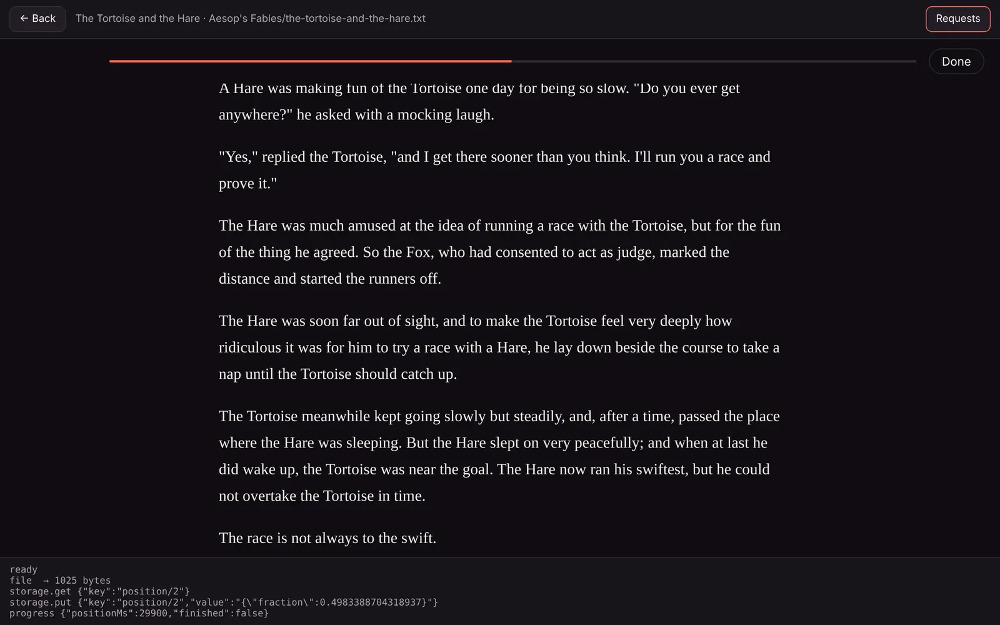

You can test most of a plugin without a Matinee server: the server part with `go test` and `matinee-plugin`, and the player with `matinee-plugin try`. Install it in a Matinee server for a last look.

## Unit tests

Handlers are plain Go functions, so `go test` calls them directly. Package [`plugintest`](https://github.com/yeixio/matinee/tree/main/pluginsdk/plugintest) fills in what Matinee would provide:

```go
import "github.com/yeixio/matinee/pluginsdk/plugintest"

func TestLookup(t *testing.T) {
	// Answer the plugin's fetches, as if this handler were the internet.
	plugintest.Network(t, http.HandlerFunc(func(w http.ResponseWriter, r *http.Request) {
		fmt.Fprint(w, `{"summary": "Eat the dots.", "cover": "https://example.com/pacman.png"}`)
	}))
	// Collect what the plugin logs.
	log := plugintest.Logs(t)

	d, err := lookup(plugin.LookupRequest{Kind: "game", Title: "Pac-Man"})
	if err != nil || d.Overview != "Eat the dots." {
		t.Fatalf("got %+v, %v", d, err)
	}
	_ = log.Lines()
}
```

Like Matinee, `plugintest.Network` refuses URLs that aren't https, and hosts your `plugin.json` doesn't list under `permissions.network`. Keep a folder of sample files in `testdata/` to index in tests. The [Stories tests](https://github.com/yeixio/matinee/blob/main/pluginsdk/examples/stories/main_test.go) show the idea.

## The matinee-plugin tool

```sh
go install github.com/yeixio/matinee/cmd/matinee-plugin@latest
```

Every command works on the plugin in the current folder, or the one you name first. Commands that run the server part run the built `server.wasm` in the same sandbox Matinee uses, so run `matinee-plugin build` after changing the code.

| Command | |
| --- | --- |
| `new <id>` | Start a plugin from a template: `-name`, `-ext .zip,.7z`, `-item game`, `-kind` |
| `check` | Check `plugin.json` and the files it names, the way Matinee does when installing |
| `build` | Build `server.wasm` with Go, check, and write `<id>.matinee-plugin`; `-include` adds files the plugin reads from its package, `-o` names the package |
| `scan <folder>` | What the plugin makes of each file in a folder |
| `lookup -title <title>` | Look up details for a title |
| `event <event.json>` | Send the plugin an event |
| `try <folder>` | Browse a folder and play it in a browser, as the web player would |

Commands that run the server part take `-set key=value` for each of the plugin's settings, and `-v` to show its debug lines. The plugin's `DataDir` is `.matinee-dev/data` in its folder.

### Scan a folder

```sh
matinee-plugin scan ~/Stories
matinee-plugin scan -lookup ~/Games      # and look each one up
matinee-plugin scan -json ~/Games > scan.json
```

For each file, `scan` prints what the plugin filed, or `skipped` or its error. Under each item are the problems Matinee would have with it: a kind that isn't the library kind's, a poster it can't find, facts it would leave out.

### Look up and send events

```sh
matinee-plugin lookup -title "Pac-Man" -year 1980 -set apiKey=abc123
echo '{"type": "playback.stopped", "item": {"id": 1, "title": "Pac-Man"}, "user": {"id": 1, "name": "Sam"}, "played": {"positionMs": 600000, "finished": true}}' | matinee-plugin event -
```

### Try the player

```sh
matinee-plugin try ~/Stories
```

`try` serves a page at `http://127.0.0.1:7390` that lists what the plugin makes of the folder. Click a title to play it with your player, in the same sandboxed frame and with the same headers as the web player. The page answers the player's requests the way the web player does:

- `file` and `libraryFile` come from the folder, with the same rules.
- Storage is kept in `.matinee-dev/storage`, one file per key, with the same key rules and limits. Delete the folder to start over.
- **Requests** shows each request and its answer, and the terminal prints them too.

The page rescans the folder and reloads the player's files every time, so change the player and reload, or rebuild the server part and click **Rescan**.



## In a Matinee server

Build the package and install it with **Settings → Plugins → Add plugin → From a file**. Installing a new build replaces the old one and keeps it on.

Matinee logs what plugins do with `plugin=<id>`. That includes your `plugin.Info` lines, what the plugin prints, and its errors:

```sh
docker logs matinee 2>&1 | grep plugin=stories
journalctl -u matinee | grep plugin=stories
```

Start Matinee with `MATINEE_DEBUG=1` to see `plugin.Debug` lines.

## When something's wrong

**Matinee says the server module doesn't export `matinee_handle`.** Build it as a reactor with the SDK: `-buildmode=c-shared` and `GOOS=wasip1 GOARCH=wasm`, which `matinee-plugin build` does. A plain `go build` makes a program with a `main` to run, and that won't work.

**A file isn't in the library.** Its extension isn't in the library kind's `extensions`, it's empty, its name starts with `.`, or `Index` skipped it or failed. `matinee-plugin scan` shows which.

**A poster doesn't show.** It must be an `https://` URL, or a file in the library's folders, the plugin's package or its data folder. A file outside those, even one that exists, isn't shown. `scan` flags it.

**A fetch fails with "isn't in the plugin's network permissions".** Add the host to `permissions.network`. An admin has to turn the plugin on again to allow it.

**The player is blank.** Open the browser's developer tools on the player's frame. Usually it's a script loaded from an absolute path (`/player.js` instead of `player.js`), `localStorage` (use storage instead), or a module script that failed to load. `try` shows the same errors.

**The player never starts.** Call `connect()` (or post `ready`) when the page loads. The web player sends the title only after that.
