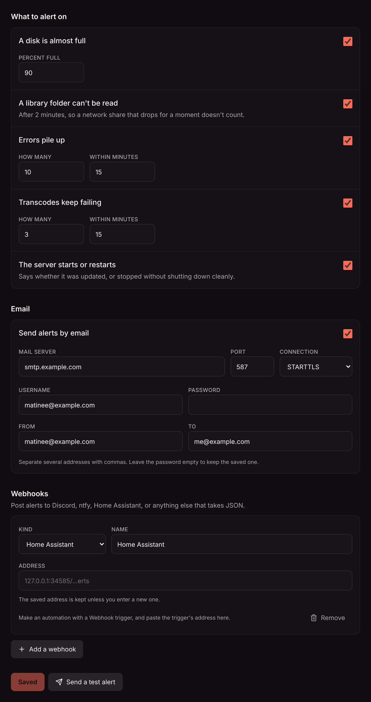
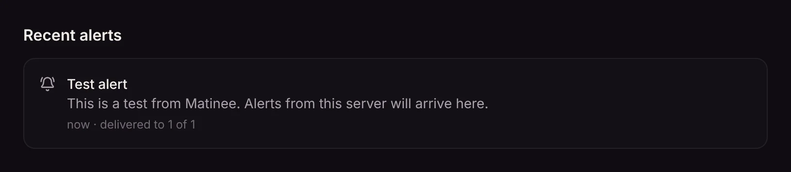
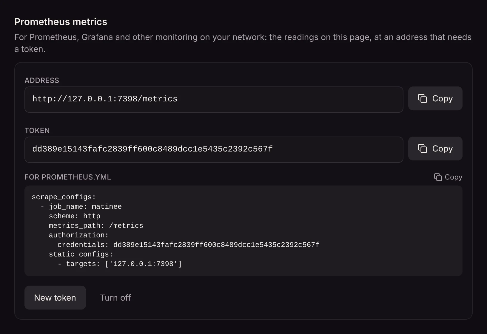

[Server health](/docs/server/server-health/) shows what's wrong when you look. Alerts tell you when you're not looking: Matinee sends an email or posts a message when something needs you, and again when it's sorted.

Alerts go straight from your server to your own mail server, Discord channel, ntfy topic or Home Assistant. Nothing passes through anyone else's servers.

Set them up in **Settings → Server health**, under **Alerts**. Only admins can.



## What Matinee alerts on

Every alert is on until you turn it off. Change the numbers to suit your server.

| Alert | When it's sent |
| --- | --- |
| **A disk is almost full** | A disk the server uses gets to 90% full (or what you set). That's the data folder, transcoding scratch space, seek bar previews, artwork, downloads and every library folder. You hear again once a day while it stays full, and once more when there's room again. |
| **A library folder can't be read** | A library folder has been out of reach for 2 minutes, which usually means a network share has dropped. A share that's gone for a moment doesn't count. You hear again when it's back. |
| **Errors pile up** | The server logs 10 or more errors within 15 minutes (or what you set). The alert names the most common ones. |
| **Transcodes keep failing** | 3 or more transcodes fail within 15 minutes (or what you set), so players couldn't play. That's often a GPU that's stopped working, or FFmpeg that can't read the files. |
| **The server starts or restarts** | The server starts. The alert says if it was updated, and warns when it stopped last time without shutting down cleanly, such as after a crash, the container being killed, or a power cut. |

Errors and failing transcodes are sent at most once an hour while they keep happening, so a bad night doesn't flood your inbox.

## Where alerts go

Add as many places as you like. **Send a test alert** tries them all, before or after you save, and says which worked and why any didn't.

### Email

Turn on **Send alerts by email** and fill in your mail server, the same details a mail app asks for. Most providers use port 587 with **STARTTLS**; some use 465 with **TLS**. For Gmail and other accounts with two-step sign-in, make an app password and use that.

**To** takes several addresses, separated by commas.

### Discord

In Discord, open the channel's settings, then **Integrations → Webhooks → New Webhook**, and **Copy Webhook URL**. Add a webhook in Matinee, pick **Discord**, and paste it.

### ntfy

[ntfy](https://ntfy.sh) sends push notifications to your phone. Pick **ntfy** and enter your topic's address, such as `https://ntfy.sh/a-long-secret-topic`, or one on your own ntfy server. If the topic needs a sign-in, enter an access token too. Problems arrive as high priority, and a folder that can't be read as urgent.

### Home Assistant

Matinee can start any automation in Home Assistant: flash a light, speak on a speaker, or send a notification to the Home Assistant app.

1. In Home Assistant, make an automation and pick the **Webhook** trigger. Leave **Only accessible from the local network** on if Matinee is on the same network.
2. Copy the trigger's address, such as `http://homeassistant.local:8123/api/webhook/matinee-alerts`.
3. In Matinee, add a webhook, pick **Home Assistant**, and paste it.

The automation gets the alert in `trigger.json`. For example, to send it to your phone:

```yaml
triggers:
  - trigger: webhook
    webhook_id: matinee-alerts
    allowed_methods: [POST]
    local_only: true
actions:
  - action: notify.mobile_app_your_phone
    data:
      title: "{{ trigger.json.title }}"
      message: "{{ trigger.json.message }}"
```

### Any other webhook

Pick **Other (JSON)** to post alerts to anything that takes JSON. Each alert looks like this:

```json
{
  "server": "Matinee",
  "rule": "disk",
  "key": "disk:/media/movies",
  "level": "warning",
  "title": "Disk almost full",
  "message": "The disk with Movies (/media/movies) is 93% full: 140.2 GB free of 1.8 TB.",
  "resolved": false,
  "time": "2026-11-02T06:00:00Z",
  "url": "https://matinee.example.com/settings/health"
}
```

`rule` is `disk`, `folder`, `errors`, `transcodes`, `restart` or `test`, and `level` is `info`, `warning` or `critical`. An alert that's sorted comes again with `resolved: true`. `url` links to Server health when the server knows its own address (`MATINEE_PUBLIC_URL`, see [Configuration](/docs/server/configuration/)).

Webhook addresses, the mail password and ntfy tokens stay on the server. Settings only shows a hint of each address; leave the box empty to keep it.

## Recent alerts

The last 50 alerts are listed under **Recent alerts**, with where each was delivered and, for any place it couldn't reach, why. Alerts that are still true are listed first under **Happening now**.



## Prometheus metrics

If you watch your home lab with Prometheus and Grafana, Matinee can report what Server health shows. It's off until you turn it on.

1. Under **Prometheus metrics**, select **Turn on**. Matinee makes a token.
2. Add the scrape config it shows to `prometheus.yml`. Prometheus sends the token with each request.



The metrics are at `/metrics` on the server's address, and answer only with the token. **New token** replaces it (the old one stops working), and **Turn off** turns metrics off again.

| Metric | What it is |
| --- | --- |
| `matinee_build_info` | The server's version, in the `version` label. |
| `matinee_start_time_seconds` | When the server started. |
| `matinee_cpu_percent`, `matinee_host_cpu_percent` | How much of the processors Matinee and the whole machine use. |
| `matinee_memory_bytes`, `matinee_memory_limit_bytes` | Memory Matinee uses, and a container's limit. |
| `matinee_sent_bytes_total` | Bytes sent since the server started. |
| `matinee_http_requests_total`, `matinee_http_server_errors_total` | Requests answered, and those that failed on the server. |
| `matinee_log_warnings_total`, `matinee_log_errors_total` | Warnings and errors logged. |
| `matinee_streams_playing`, `matinee_transcodes_active` | What's playing and transcoding now. |
| `matinee_transcodes_started_total`, `matinee_transcodes_failed_total` | Transcodes started and failed. |
| `matinee_disk_total_bytes`, `matinee_disk_free_bytes` | Each disk's size and free space, labeled with a `path` on it and its `use`. |
| `matinee_disk_reachable` | 1 when a folder can be read, 0 when it can't. |
| `matinee_libraries` | How many libraries there are. |
| `matinee_alerts_firing` | Alerts that are true now, by `rule`. |
| `matinee_goroutines` | A detail of the server process, for bug reports. |

Counts that end in `_total` start again from zero when the server restarts, which Prometheus expects.

On Kubernetes, point a ServiceMonitor or scrape job at the Matinee service's port with the token as a bearer token, the same as the config above.
