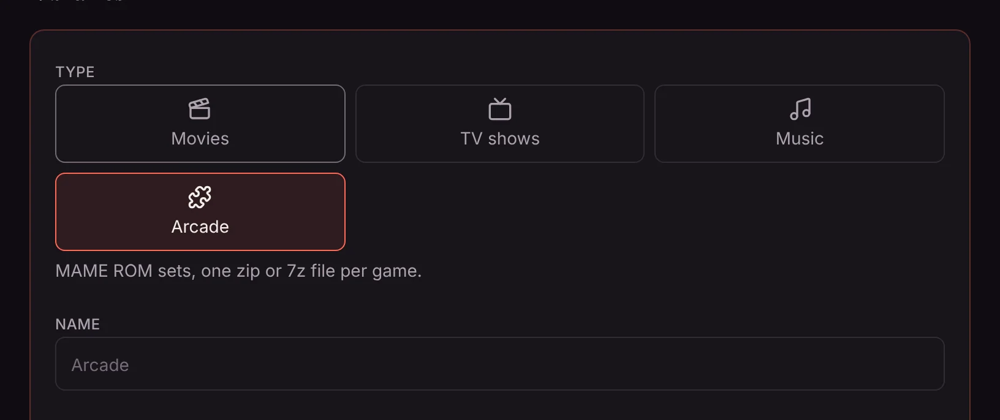
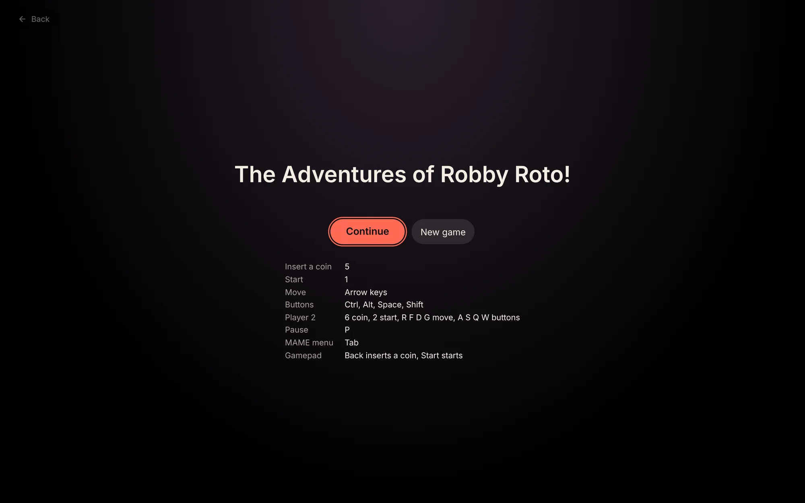

The **Arcade** plugin adds an Arcade library for your MAME ROM sets. Each game gets a page with its name, year and maker, artwork, and a **Play** button that runs it in the web player with [MAME](https://www.mamedev.org), with the keyboard or a gamepad. Matinee remembers where each person left off.

## Adding it

1. Open **Settings → Plugins**, click **Add plugin**, and install **Arcade** from the official plugins. (See [Plugins](/docs/server/plugins/) for what installing a plugin means.)
2. Click **Turn on**. Matinee asks first, because the plugin looks up artwork on `raw.githubusercontent.com` for games you have no pictures for.
3. In **Settings → Libraries**, click **Add a library**, pick **Arcade**, and choose your MAME folder.



## Setting up the folder

Point the library at the folder that has your ROMs in it. If you keep artwork the way MAME and its front ends do, point it at the folder above, so the plugin sees both:

```text
MAME/
  roms/
    pacman.zip
    puckman.zip
    galaga.zip
    neogeo.zip
  snap/          screenshots: pacman.png
  titles/        title screens
  flyers/        flyers, shown as the poster
  catver.ini     categories, shown as genres (optional)
```

- **One zip or 7z file per game**, named the way MAME names it (`pacman.zip`). Files that aren't arcade games, such as BIOS sets, are left out of the library but still used to run the games that need them, so keep them in the same folder.
- **ROM sets for MAME 0.289.** Sets for other versions mostly work too; a game whose ROMs changed since won't start, and MAME says which files it's missing.
- **Split or non-merged sets** show every game. With merged sets, clones are inside their parent's zip, so only the parents show.
- **Artwork** comes from `flyers`, `titles` and `snap` folders, as `.png` or `.jpg` named like the game. A clone without its own uses its parent's. Games without any get artwork from the [libretro thumbnails](https://github.com/libretro-thumbnails/MAME) collection.
- Folders such as `artwork`, `samples` and `cheat` are skipped.

## Which games play

Every arcade game in your library shows up, and its page says **Plays in the browser: Yes** or why not. The plugin's MAME is built in pieces, one for each family of games, so a game loads only what it needs. This first version plays:

- Pac-Man, Galaxian, Galaga, Donkey Kong, Asteroids, Centipede, Missile Command, 1942, Defender, Robotron, Joust and Exidy's games
- Capcom's CPS-1 games, such as Street Fighter II and Final Fight
- Neo Geo games, with the `neogeo.zip` BIOS next to them

More come with updates to the plugin. Games that need a hard disk or CD image (a CHD file) don't play in the browser.

The phone and TV apps don't play games yet; open them in the web player.

## Playing

Click **Play** on a game's page. The first start downloads the game and its piece of MAME, which takes a moment.



| | Keyboard |
| --- | --- |
| Insert a coin | 5 |
| Start | 1 |
| Move | Arrow keys |
| Buttons | Ctrl, Alt, Space, Shift |
| Player 2 | 6 coin, 2 start, R F D G move, A S Q W buttons |
| Pause | P |
| MAME's menu | Tab |

A gamepad works as soon as you press one of its buttons: the stick or pad moves, and on most pads **Back** (or **Select**) inserts a coin and **Start** starts. To change the keys or buttons, open MAME's menu with Tab and choose **Input Settings**.

**Controls** shows the keys while you play, and **Full screen** fills the screen. Matinee's **Back** button, top left, leaves the game.

## Saving

Matinee saves your place every minute while you play, and whenever you click **Save**. Next time, the game offers **Continue**, which picks up there, or **New game**. **Load save** goes back to the last save while you play.

Each person, and each profile, has their own saves. Removing the plugin deletes them.

A few games don't support saving in MAME; their **Save** button is greyed out.
