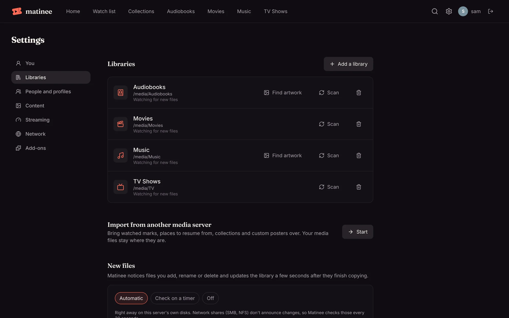
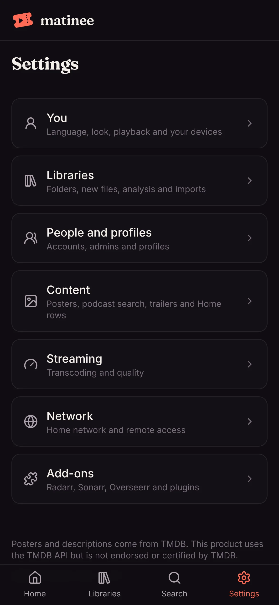

<!-- since: v0.1.9 -->
## Settings in the web player

**Settings** is split into groups. On a computer they're listed down the left side; on a phone, **Settings** in the tab bar opens the list and each group is its own page. Everyone sees **You**; admins see the rest.

| Group | What's in it |
| --- | --- |
| **You** | Language, Appearance, Playback, Your account and Your devices |
| **Libraries** | Libraries, Import from another media server, New files and Media analysis |
| **People and profiles** | People and Profiles |
| **Content** | Posters and details, Podcast search, Trailers and Home (holiday rows) |
| **Streaming** | Transcoding and streaming quality |
| **Network** | Home network and Remote access |
| **Add-ons** | Radarr and Sonarr, Overseerr, and Plugins |

The server's version is at the bottom of every group.

<!-- /since -->

## Server settings

Most of Matinee is set up in the web player under **Settings**. A few things about the server itself are set when it starts, as environment variables or flags:

| Install | Where they go |
| --- | --- |
| Docker | `-e NAME=value` on `docker run`, or `environment:` in Compose |
| apt, dnf | `/etc/matinee/matinee.env`, then `sudo systemctl restart matinee` |
| Homebrew | `$(brew --prefix)/etc/matinee/matinee.env`, then `brew services restart matinee` |
| Mac app | **Settings → Edit advanced settings** in its menu (`~/Library/Application Support/Matinee Server/matinee.env`), then **Restart server** |
| Helm | `env:` in your values |

| Variable | Default | What it does |
| --- | --- | --- |
| `MATINEE_ADDR` | `:7171` | Listen address |
| `MATINEE_DATA_DIR` | `./data` | SQLite database (when used), image cache, transcode scratch space |
| `MATINEE_DATABASE_URL` | empty | `postgres://…` to use PostgreSQL instead of SQLite |
| `MATINEE_TMDB_KEY` | empty | TMDB API key or read access token, for [posters and details](/docs/getting-started/posters-and-details/) |
| `MATINEE_RATING_COUNTRY` | `US` | Whose age ratings [kids profiles](/docs/household/profiles/) use, such as `GB`, `CA`, `AU` or `DE` |
| `MATINEE_MEDIA_ROOT` | `/` | Folder the library picker opens in |
| `MATINEE_MUSICBRAINZ` | `true` | Look up artists and albums on MusicBrainz, with covers and artist photos. Set `false` to use only local artwork |
<!-- since: v0.1.3 -->
| `MATINEE_OPENLIBRARY` | `true` | Look up audiobook covers and author photos on Open Library. Set `false` to use only local artwork |
<!-- /since -->
<!-- since: v0.1.7 -->
| `MATINEE_PODCASTS_HOME_NETWORK` | `false` | Let [podcast](/docs/watching/podcasts/) feeds and episodes come from addresses on the home network too, for shows you host yourself |
<!-- /since -->
| `MATINEE_WIKIDATA` | `true` | Look up awards on Wikidata. Set `false` to skip awards |
| `MATINEE_SCAN_INTERVAL` | `15m` | How often libraries are rescanned in full; `0` turns it off ([more](/docs/server/new-files/)) |
| `MATINEE_WATCH_POLL_INTERVAL` | `30s` | How often folders on network shares are checked for new files |
| `MATINEE_DISCOVERY` | `true` | Announce the server on the local network so the apps find it |
| `MATINEE_SERVER_NAME` | `Matinee` | The name the apps show for this server |
| `MATINEE_PUBLIC_URL` | empty | The address the apps should use, such as `https://matinee.example.com` |
| `MATINEE_HOME_ADDR` | empty | A second listen address just for the [home network](/docs/server/home-network/), such as `:7172` |
| `MATINEE_REMOTE_ADDR` | `:7443` | HTTPS address for [remote access](/docs/server/remote-access/); `off` to not offer it |
| `MATINEE_CONNECT_URL` | `https://connect.matinee.yeix.io` | The lookup service that helps the apps find the server after its address changes. It only learns the address, never carries media; `off` to not use it |
| `MATINEE_PLUGINS` | `true` | Let admins install [plugins](/docs/server/plugins/); `false` turns plugins off |
| `MATINEE_PLUGIN_CATALOG` | `https://matinee.yeix.io/plugins.json` | The list of official plugins **Add plugin** offers; `off` for none |
<!-- since: v0.1.4 -->
| `MATINEE_DRAIN_DELAY` | `0s` | On shutdown, how long to keep serving after telling players the server is restarting, so a load balancer can move to another copy ([more](/docs/getting-started/updating/#updating-while-people-are-watching)) |
| `MATINEE_SHUTDOWN_TIMEOUT` | `10s` | On shutdown, how long requests in flight get to finish |
<!-- /since -->
| `MATINEE_FFMPEG`, `MATINEE_FFPROBE` | `ffmpeg`, `ffprobe` | Paths to FFmpeg |
| `MATINEE_VAAPI_DEVICE` | empty | The GPU to use for VAAPI on a machine with several, such as `/dev/dri/renderD129` |

Each variable also works as a flag: `MATINEE_SCAN_INTERVAL=1h` is `--scan-interval=1h`.

## SQLite or PostgreSQL?

SQLite is the default and needs nothing else. It's right for a single machine or a NAS, as long as the data folder is on a local disk. Use PostgreSQL on Kubernetes, or whenever the data would otherwise live on network storage, where SQLite's file locking isn't reliable.
