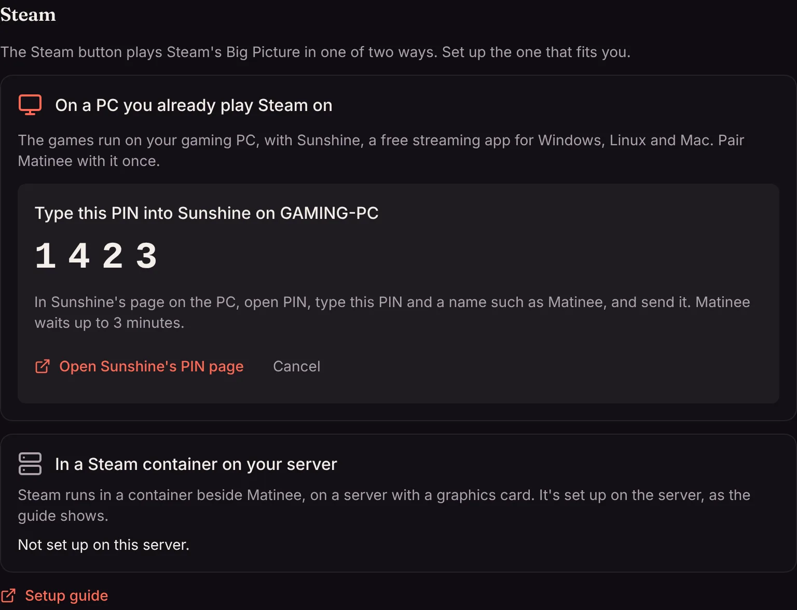
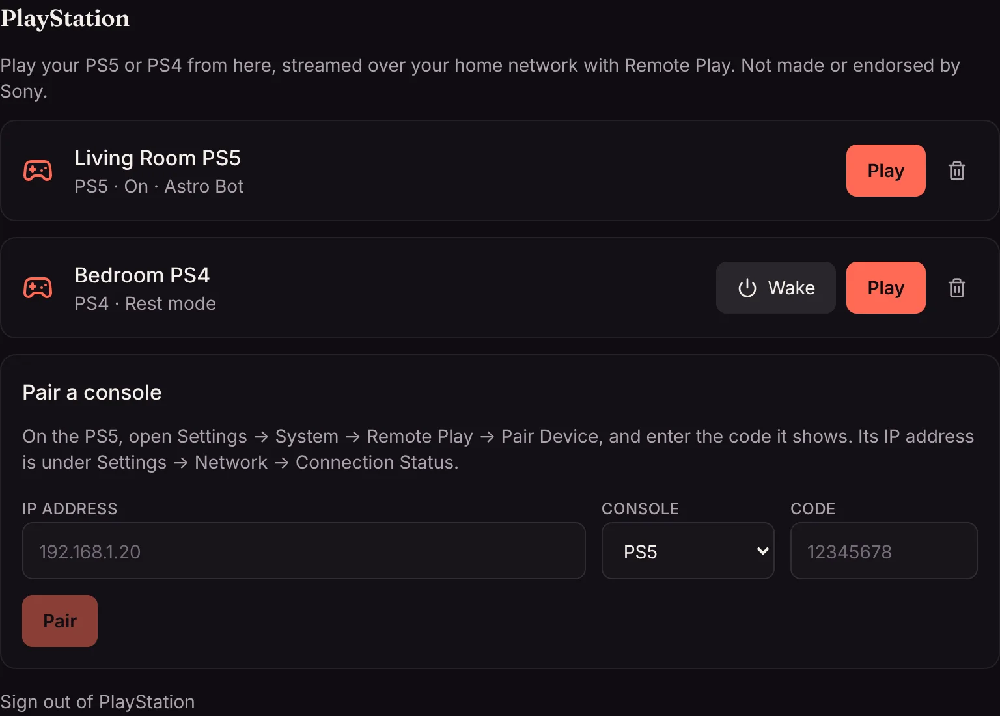

Matinee can play games for you on the server and stream them to your screen, the same way it streams a film. You connect a controller, pick a game and play: the emulator, its settings and the video all stay on the server, so there's nothing to install or set up on the device you play on.

This is a **preview**. You play in the web player and in the phone and TV apps ([below](#in-the-apps)).

## What it plays

| System | Files | Emulator |
| --- | --- | --- |
| Game Boy and Game Boy Color | `.gb`, `.gbc` | Gambatte |
| Game Boy Advance | `.gba` | mGBA |
| Nintendo Entertainment System | `.nes`, `.fds` | FCEUmm |
| Super Nintendo | `.sfc`, `.smc` | bsnes |
| Sega Genesis / Mega Drive | `.md`, `.gen`, `.bin` | clownmdemu |
| Nintendo 64 | `.n64`, `.v64`, `.z64` | ParaLLEl N64 |
| PlayStation | `.cue` (with its `.bin` tracks beside it), `.chd`, `.pbp`, `.m3u`, `.iso` | PCSX ReARMed |

<!-- since: v0.2.7 -->
From 0.2.7 it also plays:

| System | Files | Emulator |
| --- | --- | --- |
| Arcade games | MAME 0.289 sets, one `.zip` or `.7z` per game (see [Arcade games](/docs/server/arcade/)) | MAME |
| Atari 2600, 5200 and 7800 | `.a26`, `.a52`, `.a78` | Stella 2014, a5200, ProSystem |
| Atari Lynx and Jaguar | `.lnx`, `.j64`, `.jag` | Beetle Lynx, Virtual Jaguar |
| Sega Master System and Game Gear | `.sms`, `.gg` | Gearsystem |
| ColecoVision | `.col` | Gearcoleco |
| Intellivision | `.int` | FreeIntv |
| PC Engine / TurboGrafx-16 | `.pce` | Beetle PCE Fast |
| Neo Geo Pocket and Pocket Color | `.ngp`, `.ngc` | Beetle NeoPop |
| WonderSwan and WonderSwan Color | `.ws`, `.wsc` | Beetle Cygne |
| Virtual Boy | `.vb` | Beetle VB |
| Commodore 64 | `.d64`, `.t64`, `.prg`, `.crt`, `.g64` | VICE |
| Amiga | `.adf`, `.ipf` | PUAE |
| ZX Spectrum | `.tzx`, `.z80`, `.sna` | Fuse |
| DOS PCs | a zip of the game's folder | DOSBox Pure |

ColecoVision and Intellivision games need the console's own BIOS: put yours in `games/system` in Matinee's data folder (`colecovision.rom` for the ColecoVision, `exec.bin` and `grom.bin` for the Intellivision). The Amiga plays best with your own Kickstart ROM there too (`kick34005.A500` and the like). A DOS game is played from the zip in a folder named for it, such as `pc` or `dos`. The arcade, Atari Jaguar, Commodore 64, Amiga and DOS emulators aren't in the image for 32-bit ARM boards.
<!-- /since -->

A zip or 7z holding one of these works too, including a zip of a PlayStation disc's `.cue` and `.bin` files. When an archive holds several dumps of a game, as GoodTools sets do, Matinee plays the verified good one (`[!]`), preferring the US or European release, over bad dumps, overdumps, hacks, translations and betas. Matinee plays only the games you already have: it never looks for, links to or downloads games. You can add emulators for other systems yourself (see [Adding your own emulator](#adding-your-own-emulator)).

None of these needs a graphics card in the server: the N64 picture is drawn in software, which wants a recent CPU with a few cores to spare. The Super Nintendo and N64 emulators aren't in the image for 32-bit ARM boards, which are too slow for them.

The PlayStation emulator doesn't need the console's BIOS, but plays more games, more faithfully, with one: put your own BIOS file (such as `scph5501.bin`) in `games/system` in Matinee's data folder.

Games with a battery save, such as RPGs, keep their saves on the server, one for each person, and pick up where you saved next time.

## A Games library

Add your games as a library and everyone you share it with can browse them with box art and play them, like films.

1. In **Settings → Libraries** press **Add library**, pick **Games** and add the folder your games are in.
2. Matinee finds each game and fills in its name, year, system, region, publisher, number of players and genre, and its box art.

Games can be named and sorted any way you like. Matinee tells the system by the folder a game is in when the folder is named for it (`Game Boy`, `gba`, `snes`, `Mega Drive`, `PlayStation` and so on), otherwise by what's in a zip or the file's ending. It then recognizes the game by its contents, so even `tetris copy.gb` is found as Tetris (World) (Rev 1), and falls back to the file's name for games it doesn't know, such as homebrew.

For PlayStation games of more than one disc, keep an `.m3u` list beside the discs: the game shows once, and you change discs in the game.

<!-- since: v0.2.7 -->
Arcade sets go in the same library, in a folder such as `mame` or `arcade`: see [Arcade games](/docs/server/arcade/).

**Every game shows**, even one for a system Matinee has no emulator for yet, such as the Nintendo Switch, GameCube or PlayStation 2. Its page says so instead of offering **Play**, with a link for admins to [add an emulator](#adding-your-own-emulator) for it.

**A game shows once.** The same game for another region or a later revision, such as `Super Game (Europe)` next to `Super Game (USA)`, is a version of it, like a film's versions: the page shows the release most likely wanted (the USA's or the world's, then Europe's), and an arcade game's clones sit under it the same way.

If a file doesn't show up, open the Games library: admins see a note at the top saying how many files were left out and why, grouped by folder, such as zips that hold neither a console's game nor one of MAME's sets.
<!-- /since -->

<!-- since: v0.2.7 -->
### Details

Each game gets a page like a film's: its box art, a screenshot behind it, the year, who made it, how many play, and a summary from the start of its [Wikipedia](https://en.wikipedia.org) article, with its genres from Wikidata. Set `MATINEE_WIKIPEDIA=false` to skip the summaries.
<!-- /since -->

To recognize games Matinee downloads the [libretro database](https://github.com/libretro/libretro-database)'s lists for each system once and keeps them for a month, in `games/lists` in Matinee's data folder; box art comes from [libretro's thumbnails](https://thumbnails.libretro.com). Without internet, games are named by their files and have no box art. Nothing about your games is sent anywhere.

<!-- since: v0.2.6 -->
### Box art

Matinee tries hard to find a picture for every game, in this order:

1. **Your own picture.** An image named like the game beside it, such as `Tetris (World).png` next to `Tetris (World).gb`, or in a folder other game apps and scrapers keep pictures in: `boxart`, `covers`, `images`, `media/box2dfront`, `downloaded_media/covers` and the like. Names ending in `-image`, `-boxart` or `-cover` count too.
2. **libretro's box art** for the game, or the same game's from another region (the USA's, then the world's, Europe's and Japan's) when yours has none. Names that differ only by a "The", an "&" or punctuation still match.
3. **libretro's title screen**, or failing that a screenshot, when there's no box art at all.

To pick from what libretro has, Matinee keeps its list of pictures for each system for a month, in `games/lists/art`.

<!-- since: v0.2.11 -->
When libretro's thumbnail site is down or stops serving pictures, Matinee gets the same pictures, and the lists of them, from [libretro's copy on GitHub](https://github.com/libretro-thumbnails) instead. Pictures are kept on the server once they've been shown, so art you've already seen stays when both are out of reach.
<!-- /since -->

### Picking a system

In a Games library with games for more than one system, the systems sit above the games: pick one to see only its games, or **All**. **Filters** has them too, to pick several.
<!-- /since -->

## Playing a game

1. Connect a controller to the computer and press any button on it, so the browser sees it. Xbox, PlayStation and most other controllers work. Without one, the keyboard works: arrow keys, **Z** and **X** for B and A, **A** and **S** for Y and X, **Enter** for Start.
2. Open a game in your Games library and press **Play**. It opens full screen.
3. Close it with the **×** at the top, or [hold Select and Start](#leaving-a-game). A battery save is kept.

Admins can also play any game file on the server without adding it to a library: in **Settings → Streaming → Games** press **Try playing a game** and find it in the folder list.

The controller buttons go by where they sit, not by their letters: the bottom face button is B and the right one is A, as on the consoles. For the N64 the left stick is the N64's stick and the right stick its C buttons; on the keyboard the arrow keys move the stick.

<!-- since: v0.2.4 -->
### In the apps

The iPhone, iPad and Android apps, Android TV, Fire TV, and Samsung and LG TVs play games from your Games library too. Open a game and press **Play**.

- **On a phone or tablet** the game turns sideways and shows buttons on the screen: a d-pad, A, B, X, Y, L, R, Select and Start. Use both thumbs at once. On the N64 the d-pad moves the stick.
- **With a controller**, pair it with the phone, tablet or TV in its Bluetooth settings first. The buttons on the screen make way when it connects; tap the screen to bring them back. Up to four controllers play at once, each as its own player.
- **To stop**, see [Leaving a game](#leaving-a-game).
<!-- /since -->

<!-- since: v0.2.5 -->
#### On Apple TV

From app version 1.0.40, Apple TV plays games too, with a server from 0.2.5 on. Pair the controller under **Settings → Remotes and Devices → Bluetooth** on the Apple TV. Apple TV gets the game straight over the connection it already has to the server, so it doesn't need the [games port](#the-games-port). To stop, see [Leaving a game](#leaving-a-game).
<!-- /since -->

<!-- since: v0.2.11 -->
### Leaving a game

So a stray press doesn't end a game, leaving takes a moment on purpose:

- **Hold Select and Start together for 2 seconds** on any controller. On an Xbox controller they're **View** and **Menu**, on a PlayStation controller **Create** (or **Share**) and **Options**, and on a Nintendo controller **−** and **+**. A small bar fills while you hold; let go before it's full to keep playing. The buttons on a phone's screen work the same way, and so do **Shift** and **Enter** on the keyboard in the web player.
- **Press twice:** in the apps, the TV remote's **Back** (**Menu** on older Siri Remotes), Android's back gesture, the controller's own home button, or the **×** at the top of a phone or tablet leaves when pressed again within 3 seconds. The first press only shows **Press again to leave**. Touching and holding the **×** leaves at once.
- With no controller connected to a TV, one press of **Back** still leaves, since there's nothing else to play with.
- In the web player, the **×** at the top leaves with one click.

When a game starts, a small hint at the top of the screen names the buttons for your controller for a few seconds, then gets out of the way. A PC game's **Back** still opens its menu on a TV; **Stop** is in that menu.

You need app version 1.0.49 or later for this in the apps.
<!-- /since -->

## How fast it is

Every press goes to the server and the picture comes back, so there's a little more delay than playing on the device itself. On a home network it's usually a few hundredths of a second, which suits most games. A wired connection helps the most.

The **Lag test** on the games page measures it for you. Move the square with the d-pad, and hold **A** or **B**: the screen turns white, and **Measured, press to picture** shows how long that took to reach your player. Add your screen's own delay, often 10 to 30 ms with a TV's game mode on. **Show lag** also breaks it down while you play a game.

## The games port

Games stream over **UDP port 7173**, separately from the web player's port. On the home network nothing needs setting up. In a container, publish the port as UDP, such as `-p 7173:7173/udp` with Docker. The Helm chart opens it on the node by itself (`games.port`, 0 turns games off).

| Environment variable | Default | What it's for |
| --- | --- | --- |
| `MATINEE_GAMES_PORT` | `7173` | The UDP port games stream through. `0` picks ports at random. |
| `MATINEE_GAMES_PUBLIC_IP` | | The addresses players reach that port at, comma separated, when the server can't see its own, such as in a container that isn't on the host network. The Helm chart sets it to the node's address. |
| `MATINEE_GAMES_DIR` | `/usr/lib/matinee/games` | Where the game runner and emulators are. `off` turns games off. |

The Docker image, the Helm chart and, from 0.2.7, the apt and dnf packages, Matinee Server.app on Macs with Apple silicon and the Windows installer (on Intel, AMD and Arm PCs alike) include the game runner and the emulators, so there's nothing to install. Homebrew doesn't have emulators yet: its Games library shows your games, and **Settings → Streaming → Games** says this server can't play them.

## The emulators

Matinee plays games with free, open-source emulators, each in its own process so a game that crashes can't take the server with it: [Gambatte](https://github.com/libretro/gambatte-libretro) for the Game Boy, [mGBA](https://mgba.io) for the Game Boy Advance, [FCEUmm](https://github.com/libretro/libretro-fceumm) for the NES, [bsnes](https://github.com/libretro/bsnes-libretro) for the Super Nintendo, [clownmdemu](https://github.com/Clownacy/clownmdemu-libretro) for the Genesis, [ParaLLEl N64](https://github.com/libretro/parallel-n64) for the N64 and [PCSX ReARMed](https://github.com/libretro/pcsx_rearmed) for the PlayStation. Their licences are in `/usr/lib/matinee/games/licenses` in the image.

<!-- since: v0.2.7 -->
From 0.2.7 there are also [MAME](https://www.mamedev.org) for arcade games, and [Stella](https://stella-emu.github.io), a5200, ProSystem, Beetle (from [Mednafen](https://mednafen.github.io)), Virtual Jaguar, [Gearsystem](https://github.com/drhelius/Gearsystem), [Gearcoleco](https://github.com/drhelius/Gearcoleco), FreeIntv, [VICE](https://vice-emu.sourceforge.io), PUAE, [Fuse](https://fuse-emulator.sourceforge.net) and [DOSBox Pure](https://github.com/schellingb/dosbox-pure) for the systems in the table above.
<!-- /since -->

## Adding your own emulator

You can add any emulator that's a **libretro core**, for a system Matinee doesn't play yet, or to play a system with a different emulator than the built-in one.

1. Get the core built for your server: a file ending in `_libretro.so` for Linux, `_libretro.dll` for Windows or `_libretro.dylib` for a Mac, for the server's kind of CPU. **Settings → Streaming → Games** says which one you need, such as **Linux x86_64** for most Linux PCs, **Linux aarch64** for a Raspberry Pi 4 or 5, **Windows x86_64** or **macOS arm64**. The libretro project's [nightly builds](https://buildbot.libretro.com/nightly/) have most cores, zipped.
2. Unzip it, and in **Settings → Streaming → Games → Emulators** press **Add an emulator** and pick the file.
3. Matinee loads it to ask which files it plays. If that works it's added, listed with the files it plays, and those games play with it from then on, ahead of a built-in emulator for the same files. If it doesn't, Matinee says why (built for another kind of computer, say) and doesn't keep it.

<!-- since: v0.2.7 -->
You can also add one straight from a game's page: a game Matinee can't play yet says so, and admins get an **Add an emulator** button right there. Once the emulator is added, the game's **Play** button appears.
<!-- /since -->

An emulator is a program that runs on your server, so add only ones you trust, such as libretro's own builds. Each runs in its own process like the built-in ones.

You can also copy cores into `games/cores` in Matinee's data folder by hand; Matinee picks them up the next time it lists games. To remove one, press the bin next to it, or delete the file.

Some emulators need a BIOS file from the console. Put it in `games/system` in Matinee's data folder, named as the emulator's own documentation says. Emulators that draw with a graphics card (OpenGL or Vulkan) can't run on the server yet. An arcade emulator that plays zips is given the zip as it is, so the zip has to be the set of game files that emulator's version expects.

<!-- since: v0.2.6 -->
## PC games from Steam (preview)

Matinee can also stream PC games from Steam. The games don't run on the Matinee server: they run on a **game host**, a Linux computer with a graphics card and Steam on it, such as a gaming PC.

<!-- since: v0.2.11 -->
There are two ways to set it up, and **Games → Steam** in the web app shows both side by side, with the one the Steam button uses now:

- **On a PC you already play Steam on**, with Sunshine, a free streaming app for Windows, Linux and Mac. Nothing to install on the server, and you pair it from the web app: see [Steam on a PC you already have](#steam-on-a-pc-you-already-have-preview). Start here if you have a gaming PC.
- **In a Steam container on your server**, beside Matinee, for a home server with a graphics card of its own. It's set up on the server, as the rest of this section shows.

If both are set up, the Steam button plays the PC.
<!-- /since --> The game host plays the game, records its picture and sound on its graphics card, and sends them to Matinee, which streams them to your player the same way it streams console games. Your controller works as a controller plugged into the game host.

Only the games you own and have installed in Steam on the game host are listed. Matinee never downloads games.

This is an early preview, played by an admin from **Games** in the web app, or from a Games library in the web app and the Matinee apps:

1. On the game host, sign in to Steam and install the games you want to play.
2. Run `matinee-gamehost` on the game host, as the user Steam runs as, with a secret token of your own:

   ```sh
   MATINEE_GAMEHOST_TOKEN=pick-a-long-secret matinee-gamehost
   ```

   It listens on port `7174`. It needs FFmpeg, a desktop session for the game to draw on (it uses `DISPLAY`, `:0` if unset), PulseAudio or PipeWire for the sound, and write access to `/dev/uinput` for the controllers. For now, build it from Matinee's source with `go build ./cmd/matinee-gamehost`.
3. Tell the Matinee server where it is:

   | Setting | What it's for |
   | --- | --- |
   | `MATINEE_GAME_HOST` | The game host's address, such as `http://gaming-pc:7174`. |
   | `MATINEE_GAME_HOST_TOKEN` | The same token as the game host's. |

4. Open **Games** in the web app. Under **PC games**, **Steam** opens Steam's Big Picture full screen, where you pick, play and quit games with your controller, as on a TV console.

   <!-- since: v0.2.9 -->
   **Steam** is the one button: browse your games, start them, and install or remove them inside Big Picture, as on a Steam Deck. Each installed game no longer gets its own button.
   <!-- /since -->

The game host plays one game at a time. Closing the player quits the game, or leaves Big Picture.

<!-- since: v0.2.7 -->
In the web app, your keyboard and mouse control PC games and Steam as they are, so you can click Steam's buttons, type and play without a controller. A controller works too. For a game that turns the view with the mouse, choose **Capture mouse** at the top of the player; press Esc to let the mouse go. The game host needs write access to `/dev/uinput` for this, as it does for controllers.
<!-- /since -->

<!-- since: v0.2.7 -->
The Matinee apps play PC games too, from app 1.0.42: on a TV, phone or tablet, **PC games** sits at the top of each Games library for admins, with **Steam**. Play with a controller.
<!-- /since -->

<!-- since: v0.2.9 -->
### Typing and a mouse on a TV

Steam's sign-in and some PC games need a keyboard and a mouse. From app 1.0.44, press **Back** on the TV remote while a PC game plays (on a phone or tablet, the keypad button at the top) for a menu:

- **Type text** and **Type a password** open the TV's own keyboard. Choose **Send** and what you typed is typed into the game. A phone set up as the TV's remote can type into it too.
- **Press Enter**, **Press Tab** and **Backspace** press those keys.
- **Use the controller as a mouse**: the left stick moves the pointer, the d-pad nudges it, the bottom button clicks, the right button right-clicks and the right stick scrolls. Choose **Use the controller as a controller** in the menu to go back.

For example, to sign in to Steam: use the controller as a mouse to click the account name box, then **Type text** for your account name, **Press Tab**, **Type a password**, and **Press Enter**. If the sign-in QR code has expired, click it to get a new one.
<!-- /since -->

<!-- since: v0.2.7 -->
**PC games** also sits at the top of each Games library, above the console games. If the game host is set up but isn't answering, PC games says why instead of disappearing, such as when the game host computer is off or `matinee-gamehost` isn't running.
<!-- /since -->

### Signing in to Steam from Matinee

If the game host's computer has no screen of its own, such as Steam in a container, give the game host the address of a web page that shows its screen (`MATINEE_GAMEHOST_DESKTOP`, such as the noVNC page a Steam container serves). **Games → PC games → Steam desktop** then opens that screen in your browser, through Matinee, so you can sign in to Steam and install games without opening another port. Only admins can open it: it controls the whole computer.

| Game host setting | Default | What it's for |
| --- | --- | --- |
| `MATINEE_GAMEHOST_LISTEN` | `:7174` | The address it listens on. |
| `MATINEE_GAMEHOST_TOKEN` | | The token Matinee must send. Required. |
| `MATINEE_GAMEHOST_HOME` | your home folder | Where to look for Steam. |
| `MATINEE_GAMEHOST_VAAPI` | `/dev/dri/renderD128` | The graphics card to encode on. Without one, it encodes on the CPU, which is slower. |
| `MATINEE_GAMEHOST_AUDIO` | the default output | The PulseAudio source to record the sound from. |
| `MATINEE_GAMEHOST_BITRATE` | `20` | The video bitrate in megabits per second. |
| `MATINEE_GAMEHOST_DESKTOP` | | The address of a web page showing the game host's screen, such as `http://127.0.0.1:8083`, opened by **Steam desktop**. |
<!-- /since -->

<!-- since: v0.2.9 -->
### TV mode for a Steam-only computer

If the game host's computer only runs Steam, such as a Steam container, set `MATINEE_GAMEHOST_TV_MODE=true` and start Steam with `-gamepadui`. Steam then always shows Big Picture, its TV and controller screen, and stays there when a player leaves instead of going back to a desktop. Leave TV mode off on a computer you also use as a desktop, so Big Picture closes after you play.

| Game host setting | Default | What it's for |
| --- | --- | --- |
| `MATINEE_GAMEHOST_TV_MODE` | `false` | Keep Steam in Big Picture when a player leaves. |
<!-- /since -->

<!-- since: v0.2.11 -->
## Steam on a PC you already have (preview)

If you already play Steam on a gaming PC, Matinee can play it from there. The PC runs [Sunshine](https://app.lizardbyte.dev/Sunshine/), a free, open-source game streaming app for Windows, Linux and Mac. Matinee connects to it as the Moonlight apps do, starts Steam's Big Picture on the PC, and streams it to your player like any other game. Your controller works as an Xbox controller plugged into the PC, and in the web app your keyboard and mouse work too. Everything stays on your home network.

Steam's own Remote Play only streams to Valve's Steam Link app, so Matinee can't receive it: that's what Sunshine is for. Matinee's side is built on [moonlight-common-c](https://github.com/moonlight-stream/moonlight-common-c). The Matinee server image has it built in. Other installs don't have it yet.

### Setting it up

1. **On the PC**, install Sunshine from [its download page](https://app.lizardbyte.dev/Sunshine/) and start it. Open its page in a browser on the PC, at `https://localhost:47990`, and pick a username and password. Sunshine adds **Steam Big Picture** to its applications on its own; if it's missing, add an application that runs `steam://open/bigpicture` (on Windows) or `steam steam://open/bigpicture` (on Linux) and name it "Steam Big Picture".
2. Make sure Steam is installed and signed in on the PC, with the games you want installed. Give the PC a fixed IP address in your router, so Matinee always finds it.
3. **In Matinee**, open **Games** in the web app. Under **Steam**, in **On a PC you already play Steam on**, enter the PC's address (such as `192.168.1.30`, or `192.168.1.30:48989` if you changed Sunshine's port) and choose **Pair**.
4. Matinee shows a 4-digit PIN. On the PC, in Sunshine's page, open **PIN**, type that PIN and a name such as "Matinee", and send it. **Open Sunshine's PIN page** opens it for you from a computer that can reach the PC. Matinee waits up to 3 minutes, then shows the PC as paired.



The PC's firewall has to let Sunshine's ports through from the Matinee server: TCP 47984, 47989, 47990 and 48010, and UDP 47998 to 48010. Sunshine's installer opens them on Windows. The Matinee server has to reach the PC directly, so both need to be on the same home network. If Matinee runs in Kubernetes or Docker, it reaches the PC through its computer's network, as it reaches the internet.

### Playing

Choose **Steam** under **PC games**, in the web app or at the top of a Games library in the Matinee apps, as with a Steam container. Steam's Big Picture opens on the PC, at 1080p and 60 frames a second, and streams to you; pick and play games with your controller. **Select** and **Start** together press the Xbox button, which opens Steam's menu. Closing the player closes Big Picture on the PC.

The PC plays one game for one person at a time, and not while someone else streams from it with Moonlight. While you play, the game shows on the PC's own screen too, as Sunshine streams what's on it. To stop playing on the PC, remove it under **Steam**: Matinee asks the PC to forget it too.

| Server setting | Default | What it's for |
| --- | --- | --- |
| `MATINEE_PCREMOTE` | `/usr/lib/matinee/pcremote/matinee-pcremote` in the image | Where the bridge to Sunshine is; `off` to not offer Steam on a PC. |
<!-- /since -->

<!-- since: v0.2.11 -->
## PlayStation Remote Play (preview)

Matinee can also play your own PS5 or PS4 on your home network, with Remote Play, the way Sony's Remote Play app does. The game runs on the console. Matinee receives its picture and sound and streams them to your player like any other game, and your controller works as the console's controller. The stream goes from the console to the Matinee server to your player, all on your home network, and never through Sony's servers or anyone else's.

It's built on [chiaki-ng](https://github.com/streetpea/chiaki-ng), the open-source Remote Play client, and isn't made or endorsed by Sony. The Matinee server image has it built in. Other installs don't have it yet.

### Setting it up

An admin does this once, from **Games** in the web app, under **PlayStation**:



1. **Sign in to PlayStation.** Pairing needs your PSN account ID, which Sony doesn't show anywhere. Choose **Open PlayStation sign-in**, sign in on Sony's own page, and when the page shows the word "redirect", copy the address from your browser's address bar and paste it into Matinee. Matinee asks Sony for your account ID once and keeps only the ID: never your password, and not the sign-in. If you already know your account ID (12 letters and numbers ending in `=`), choose **I have my account ID** and paste it instead.
2. **Pair the console.** On a PS5, open **Settings → System → Remote Play** and turn on **Enable Remote Play**, then choose **Pair Device**: the console shows an 8-digit code. On a PS4, open **Settings → Remote Play Connection Settings**, turn on **Enable Remote Play**, then choose **Add Device**. In Matinee, enter the console's IP address (on the console under **Settings → Network → Connection Status**), pick PS5 or PS4, type the code and choose **Pair**.
3. To have Matinee turn the console on from rest mode, set the console's rest mode to stay connected to the internet and to allow turning it on from the network (on a PS5: **Settings → System → Power Saving → Features Available in Rest Mode**).

Give the console a fixed IP address in your router, so it keeps the address you paired it at. The Matinee server has to reach the console directly, so both need to be on the same home network. If Matinee runs in Kubernetes or Docker, the server reaches the console through its computer's network, as it reaches the internet.

### Playing

Choose **Play** next to the console. If it's in rest mode, Matinee wakes it first, which takes a PS5 about 20 seconds. The PlayStation is shown at up to 1080p and 60 frames a second (720p from a PS4 that isn't a Pro).

Your controller's buttons are where they are on a PlayStation controller: the bottom face button is Cross, the right one Circle. **Select** presses the touchpad, and **Select** and **Start** together press the **PS** button. With a keyboard, the keys stand in for a controller as they do for console games.

Only one person can play a console at a time, and not while Sony's own Remote Play app is using it. If the console asks for a login passcode, turn the passcode off for that user on the console. Closing the player ends Remote Play; the game keeps running on the console.

From app 1.0.50, the iPhone, iPad and Android apps, Apple TV, Android TV, Fire TV, and Samsung and LG TVs play your paired consoles too: they're at the top of each Games library, under **PlayStation**, beside PC games. Choose a console to play it; Matinee wakes it first if it's resting, which can take a minute. As in the web app, only admins see them. Signing in to PlayStation and pairing stay in the web app.

Server 0.2.10 left the PlayStation bridge out of its builds by mistake, so PlayStation needs a server from 0.2.11 on.

| Server setting | Default | What it's for |
| --- | --- | --- |
| `MATINEE_PSREMOTE` | `/usr/lib/matinee/psremote/matinee-psremote` in the image | Where the PlayStation bridge is; `off` to not offer PlayStation. |
<!-- /since -->
