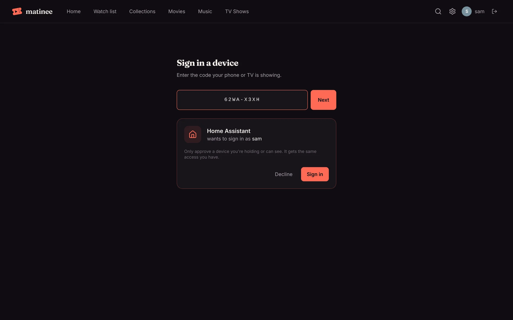
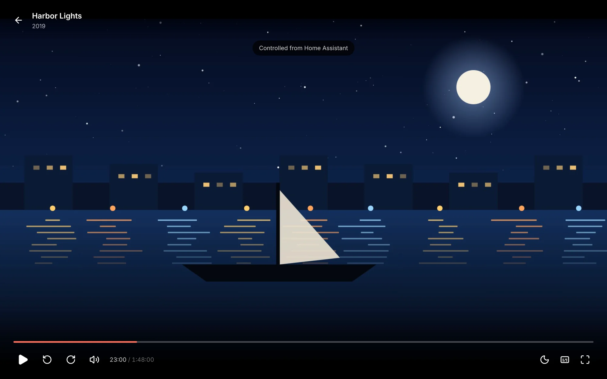

Connect Matinee to [Home Assistant](https://www.home-assistant.io/) and every Matinee player in your home shows up there: the web player in each browser, the phone and tablet apps, and the TV apps. You can see what each one is playing, pause it, start a film on the living room TV, set a sleep timer, and build automations around what you watch, such as dimming the lights when a movie starts.

Setting it up works like signing in a TV: Home Assistant finds Matinee on your network and shows a code, and you approve it in Matinee. There are no API keys or passwords to copy.

## What you get

- **A media player for every Matinee player.** Each shows what's playing (with its poster), how far in it is, and who's watching, and takes play, pause, seek, stop, next episode and volume where the device has its own. Players come and go by themselves as apps open and close.
- **Start anything on any player.** Pick from your libraries in Home Assistant's media browser, or name a title in an automation: _play "The Muppet Movie" on the living room TV_. A show starts at the next episode the person on that device hasn't watched.
- **A sleep timer and subtitles** for each player, as actions.
- **Sensors:** how many players are playing right now (and what), how many titles each library has, and the newest addition.
- **A Scan libraries button** that looks for new files in every library.
- **Events for automations:** something started, paused, resumed or stopped playing (and whether it reached the end), something new was added, a library finished scanning.

## Setting it up

You need a Matinee admin account, and Home Assistant 2026.1 or newer.

1. **Install the integration.** In Home Assistant, open **HACS**, choose **Custom repositories** in the menu, and add `https://github.com/yeixio/matinee-home-assistant` as an **Integration**. Then search HACS for **Matinee**, download it, and restart Home Assistant.
2. **Add Matinee.** When Matinee is on the same network, Home Assistant finds it by itself: open **Settings → Devices & services**, where Matinee waits under **Discovered**, and click **Add**. Otherwise click **Add integration**, pick **Matinee**, and type the address you open Matinee at, such as `http://192.168.1.20:7171`.
3. **Approve the code.** Home Assistant shows a code and a link to your server's **/link** page. Open it on any phone or computer signed in to Matinee as an admin, check that it says **Home Assistant**, and click **Sign in**. Home Assistant carries on by itself.



Home Assistant then appears in Matinee under **Settings → Your devices**, where you can sign it out at any time. It stays signed in as long as it's in use, so you won't have to do this again.

## Controlling players

Every Matinee player that's open shows up as a media player named after its device, such as _Living room TV_ or _Firefox on macOS_. A player that's closed shows as off, and comes back when the app opens again. Players work whether someone signed in or is watching at home without an account.

When Home Assistant (or anything else) controls a player, the player says so for a moment, so nobody wonders why the film paused by itself:



A few things to know:

- The apps take commands while they're open on screen. A phone in someone's pocket isn't a player until they open Matinee.
- TVs keep the volume to the TV itself, so TV players offer no volume control in Home Assistant.
- In the web player, one tab per browser listens. The tab with the player open takes over.
- A kids profile only plays what it could pick by itself. Starting something else on its player fails, and Home Assistant says the title wasn't found.

### Starting something to watch

From the dashboard, open a player's **Browse media** to pick from **Recently added** or any library. In an automation or script, use the **Media player: Play media** action with the title as the content id:

```yaml
action: media_player.play_media
target:
  entity_id: media_player.living_room_tv
data:
  media_content_type: movie
  media_content_id: The Muppet Movie
```

The content type can be `movie`, `tvshow`, `episode` or `music`, and narrows the search; the title doesn't have to be exact. To start partway, add `extra: { position: 600 }` (seconds). Items picked in the media browser use ids like `matinee://item/123`, which always mean that exact title.

### The sleep timer

The **Matinee: Sleep timer** action works like the [player's own sleep timer](/docs/watching/playing/#sleep-timer): pause after so many minutes, or stop at the end of the episode or movie.

```yaml
action: matinee.sleep_timer
target:
  entity_id: media_player.bedroom_tv
data:
  minutes: 30 # or end_of_item: true; 0 turns it off
```

**Matinee: Set subtitles** shows a subtitle track by its id, or none with an empty track. The player's `subtitles` attribute says which track is showing.

## Automations

The **Activity** event entity fires for everything that happens, so you can pick it as a trigger in the automation editor. The same events arrive on Home Assistant's event bus as `matinee_event`, with:

| Field | What it is |
| --- | --- |
| `type` | `playback_started`, `playback_paused`, `playback_resumed`, `playback_stopped`, `item_added` or `library_scanned` |
| `title`, `kind`, `item_id` | What it's about: a movie, episode or track. Episodes also have `show`, `season` and `episode` |
| `client_name`, `client_id` | The player, for playback events |
| `user` | Who's watching: the account or profile |
| `position` | Seconds into the title |
| `finished` | For `playback_stopped`: whether it got to the end |
| `library`, `library_id` | For `library_scanned` and `item_added` |

Dim the lights when a movie starts on the living room TV, and bring them back when it's paused or over:

```yaml
triggers:
  - trigger: state
    entity_id: media_player.living_room_tv
    to: playing
actions:
  - action: light.turn_on
    target:
      entity_id: light.living_room
    data:
      brightness_pct: 10
```

Tell everyone when a new episode arrives:

```yaml
triggers:
  - trigger: event
    event_type: matinee_event
    event_data:
      type: item_added
      kind: episode
actions:
  - action: notify.notify
    data:
      message: "New on Matinee: {{ trigger.event.data.show }}, {{ trigger.event.data.title }}"
```

## If something's wrong

- **Matinee wasn't discovered.** Discovery only works when Home Assistant and Matinee are on the same network. Add it by address instead. A server in Kubernetes is discovered when the Helm chart's discovery is on (see [Kubernetes](/docs/server/kubernetes/#the-apps-at-home)).
- **"That account isn't a Matinee admin".** Approve the code while signed in as an admin. Home Assistant needs to see and control every player, which only admins may.
- **A player doesn't show up.** Update the app or reload the web player: players from before this feature don't report what they play.
- **Home Assistant asks to sign in again.** Someone signed it out under **Settings → Your devices**, or removed the admin account it used. Click **Reconfigure** and approve a new code.
- **Players show as unavailable.** Home Assistant lost its connection to Matinee and reconnects by itself, waiting a little longer each time, up to a minute.
