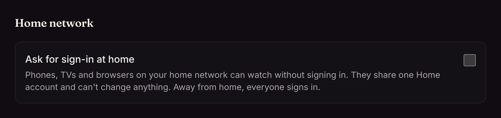

Matinee is built so nobody at home needs to know an IP address or have an account to put something on.

## The apps find the server

Matinee announces itself on your home network (over multicast DNS, also called Bonjour). The phone and TV apps list it on their first screen, and go straight to it when it's the only one.

| How you run Matinee | Found by the apps? |
| --- | --- |
| apt, dnf, Homebrew, from source | yes, as it is |
| Docker | only with `--network host`; on the default bridge network the announcement can't get out |
| Kubernetes | yes: the chart runs a small announcer on a node's host network that points the apps at your ingress. If the ingress is managed outside the chart, set `discovery.url` to the address you open Matinee at |

To keep a server unlisted, set `MATINEE_DISCOVERY=false` (`discovery.enabled=false` in the chart). The apps can still connect by typing the address. `MATINEE_SERVER_NAME` sets the name they show.

## Watching without signing in

Phones, TVs and browsers on your home network can browse and play without an account. They share one **Home** account, so they share its watch progress, and they can't change anything: no settings, no downloads, no approving devices, no requests. Away from home, everyone signs in.

To make everyone sign in at home too, turn on **Settings → Network → Home network → Ask for sign-in at home**.

The Home account can have [profiles](/docs/household/profiles/#profiles-at-home), so the family TV can still keep everyone's place apart.

## How Matinee knows you're at home

Matinee decides a device is at home by the address its connection comes from, and only when nothing sits in between:

- **apt, dnf, Homebrew, source, and Docker with `--network host`:** a device with a private address (such as `192.168.x.x`) connecting straight to the server counts as home.
- **Behind a reverse proxy or ingress,** every request arrives from the proxy, including ones from the internet, so requests through it never count as home. Give the home network its own way in with `MATINEE_HOME_ADDR` (for example `:7172`); only connections there count, and the apps at home use it. Don't forward that port from your router.
- **Kubernetes:** the chart does this for you. It opens port 7172 on the server's node (`discovery.homePort`) and runs the announcer on the same node, so the apps at home connect there and use your ingress address away from home. Set `discovery.homePort=0` to turn it off.

If something in front of Matinee rewrites addresses without saying so, such as a port forward that makes internet traffic look like it comes from your router, turn on **Ask for sign-in at home**.
