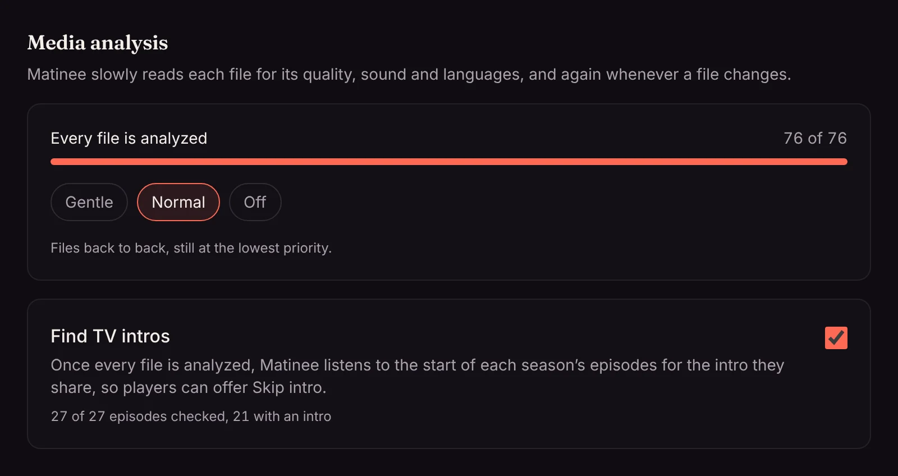

In the background, Matinee reads each file for what's inside: resolution, HDR (HDR10, HDR10+, HLG, Dolby Vision), codecs and bitrates, audio channels, Dolby Atmos and languages, subtitles, and where the credits start.

That's where the badges on titles come from, along with the **Quality** [filters](/docs/watching/browsing/#filters) (4K, HDR, Atmos…), the [File details](/docs/watching/title-pages/#file-details), and the timing of [Up next](/docs/watching/playing/#up-next).

<!-- since: v0.1.10 -->
Once every file is analyzed, Matinee goes on to listen to the start of each season's episodes for the intro they share, for [Skip intro](/docs/watching/skipping-intros/). **Find TV intros** on the same card turns that off, and shows how far it is.
<!-- /since -->

## Gentle on your server

The analysis reads one file at a time at the lowest priority, waits while someone's watching something being converted, and rests for a few minutes when files are slow to read. It looks at a file again only when the file changes, so after the first pass it has little to do.

Admins can see its progress under **Settings → Libraries → Media analysis** and pick a speed:

| Speed | |
| --- | --- |
| **Gentle** (default) | One file every few seconds, and none while the server is converting something for playback. |
| **Normal** | Files back to back, still at the lowest priority. Good for the first pass over a new library. |
| **Off** | Paused until you turn it back on. |

On a big library the first pass on Gentle takes a while; switch to Normal to hurry it along. Everything works in the meantime, and titles get their badges as they're reached.
