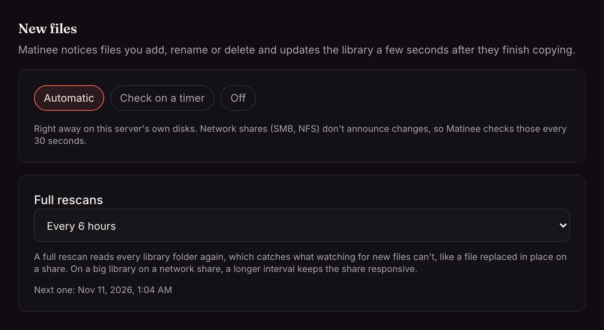

Copy a film into a library folder and it shows up in Matinee a few seconds after the copy finishes. Rename or delete files and the library follows. Only the changed file or folder is scanned, so this stays quick on big libraries.

**Settings → Libraries → New files** has three ways to watch:

| Mode | How it works |
| --- | --- |
| **Automatic** (default) | Folders on the server's own disks announce changes the moment they happen. Network shares (SMB, NFS) can't, so Matinee checks those every 30 seconds by looking at each folder's modification time, which is cheap even on a big library. |
| **Check on a timer** | Every folder is checked every 30 seconds. Pick this if new files on a disk don't show up by themselves. |
| **Off** | New files show up at the next full rescan, or when you press **Scan** next to a library. |

Each library under **Settings → Libraries** says how it's watched.

<!-- since: v0.2.0 -->
## Upgraded and renamed files

When a file is swapped for a better copy (say a download tool replaces a 1080p film with a 4K one), renamed, or moved into its own folder, Matinee sees it's the same title and moves the new file onto the existing one. Everyone keeps their watched marks, resume points, ratings, watch lists, collections, playlists, downloads and found subtitles.

Matinee knows it's the same title when it's:

- a movie with the same title and year,
- an episode with the same show, season and episode number,
- a song or audiobook part with the same album or book, number and title.

Download tools often delete the old copy first and move the new one in a few minutes later. So when a watched folder loses a file, Matinee keeps it listed for 10 minutes, waiting for the file that replaces it, before it removes it. A full rescan or the **Scan** button removes missing files straight away, after looking for what replaced them.

Intro and credits markers and seek bar pictures are made again in the background when the new file is different.
<!-- /since -->

## Full rescans

As well, Matinee rescans every library in full every 15 minutes to catch anything else. Change that with `MATINEE_SCAN_INTERVAL` (such as `1h`), or `0` to turn it off.

## Big libraries on slow shares

`MATINEE_WATCH_POLL_INTERVAL` sets how often network shares are checked (default `30s`). A big library on a slow share is checked less often by itself, so the share stays responsive.
