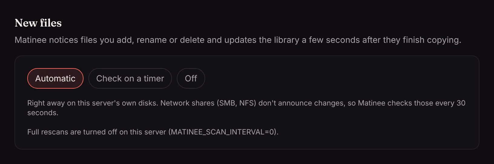

Copy a film into a library folder and it shows up in Matinee a few seconds after the copy finishes. Rename or delete files and the library follows. Only the changed file or folder is scanned, so this stays quick on big libraries.

**Settings → New files** has three ways to watch:

| Mode | How it works |
| --- | --- |
| **Automatic** (default) | Folders on the server's own disks announce changes the moment they happen. Network shares (SMB, NFS) can't, so Matinee checks those every 30 seconds by looking at each folder's modification time, which is cheap even on a big library. |
| **Check on a timer** | Every folder is checked every 30 seconds. Pick this if new files on a disk don't show up by themselves. |
| **Off** | New files show up at the next full rescan, or when you press **Scan** next to a library. |

Each library under **Settings → Libraries** says how it's watched.

## Full rescans

As well, Matinee rescans every library in full every 15 minutes to catch anything else. Change that with `MATINEE_SCAN_INTERVAL` (such as `1h`), or `0` to turn it off.

## Big libraries on slow shares

`MATINEE_WATCH_POLL_INTERVAL` sets how often network shares are checked (default `30s`). A big library on a slow share is checked less often by itself, so the share stays responsive.
