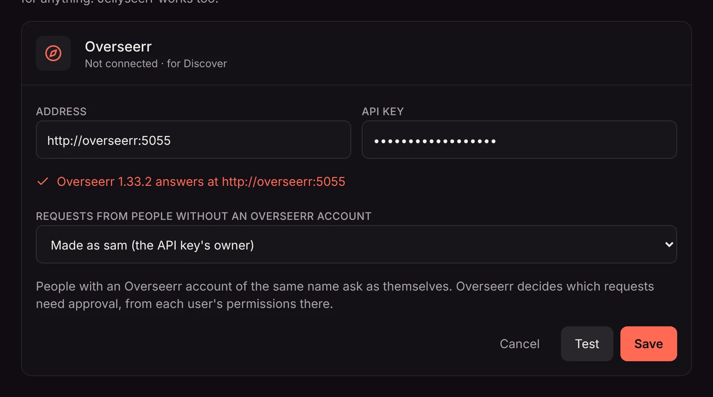

If you run [Overseerr](https://overseerr.dev/), or Jellyseerr, which works the same way, connect it to Matinee and everyone gets a [Discover](/docs/watching/discover/) tab: recommendations based on what they watched, what's trending and coming up, and a way to ask for any movie or show.

## Connecting

1. Open **Settings → Add-ons → Radarr and Sonarr**. Overseerr is at the bottom of the section.
2. Click **Connect** and enter Overseerr's address, such as `http://overseerr:5055`, and its API key. You'll find the key in Overseerr under **Settings → General**.
3. Click **Test**. Matinee checks the address and key and lists Overseerr's users.
4. Choose whose name requests are made in for people who don't have an Overseerr account, then **Save**.

The Discover tab appears straight away. **Disconnect** takes it away again.

## Who requests are made as

Matinee asks Overseerr in the name of the person asking, so Overseerr's own rules apply: who needs approval, request limits, and which quality and folder titles get.

- Someone whose Matinee name matches an Overseerr user's name, username or email (before the @) asks as that user.
- Everyone else asks as the user you chose when connecting. By default that's the API key's owner.
- A [profile](/docs/household/profiles/) asks as the account it belongs to.

Who may ask at all is set by **Who can add movies and shows**, the same setting [Radarr and Sonarr](/docs/server/radarr-and-sonarr/#who-can-add-titles) use. With **Only admins add titles**, everyone else can browse Discover but not ask.

## Overseerr and Radarr or Sonarr together

They work side by side. Requests from **Discover** go through Overseerr, while **Requests** (the inbox icon), **Coming soon** and problem reports work with the Radarr and Sonarr you connected to Matinee directly. You can connect Overseerr without connecting Radarr or Sonarr to Matinee at all.
