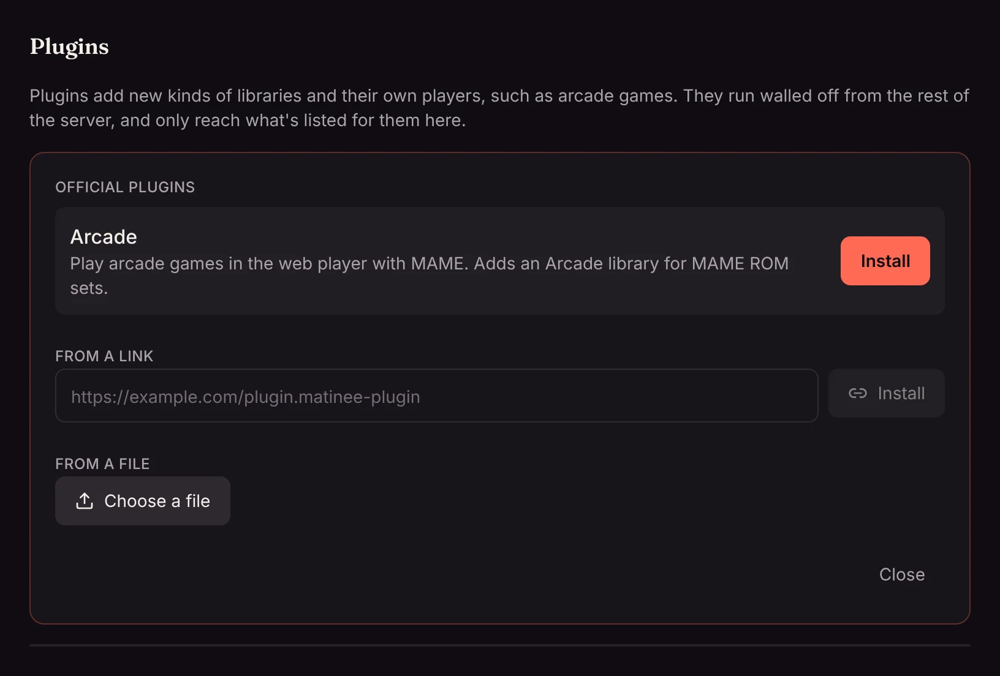

Plugins add things Matinee doesn't do by itself: a new kind of library with its own player, such as [arcade games](/docs/server/arcade/), or something that happens when a title is added or someone starts watching. Only admins can add them, in **Settings → Add-ons → Plugins**.

## Adding a plugin

1. Open **Settings → Add-ons → Plugins** and click **Add plugin**.
2. Pick one of the **Official plugins** and click **Install**. You can also install one from a link someone gave you, with **From a link**, or a `.matinee-plugin` file you downloaded, with **From a file**.
3. The plugin appears in the list, turned off. Click its name to see what it adds and what it can reach (below), then click **Turn on**.

A plugin that adds a kind of library shows up as a new choice when you [add a library](/docs/getting-started/first-run/). Its titles get their own player in the web player.

Installing a newer version of a plugin you have replaces it and keeps it on, along with its settings.

## What a plugin can reach

Plugins run walled off from the rest of Matinee. Each one can only reach:

- **Its own libraries' folders**, and only to read them. It can't change or delete your files, or see any other folder on the server.
- **The websites it lists**, such as a site with game artwork. Matinee asks before you turn a plugin on: *It will be able to reach…* A plugin that lists none never goes on the internet.

If an update to a plugin asks to reach more websites than before, Matinee turns it off until you turn it on again and agree.

A plugin's player can't see your password or act as you. It only gets the title it plays, and a place to keep things for each person, such as their saved games.

Only install plugins you trust, the same as any other software, since a plugin decides what its libraries show.

## Settings, turning off and removing

Click a plugin's name to open it:

- Some plugins have settings, such as an API key for a website. Fill them in and click **Save**.
- **Turn off** stops the plugin. Libraries it added stay, with their titles, but aren't scanned and can't be played until you turn it on again.
- **Remove** deletes the plugin, along with what it kept for everyone, such as saved games. Its libraries stay until you remove them in **Settings → Libraries**.

## If a plugin isn't running

A plugin that's on but shows **Not running** says why underneath. The usual reasons:

- **Made for a different version of Matinee**: update Matinee, or get the version of the plugin that matches yours.
- **It now asks to reach** a new website: turn it on again to agree.
- **Another plugin already adds a library kind with this name**: two plugins can't both add, say, an Arcade library. Remove one of them.

## For server admins

Plugins live in the `plugins` folder of Matinee's data folder. With the [Helm chart](/docs/server/kubernetes/) they're kept on a volume of their own (`plugins.persistence`), since the data folder there is rebuilt on every restart.

To turn plugins off on a server altogether, set `MATINEE_PLUGINS=false` ([settings reference](/docs/server/configuration/)).

Writing a plugin? Start with [How plugins work](/docs/plugins/overview/) and [Your first plugin](/docs/plugins/first-plugin/).
