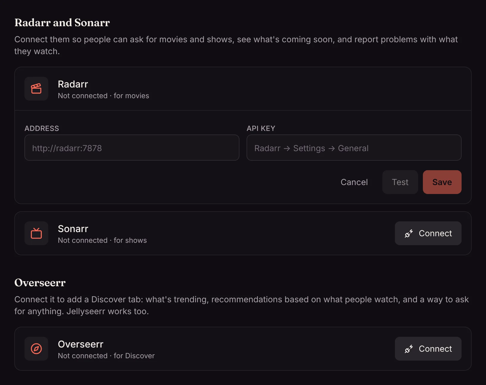

If you use [Radarr](https://radarr.video/) for movies or [Sonarr](https://sonarr.tv/) for TV, Matinee can work with them. People ask for titles from Matinee, see what's on its way, and report bad files, and Radarr and Sonarr do the downloading.

## Connecting

1. Open **Settings → Add-ons → Radarr and Sonarr** and click **Connect** next to Radarr (or Sonarr).
2. Enter its address, such as `http://radarr:7878`, and its API key. You'll find the key in Radarr or Sonarr under **Settings → General**.
3. Click **Test**, then pick the quality profile and root folder that new titles get, and **Save**.

The address and key stay on the server; nobody's browser or app ever sees them.

## Disconnecting

To stop using Radarr or Sonarr (for example after you turn it off, or move to Box Office), click **Disconnect** next to it under **Settings → Add-ons** and confirm. On a phone it's the unplug button. It works even when the app isn't answering any more. When Box Office is connected, the Radarr and Sonarr entries say **Movies go through Box Office** and **Shows go through Box Office**. That's Box Office's own connection, not the Radarr or Sonarr apps, so they have no Disconnect of their own: disconnect Box Office instead. Titles already in Radarr or Sonarr stay there, and asking for titles and **Coming soon** turn off until something is connected again.

<!-- since: v0.2.3 -->
## Box Office

[Box Office](https://github.com/yeixio/boxoffice) finds and downloads movies and shows, and answers Matinee the way Radarr and Sonarr do. It has its own entry, first in the list, so one connection does both jobs:

1. Open **Settings → Add-ons**. Matinee looks for Box Office as soon as the page opens, and when it finds one, **Box Office** says *Found on your network* with its address. Click **Connect**: the address is already filled in. Change it if you'd rather use another, or click another one Matinee found.
2. Paste Box Office's API key. In Box Office, sign in as an admin, open **Settings → Connect Matinee**, and use the copy button next to **API key**.
3. Click **Test**, then **Save**.

Saving points Radarr at `<address>/radarr` and Sonarr at `<address>/sonarr` with that key, keeping the quality profile and root folder they had when Box Office has them, else Box Office's first. Change those under Radarr and Sonarr below. If Box Office has no TV (or movie) root folder yet, only the other kind connects until you add one and save again. Disconnecting Box Office disconnects both.

### How Matinee finds Box Office

Matinee asks each of these places whether it's Box Office, and nothing goes through Yeix or any other service. It tries, in this order:

- wherever Radarr or Sonarr already go;
- `boxoffice:7272`, its name in Kubernetes or Docker Compose, and port 7272 on the same machine;
- `boxoffice.` beside Matinee's own domain, such as `https://boxoffice.example.com` for `https://matinee.example.com`;
- Box Office announcing itself on the home network (it does this on its own, as `_boxoffice._tcp`, unless it's started with `BOXOFFICE_ANNOUNCE=false`);
- port 7272 on the other computers on Matinee's own home network (the 256 addresses around its own).

Only an address that answers as Box Office is listed. If Box Office listens on another port or Matinee runs somewhere it can't see the home network, such as inside Kubernetes without Box Office beside it, type the address.
<!-- /since -->

## Who can add titles

Under **Who can add movies and shows**, pick one:

| Choice | What happens |
| --- | --- |
| **Ask, then an admin approves** (the default) | Anyone with an account can ask for a title. It waits for an admin. |
| **Add right away** | What people ask for goes straight to Radarr or Sonarr. |
| **Only admins add titles** | Everyone else can still see what's coming soon and report problems. |

## Requests

**Requests** (the inbox icon in the top bar) has up to three tabs:

- **Ask for something:** search for any movie or show and ask for it (or **Add** it, when requests are added right away).
- **Requests:** admins see everyone's requests here and **Approve** or **Decline** them. Everyone else sees **Your requests** and where each one is up to.
- **Problems:** reports from **Report a problem** on a title's page. An admin can **Close** one once it's sorted, or click **Replace file**, which deletes the file in Radarr or Sonarr and has it download another copy. Everyone else sees **Your reports**.

## Notifications from Box Office

When Radarr or Sonarr is [Box Office](https://github.com/yeixio/boxoffice), Matinee tells people in the web player and the phone and TV apps when something they asked for is found and downloading, and when it's ready to watch. The bell in the top bar lists them. There's nothing else to set up: Matinee checks Box Office every half a minute with the address and key you already gave it.

Admins also hear about downloads that fail or look unsafe. Under **Settings → Add-ons → Radarr and Sonarr**, pick what admins hear about: **Problems** (the default), **Everything**, or **Only their own**.

<!-- since: v0.2.3 -->
On phones and tablets, people can also get these as the device's own notifications with the app closed: see [Notifications on your phone](/docs/apps/notifications/).
<!-- /since -->

## Coming soon

**Coming soon** (the calendar icon) lists new episodes and movie releases due in the next two months that aren't in your library yet. The same titles appear in a row on [Home](/docs/watching/home/), and in the [phone and TV apps](/docs/apps/phone-and-tv/).

## Changing quality

On a movie or show's page, admins can change the quality profile Radarr or Sonarr uses for it, for example to upgrade a favorite to 4K.

:::note
Devices at home that haven't signed in can see **Coming soon**, but can't ask for titles or report problems. See [Home network](/docs/server/home-network/).
:::
