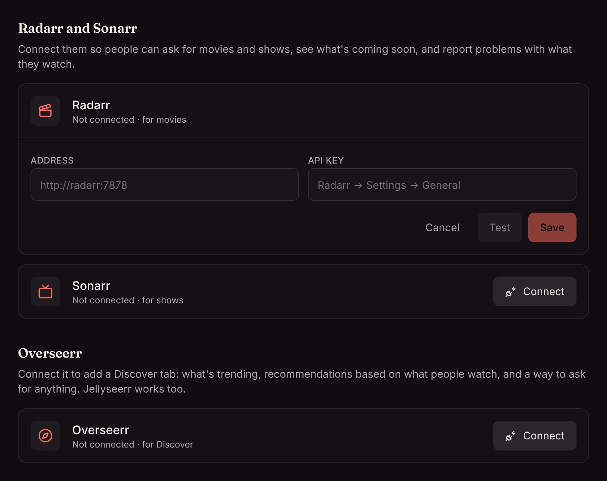

If you use [Radarr](https://radarr.video/) for movies or [Sonarr](https://sonarr.tv/) for TV, Matinee can work with them. People ask for titles from Matinee, see what's on its way, and report bad files, and Radarr and Sonarr do the downloading.

## Connecting

1. Open **Settings → Add-ons → Radarr and Sonarr** and click **Connect** next to Radarr (or Sonarr).
2. Enter its address, such as `http://radarr:7878`, and its API key. You'll find the key in Radarr or Sonarr under **Settings → General**.
3. Click **Test**, then pick the quality profile and root folder that new titles get, and **Save**.

The address and key stay on the server; nobody's browser or app ever sees them.

## Who can add titles

Under **Who can add movies and shows**, pick one:

| Choice | What happens |
| --- | --- |
| **Ask, then an admin approves** (the default) | Anyone with an account can ask for a title. It waits for an admin. |
| **Add right away** | What people ask for goes straight to Radarr or Sonarr. |
| **Only admins add titles** | Everyone else can still see what's coming soon and report problems. |

## Requests

**Requests** (the inbox icon in the top bar) has up to three tabs:

- **Ask for something:** search for any movie or show and ask for it (or **Add** it, when requests are added right away).
- **Requests:** admins see everyone's requests here and **Approve** or **Decline** them. Everyone else sees **Your requests** and where each one is up to.
- **Problems:** reports from **Report a problem** on a title's page. An admin can **Close** one once it's sorted, or click **Replace file**, which deletes the file in Radarr or Sonarr and has it download another copy. Everyone else sees **Your reports**.

## Coming soon

**Coming soon** (the calendar icon) lists new episodes and movie releases due in the next two months that aren't in your library yet. The same titles appear in a row on [Home](/docs/watching/home/), and in the [phone and TV apps](/docs/apps/phone-and-tv/).

## Changing quality

On a movie or show's page, admins can change the quality profile Radarr or Sonarr uses for it, for example to upgrade a favorite to 4K.

:::note
Devices at home that haven't signed in can see **Coming soon**, but can't ask for titles or report problems. See [Home network](/docs/server/home-network/).
:::
