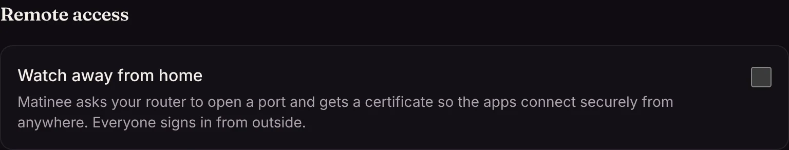
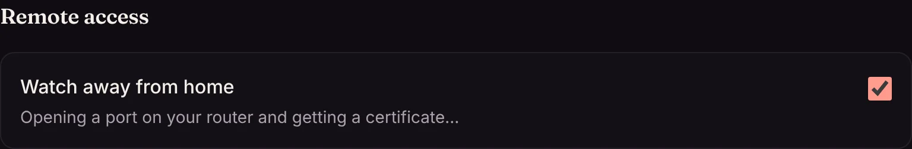
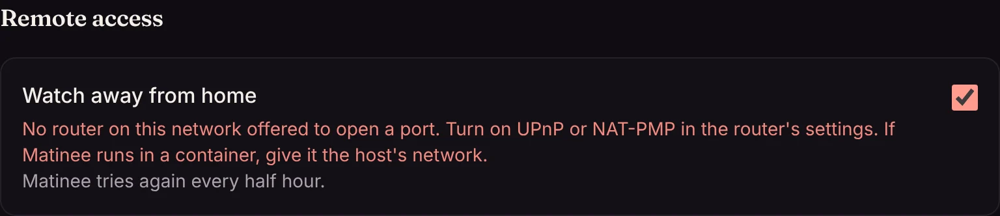

Turn on **Settings → Remote access → Watch away from home** and Matinee sets itself up to be reached from outside your home, with nothing to configure on the router.

## What it does

1. **Opens a port.** It asks your router to forward a port to it (7443, or another the router picks) over UPnP or NAT-PMP. Most home routers allow this; if yours doesn't, turn on UPnP in its settings.
2. **Gets a certificate.** It gets an HTTPS certificate for your public IP address from [Let's Encrypt](https://letsencrypt.org/), so phones and browsers trust the connection. For the check, Let's Encrypt connects once through port 443 or 80, which Matinee forwards for a minute and closes again. This also proves the internet can reach the server. The certificate lasts six days and renews by itself, and a new one is fetched when your address changes.
3. **Tells the apps.** The apps pick up the outside address while they're at home and use it when they're away.

<!-- since: v0.1.1 -->
4. **Keeps the apps able to find it.** Matinee tells a small lookup service run by the Matinee project its current public address every few minutes. If your address changes while you're away, the apps look the server up there and connect to the new address. Settings says so once it works.

Everyone signs in from outside. Nothing that arrives through this port counts as [home](/docs/server/home-network/).

### The video never goes through anyone else

The apps always connect straight to your server. The lookup service only ever learns the server's public address and a random id that comes from a key on your server; it never sees your library, your accounts, or anything you watch, and nothing streams through it. There is no relay. If the internet can't reach your server directly, Matinee tells you what to change rather than sending your video through someone else's computer.

To not use the lookup service, set `MATINEE_CONNECT_URL=off`. The apps then learn a new address only when they're back home.

## When it doesn't work

Settings shows what stands in the way.

Two setups can't be reached directly:

- An internet provider that shares one public address among many customers (called carrier-grade NAT, common on mobile and some fiber connections).
- A second router in front of yours, such as an ISP modem that also routes.

In both cases, ask your provider for a public address (many give one for free or a small fee when asked), put the modem in bridge mode, or use your own domain through a tunnel or VPN (below).

<!-- since: v0.1.1 -->
### Forwarding a port yourself

If your router won't open a port when asked, and you'd rather not turn on UPnP, forward one in the router's settings:

1. Forward TCP port **443** on the router to port **7443** on the computer running Matinee. If 443 is taken, use port 80 instead.
2. In **Settings → Remote access**, set **Router port** to the port you forwarded.

Matinee asks the lookup service to try connecting to that port from outside, so if the forward doesn't work yet, Settings says so right away. Let's Encrypt then checks through the same port and the certificate renews there by itself. Only 443 and 80 work, since those are the ports Let's Encrypt checks.

## Where it's available

Remote access needs Matinee on the host's network: apt, dnf, Homebrew, source, or Docker with `network_mode: host`. It isn't offered in the Helm chart, where the ingress is the way in. To not offer it at all, set `MATINEE_REMOTE_ADDR=off`.

## Using your own domain instead

If you already reach Matinee at your own address, through a reverse proxy, a tunnel or a VPN, set `MATINEE_PUBLIC_URL` (such as `https://matinee.example.com`) and the apps use that away from home.
