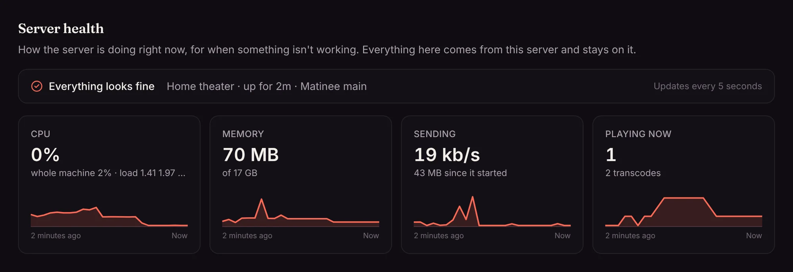
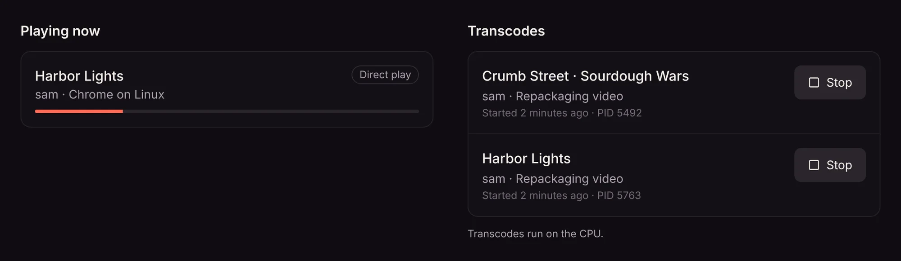
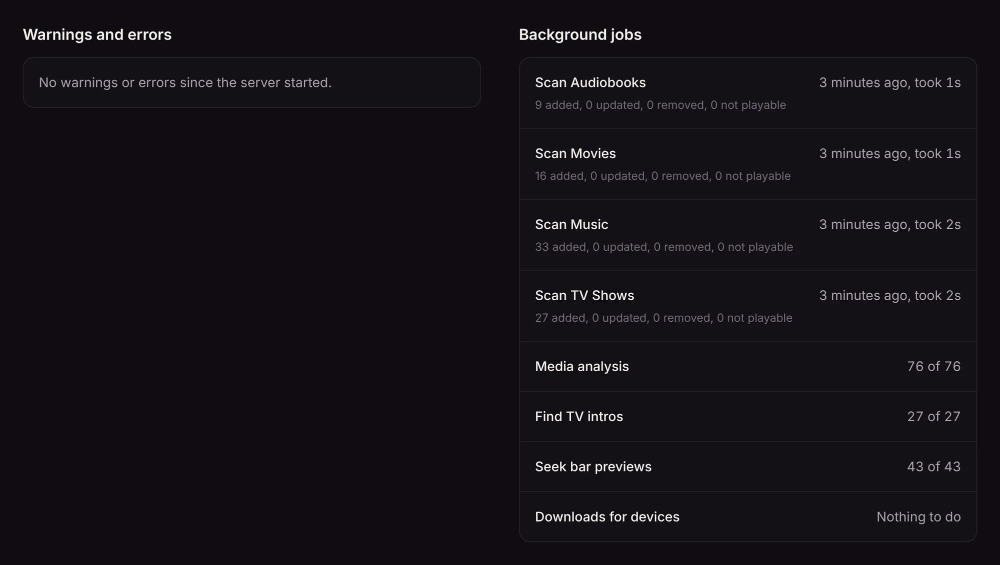
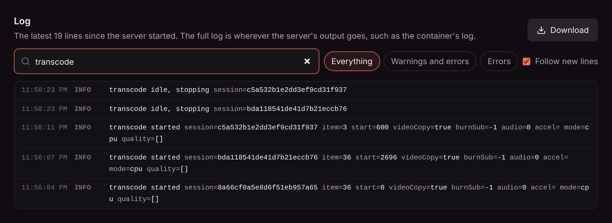

When something isn't working, **Settings → Server health** is the place to start. It's for admins, and it shows in one page what the server is doing right now and what has gone wrong lately. It updates every 5 seconds.

Everything on it comes from your own server. Nothing is sent anywhere.

## At the top

A line says whether all looks well, or how many warnings and errors there were in the last hour, along with how long the server has been up and its version. It also calls out the bigger problems first: a database that doesn't answer, a folder that can't be read, or a server that's restarting.

Below it are four readings, each with a chart of the last hour. Point at a chart to see the value at that moment.

| Reading | What it shows |
| --- | --- |
| **CPU** | How much of the machine's processors Matinee uses, with the whole machine's use and load average next to it where the system reports them. |
| **Memory** | How much memory Matinee uses, out of the machine's memory or the container's limit. |
| **Sending** | How fast the server is sending right now, and how much it has sent since it started. Video is most of it. |
| **Playing now** | How many players are playing, and how many transcodes are running. |

On Linux, including Docker and Kubernetes, CPU and memory include the FFmpeg processes Matinee runs to convert video, so a busy transcode shows up there. On a Mac or Windows they count the server alone. Hover over the reading to see which.

## Playing now and transcodes

**Playing now** lists every player that has something open: who, on which device and app, how far along, and whether it plays the file directly or the server is converting it. Players away from home are marked.

**Transcodes** lists what FFmpeg is working on: the title and who it's for, whether it converts the picture or only repackages it, whether the GPU does the work (and how much of it), the quality, and whether subtitles are drawn into the picture. Below the list is the GPU new transcodes use, as in **Settings → Streaming → Transcoding**.

**Stop** ends a transcode that's stuck. If the player is still open, it asks for a new one when it carries on, so stopping is safe.

## Warnings and errors

The same warning or error is listed once, with how often it happened and when it last did. Click one to see its details, and **Show in log** to find it in the log below with everything that happened around it.

The list starts empty each time the server starts.

## Background jobs

- **Scan** for each library: whether it's being scanned now, and how the last full scan since the server started went (how long it took, what it added, updated and removed, and files that couldn't be played).
- **Media analysis**, **Find TV intros** and **Seek bar previews**: how far they are. See [Media analysis](/docs/server/media-analysis/).
- **Downloads for devices**: downloads waiting to be converted, being converted, and ones that failed.
- **Importing watch history**, while an [import](/docs/getting-started/switching/) runs.

## Disk space

Free space on every disk the server uses: its data folder (with the database, if it's SQLite), the transcoding scratch space, seek bar previews, posters and artwork, downloads, and each library folder. Folders on the same disk are listed together, and a disk turns red when it's nearly full.

A library folder that can't be read is called out. That's usually a network share that has dropped, so check the share is still connected and mounted.

## Server details

The version, FFmpeg's version and where it is, the operating system, when the server started, the database (SQLite or PostgreSQL, its size and how quickly it answers), how many requests the server has answered and how many failed, scheduled rescans, remote access, and a few numbers about the server process for bug reports.

## The log

The page keeps the latest 5,000 lines the server has logged since it started. Search them, show only warnings and errors, or only errors, and turn off **Follow new lines** to stop the list from moving while you read.

**Download** saves the lines you're looking at as a text file, which is the thing to attach to a bug report.

The full log is wherever the server's output goes: `docker logs matinee` with Docker, `kubectl logs` on Kubernetes, `journalctl -u matinee` with a Linux package, and **Show log** in the menu of the [Mac](/docs/getting-started/mac/) and [Windows](/docs/getting-started/windows/) apps. Set `MATINEE_DEBUG=1` to log more detail, including every request; the page keeps those lines too.
