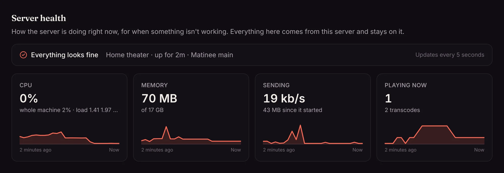
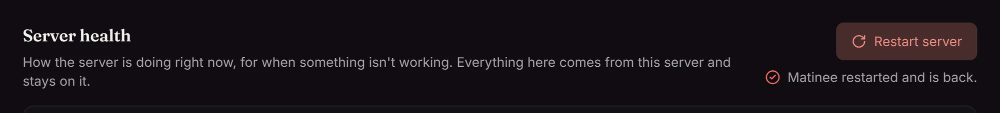
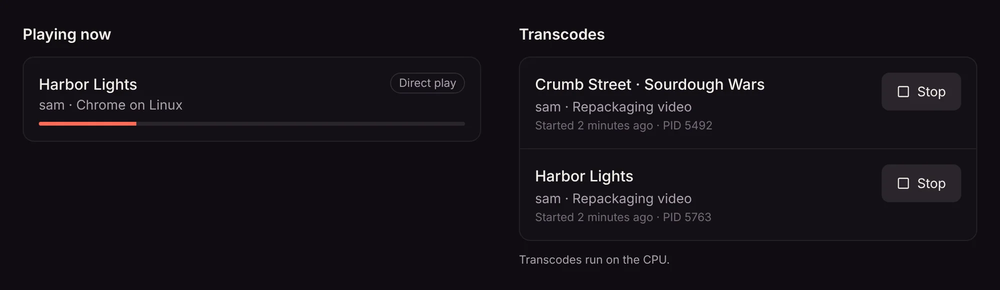
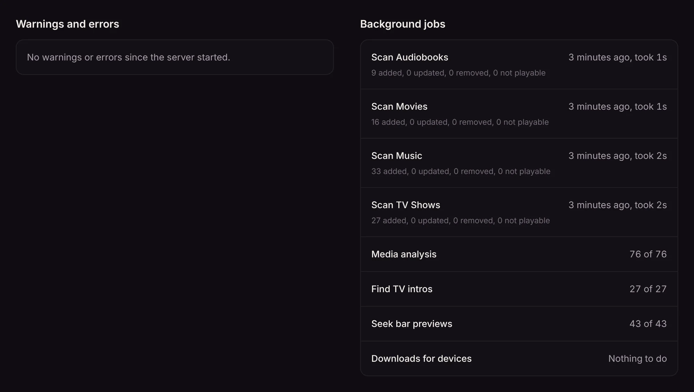
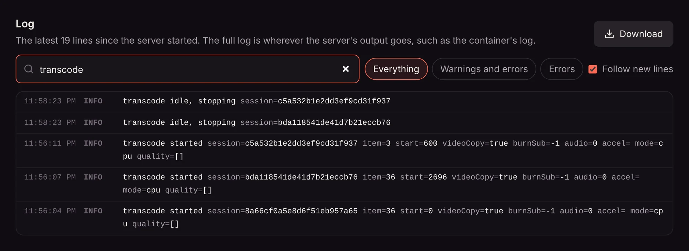
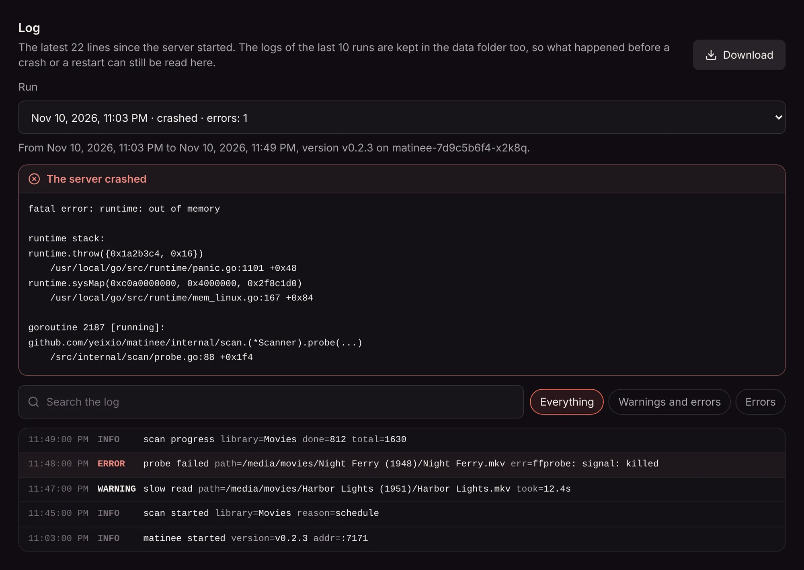

When something isn't working, **Settings → Server health** is the place to start. It's for admins, and it shows in one page what the server is doing right now and what has gone wrong lately. It updates every 5 seconds.

Everything on it comes from your own server. Nothing is sent anywhere.

<!-- since: v0.1.12 -->
To be told when something goes wrong instead of checking, set up [alerts](/docs/server/alerts/) further down the same page.
<!-- /since -->

## At the top

A line says whether all looks well, or how many warnings and errors there were in the last hour, along with how long the server has been up and its version. It also calls out the bigger problems first: a database that doesn't answer, a folder that can't be read, or a server that's restarting.

<!-- since: v0.2.0 -->
When the server can't reach the internet, a line under the status says **No internet connection** and for how long, and which sites aren't answering. Lookups that wait for it aren't listed as problems. See [When the internet is down](/docs/server/no-internet/).
<!-- /since -->

Below it are four readings, each with a chart of the last hour. Point at a chart to see the value at that moment.

| Reading | What it shows |
| --- | --- |
| **CPU** | How much of the machine's processors Matinee uses, with the whole machine's use and load average next to it where the system reports them. |
| **Memory** | How much memory Matinee uses, out of the machine's memory or the container's limit. |
| **Sending** | How fast the server is sending right now, and how much it has sent since it started. Video is most of it. |
| **Playing now** | How many players are playing, and how many transcodes are running. |

On Linux, including Docker and Kubernetes, CPU and memory include the FFmpeg processes Matinee runs to convert video, so a busy transcode shows up there. On a Mac or Windows they count the server alone. Hover over the reading to see which.

<!-- since: v0.2.4 -->
## Restart the server

**Restart server**, at the top right of Server health, stops Matinee and starts it again. It's there for when something seems stuck, to finish [restoring a backup](/docs/server/backups/), or to switch to a new [time zone](/docs/server/configuration/#time-zone).

Matinee asks first, and says how many streams are playing. It restarts the same way it does for an [update](/docs/server/updates/): anyone watching or listening sees that the server is restarting, and their player picks up where it was once it's back, usually within a few seconds. Server health waits for it and says when it's back. If it isn't back after two minutes, the page says so; look at the server's log, or start it again the way you installed it.

Matinee starts again with the same settings it started with. To pick up a change to its [environment variables](/docs/server/configuration/), such as in `matinee.env` or your `docker-compose.yml`, restart it the way you installed it instead: `sudo systemctl restart matinee`, `brew services restart matinee`, **Restart server** in the Mac app's menu, or recreating the container.

The button is there on Linux, macOS, Docker and Kubernetes, and on Windows when the Matinee tray app runs the server.
<!-- /since -->

## Playing now and transcodes

**Playing now** lists every player that has something open: who, on which device and app, how far along, and whether it plays the file directly or the server is converting it. Players away from home are marked.

<!-- since: v0.2.0 -->
When a stream stopped to buffer in the last few minutes, it says why under the title: the server read the file slowly, converted slower than real time, or the connection was slower than the video. See [Why it buffered](/docs/watching/why-it-buffered/).
<!-- /since -->

**Transcodes** lists what FFmpeg is working on: the title and who it's for, whether it converts the picture or only repackages it, whether the GPU does the work (and how much of it), the quality, and whether subtitles are drawn into the picture. Below the list is the GPU new transcodes use, as in **Settings → Streaming → Transcoding**.

<!-- since: v0.2.4 -->
Under the list is the room transcodes have left. When long videos don't fit, it turns into a warning and those transcodes are marked *short of room*: they keep only the minutes around where they play. It also warns when a video couldn't play for lack of room in the last half hour. See [When the transcode folder runs short of room](/docs/server/transcoding/#when-the-transcode-folder-runs-short-of-room).
<!-- /since -->

**Stop** ends a transcode that's stuck. If the player is still open, it asks for a new one when it carries on, so stopping is safe.

## Warnings and errors

The same warning or error is listed once, with how often it happened and when it last did. Click one to see its details, and **Show in log** to find it in the log below with everything that happened around it.

The list starts empty each time the server starts.

## Background jobs

- **Scan** for each library: whether it's being scanned now, and how the last full scan since the server started went (how long it took, what it added, updated and removed, and files that couldn't be played).<!-- since: v0.2.4 --> It also says what started the scan: the scheduled [full rescan](/docs/server/new-files/#full-rescans), new or changed files in a watched folder, someone pressing **Scan**, or the server itself (say, for a library just added). **Stop scan** stops one that's running; see [Stopping a scan](/docs/server/new-files/#stopping-a-scan).<!-- /since -->
- **Media analysis**, **Find TV intros** and **Seek bar previews**: how far they are. See [Media analysis](/docs/server/media-analysis/).
- **Downloads for devices**: downloads waiting to be converted, being converted, and ones that failed.
- **Importing watch history**, while an [import](/docs/getting-started/switching/) runs.
<!-- since: v0.2.4 -->
- **Videos that couldn't be read**: videos the seek bar previews couldn't be made of, by title, each linking to its page (hover for the file's path). They're most likely damaged, such as a download whose end was never written. A video lands here when making its previews failed, or timed out from its start or before its middle while its network share was answering (a video whose end alone can't be read keeps its previews up to there); a timeout while the share isn't answering doesn't count, so a share that drops for a while doesn't put good files here. Replace them, for example by having Box Office or Radarr grab them again; each one is tried again once its file changes. With Box Office connected, a video that kept timing out is reported to it by itself, and it gets another copy (see [Problems Box Office fixes by itself](/docs/server/radarr-and-sonarr/#problems-box-office-fixes-by-itself)).
<!-- /since -->

## Disk space

Free space on every disk the server uses: its data folder (with the database, if it's SQLite), the transcoding scratch space, seek bar previews, posters and artwork, downloads, and each library folder. Folders on the same disk are listed together, and a disk turns red when it's nearly full.

A library folder that can't be read is called out. That's usually a network share that has dropped, so check the share is still connected and mounted.

## Server details

The version, FFmpeg's version and where it is, the operating system, when the server started, the database (SQLite or PostgreSQL, its size and how quickly it answers), how many requests the server has answered and how many failed, scheduled rescans, remote access, and a few numbers about the server process for bug reports.

## The log

The page keeps the latest 5,000 lines the server has logged since it started. Search them, show only warnings and errors, or only errors, and turn off **Follow new lines** to stop the list from moving while you read.

**Download** saves the lines you're looking at as a text file, which is the thing to attach to a bug report.

<!-- since: v0.2.4 -->
### Earlier runs and crashes

Each time the server runs, it also saves its log to the `logs` folder in its data folder, as it goes. So when the server crashes, is killed for using too much memory, loses power or is replaced by a new container, its last lines are still there after it comes back.

When the server has run more than once, **Run** above the log picks which run to read: **This run**, or an earlier one by when it started, with whether it stopped cleanly, crashed or stopped unexpectedly, and how many errors it logged. An earlier run shows when it started and ended, its version, and the machine or pod it ran on. If it crashed, what the server printed as it crashed comes first: the first lines say what went wrong and where. Search, the level buttons and **Download** work on an earlier run too, and its download ends with the crash.

The last 10 runs are kept, each up to about 32 MB (when a run logs more, its oldest lines go first). The [restart alert](/docs/server/alerts/) points here when the server stopped without shutting down cleanly.

On Kubernetes, the Helm chart keeps the `logs` folder on a volume of its own (`logs.persistence`, see [Kubernetes](/docs/server/kubernetes/)), so a new pod sees the logs of the pods before it. With Docker, it's in the data folder you mounted (`./data/logs` in the example `docker-compose.yml`).
<!-- /since -->

The full log is wherever the server's output goes: `docker logs matinee` with Docker, `kubectl logs` on Kubernetes, `journalctl -u matinee` with a Linux package, and **Show log** in the menu of the [Mac](/docs/getting-started/mac/) and [Windows](/docs/getting-started/windows/) apps. Set `MATINEE_DEBUG=1` to log more detail, including every request; the page keeps those lines too.
