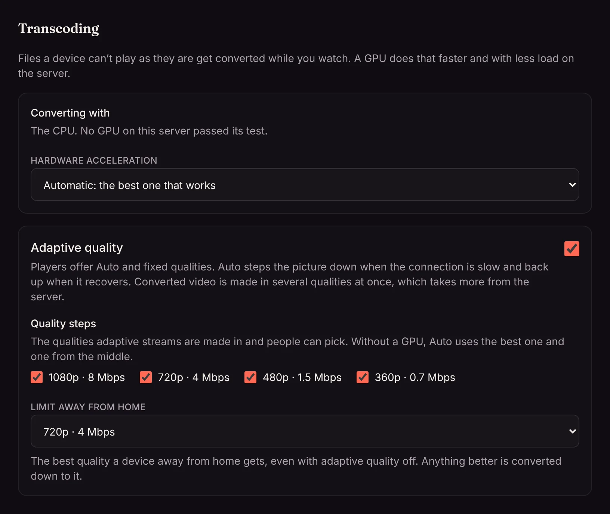
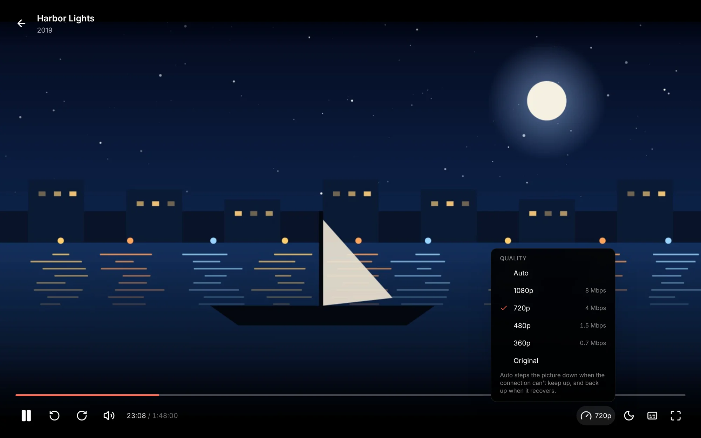

On a slow or busy connection (a phone on mobile data, a hotel's Wi-Fi, a crowded network at home) a film can play faster than it arrives, and the player stops to buffer. **Adaptive quality** fixes that: the picture steps down to a lighter stream when the connection struggles and back up when it recovers, the way the big streaming services work.

It's off until an admin turns it on, because it asks more of the server.

## Turning it on

In **Settings → Streaming → Transcoding**, turn on **Adaptive quality**, then pick the **Quality steps** players can use:

| Step | Picture | Video | Sound |
| --- | --- | --- | --- |
| 1080p | up to 1920 wide | 8 Mbps | stereo, 192 kbps |
| 720p | up to 1280 wide | 4 Mbps | stereo, 128 kbps |
| 480p | up to 854 wide | 1.5 Mbps | stereo, 96 kbps |
| 360p | up to 640 wide | 0.7 Mbps | stereo, 96 kbps |

## Picking a quality

With adaptive quality on, the player has a **Quality** button next to the subtitles. It shows what's playing, such as **Auto · 720p**.

- **Auto** (the default) plays the file as it is when the device can, just as before. If it keeps stopping to buffer, the player moves to an adaptive stream at the same spot and says so. A file the device can't play as it is goes straight to the adaptive stream.
- **A fixed step**, such as **480p**, always plays at that quality. Handy to save mobile data.
- **Original** plays the file as it is, or as close to it as the device allows, and never steps down.

The phone and TV apps have the same **Quality** choice from version 1.0.14: on a phone it's the gauge at the top of the player, on a TV it sits under the progress bar with Audio, Subtitles and Sleep timer.

## Limit away from home

**Limit away from home** sets the best quality a device gets when it isn't on your home network, for a slow upload at home or someone's data plan. Anything better is converted down to it, and the player only offers steps up to it. The limit works even with adaptive quality off: a file over it plays as one converted stream at the limit.

Devices on the home network are never limited. See [Home network](/docs/server/home-network/) for how Matinee tells them apart.

## What it costs the server

An adaptive stream converts the picture into every step at once, so each one counts as several encodes:

- **With a GPU** (see [Hardware transcoding](/docs/server/transcoding/)), every step you picked is made, and a modern GPU handles a few viewers at once easily.
- **Without a GPU**, an adaptive stream makes two steps: the best one that fits the film and one from the middle, so the CPU can keep up.
- Steps bigger than the file are left out: a 720p episode is never made in 1080p.
- Files that play as they are cost nothing extra. Auto only converts when the connection, the limit or the device needs it.

Each adaptive stream counts as someone watching, so [media analysis](/docs/server/media-analysis/) waits for it as for any other.

:::tip
On a Raspberry Pi or a small NAS without a GPU, leave adaptive quality off and set a limit away from home instead. Converting to one step is the lightest way to keep remote playback smooth.
:::
