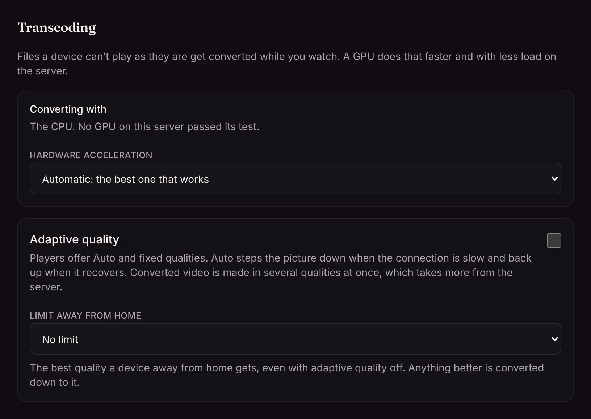

When a device can't play a file as it is, Matinee converts it while you watch. A GPU makes that much faster and lighter on the server: a 4K HEVC film becomes 1080p H.264 without keeping the CPU busy.

At startup Matinee tests what the machine's FFmpeg can use, with a one-second test encode, and picks the best that works:

| Hardware | Backend |
| --- | --- |
| NVIDIA | NVENC to encode, NVDEC to decode |
| AMD or Intel on Linux | VAAPI |
| Intel | Quick Sync |
| Mac | VideoToolbox |
| AMD on Windows | AMF |
| Raspberry Pi and other ARM boards | V4L2 |

**Settings → Streaming → Transcoding** shows which one is in use, and lets an admin pick another or turn it off.



<!-- since: v0.1.5 -->
The same section turns on [adaptive quality](/docs/server/streaming-quality/), which makes several qualities at once so playback steps down on a slow connection.

<!-- /since -->
If the GPU can't handle a file (an old codec, a profile it doesn't decode), that playback starts again on the CPU, and the file keeps using the CPU from then on, so nobody sees an error.

## Giving Matinee a GPU

**Docker:** pass `/dev/dri` in for AMD and Intel, and add the group that owns it on the host:

```yaml
services:
  matinee:
    image: ghcr.io/yeixio/matinee:latest
    devices:
      - /dev/dri:/dev/dri
    group_add:
      - "993"   # the render group's number on the host: getent group render
```

For NVIDIA, install the NVIDIA Container Toolkit on the host and request a GPU (`--gpus all`, or a `deploy.resources` reservation in Compose; the [`docker-compose.yml`](https://github.com/yeixio/matinee/blob/main/docker-compose.yml) has both examples). The image includes FFmpeg with every Linux backend and the AMD and Intel drivers.

**Kubernetes:** set `gpu.type` to `vaapi` or `nvidia`, and `nodeSelector` to keep Matinee on the node with the GPU. For VAAPI, list the node's render group in `gpu.vaapi.groups`; if it's wrong, **Settings → Streaming → Transcoding** says which number it needs. See `gpu:` in the chart's [`values.yaml`](https://github.com/yeixio/matinee/blob/main/deploy/helm/matinee/values.yaml).

**Packages:** Matinee uses the system's FFmpeg and drivers, and its user is already in the `render` and `video` groups.

On a machine with several GPUs, `MATINEE_VAAPI_DEVICE` picks one for VAAPI, such as `/dev/dri/renderD129`.

:::note[Help test it]
VAAPI on AMD has been tried on real hardware so far. If you run one of the others, a [compatibility report](https://github.com/yeixio/matinee/issues/new?template=compatibility_report.yml) helps a lot.
:::
