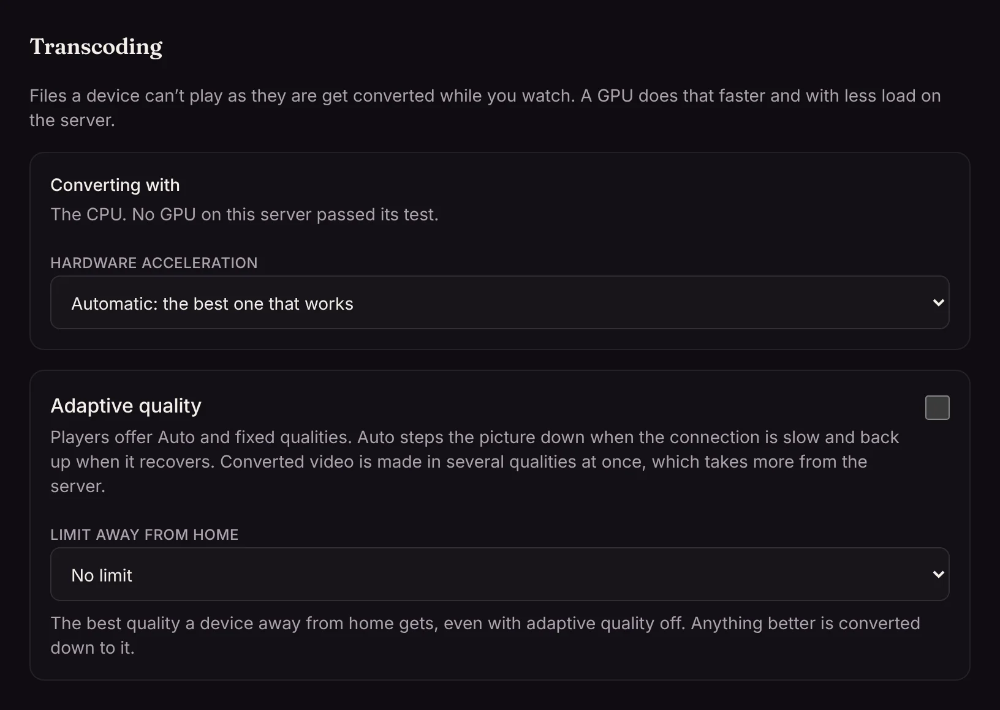

When a device can't play a file as it is, Matinee converts it while you watch. A GPU makes that much faster and lighter on the server: a 4K HEVC film becomes 1080p H.264 without keeping the CPU busy.

At startup Matinee tests what the machine's FFmpeg can use, with a one-second test encode, and picks the best that works:

| Hardware | Backend |
| --- | --- |
| NVIDIA | NVENC to encode, NVDEC to decode |
| AMD or Intel on Linux | VAAPI |
| Intel | Quick Sync |
| Mac | VideoToolbox |
| AMD on Windows | AMF |
| Raspberry Pi and other ARM boards | V4L2 |

**Settings → Streaming → Transcoding** shows which one is in use, and lets an admin pick another or turn it off.



<!-- since: v0.1.5 -->
The same section turns on [adaptive quality](/docs/server/streaming-quality/), which makes several qualities at once so playback steps down on a slow connection.

<!-- /since -->
If the GPU can't handle a file (an old codec, a profile it doesn't decode), that playback starts again on the CPU, and the file keeps using the CPU from then on, so nobody sees an error.

<!-- since: v0.2.0 -->
## Repackaging instead of converting

Often a device plays the picture fine and only the rest of the file is the problem: an MKV on an iPhone, or a film whose sound is TrueHD or DTS. Then Matinee doesn't convert the picture at all. It repackages it as it is and converts only the sound, which takes almost no work and keeps the picture exactly as good as the file.

The apps and the web player tell the server which video they decode (H.264, HEVC, AV1) and whether the screen shows HDR. A picture they decode is copied, in 4K and HDR if that's what the file has, as long as:

- the screen shows the file's HDR (a screen without HDR gets it converted; HDR10+ plays as HDR10, and Dolby Vision as the HDR10 or HLG under it when the file has one),
- no picture subtitle is drawn into the video, and
- the quality is **Auto** or **Original** and within any cap for watching away from home.

Until [media analysis](/docs/server/media-analysis/) has looked at a new HEVC or AV1 file, Matinee doesn't know whether it's HDR, so it only repackages it for an HDR screen. With **Auto**, playback moves to the adaptive stream if the connection can't keep up with the original.

**Settings → Server health** shows each stream as **Repackaging video** or **Converting video**, and for a conversion, why: the device can't play the video format, the screen can't show the HDR, or a lower quality was picked.

<!-- /since -->

## Giving Matinee a GPU

**Docker:** pass `/dev/dri` in for AMD and Intel, and add the group that owns it on the host:

```yaml
services:
  matinee:
    image: ghcr.io/yeixio/matinee:latest
    devices:
      - /dev/dri:/dev/dri
    group_add:
      - "993"   # the render group's number on the host: getent group render
```

For NVIDIA, install the NVIDIA Container Toolkit on the host and request a GPU (`--gpus all`, or a `deploy.resources` reservation in Compose; the [`docker-compose.yml`](https://github.com/yeixio/matinee/blob/main/docker-compose.yml) has both examples). The image includes FFmpeg with every Linux backend and the AMD and Intel drivers.

**Kubernetes:** set `gpu.type` to `vaapi` or `nvidia`, and `nodeSelector` to keep Matinee on the node with the GPU. For VAAPI, list the node's render group in `gpu.vaapi.groups`; if it's wrong, **Settings → Streaming → Transcoding** says which number it needs. See `gpu:` in the chart's [`values.yaml`](https://github.com/yeixio/matinee/blob/main/deploy/helm/matinee/values.yaml).

**Packages:** Matinee uses the system's FFmpeg and drivers, and its user is already in the `render` and `video` groups.

On a machine with several GPUs, `MATINEE_VAAPI_DEVICE` picks one for VAAPI, such as `/dev/dri/renderD129`.

:::note[Help test it]
VAAPI on AMD has been tried on real hardware so far. If you run one of the others, a [compatibility report](https://github.com/yeixio/matinee/issues/new?template=compatibility_report.yml) helps a lot.
:::
