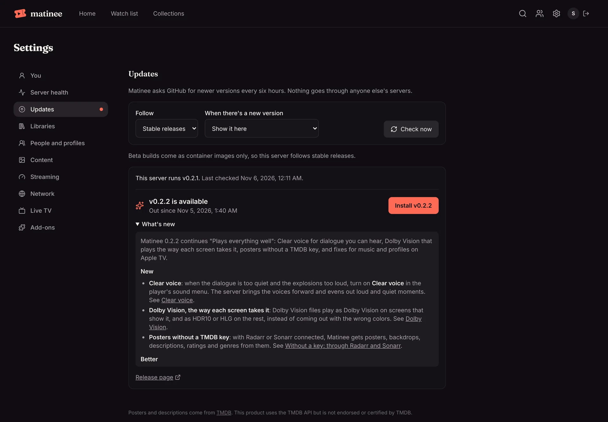

**Settings → Updates** shows the version your server runs, whether a newer one is out, and what changed. Where Matinee can replace itself, **Install** updates it in a click, or Matinee does it by itself when nobody is watching. Where it can't, such as in Docker, it shows the exact command to run.

Matinee asks GitHub, where its releases live, every six hours. Nothing goes through anyone else's servers, and **Don't check** turns it off.



## Stable or beta

**Follow** picks which versions you're offered:

- **Stable releases** (the default). Tested releases with release notes, the same ones as on [GitHub](https://github.com/yeixio/matinee/releases).
- **Beta (risky).** Every change to Matinee that passes its checks, as soon as it lands. You get new features days or weeks before a release, and sometimes new bugs with them. Instead of release notes, Settings lists the changes since the build you run, each linked to GitHub. Beta builds are container images, so beta is offered on Docker and Kubernetes.

Switching back to **Stable releases** is safe at any time. A beta build is usually newer than the latest release, so Settings says so and offers the next release once it's out.

## When there's a new version

| Choice | What happens |
| --- | --- |
| **Install it when nobody is watching** | Matinee installs the new version by itself once no one is watching or listening, then restarts. Only where Matinee can install updates (see below). |
| **Show it here** (the default) | Settings → Updates shows the new version, with a dot next to **Updates** in the list of settings, and you install it when it suits you. |
| **Don't check** | Matinee never asks GitHub. **Check now** still looks when you ask. |

Installing restarts Matinee. Anyone watching sees that the server is restarting and [picks up where they were](/docs/watching/playing/#when-the-server-restarts-or-updates) once it's back. With SQLite, Matinee [backs up the database](/docs/server/backups/) before the new version changes it.

## How each install updates

| How you installed | What Settings → Updates does |
| --- | --- |
| apt or dnf packages | Installs it. The package comes with a small helper, `matinee-update.path`, that upgrades the matinee package (and nothing else) from the repository you added, and the package then restarts Matinee. |
| Homebrew | Installs it with `brew upgrade matinee`, then restarts Matinee. |
| The archive from a release | Installs it: downloads the archive for your computer, checks it against the release's checksums, puts the new `matinee` in place of the old one and restarts. Matinee needs to be able to write to the folder it runs from. |
| Docker | Shows the command. A container can't replace itself: `docker pull` the new image and start the container again (`docker compose pull && docker compose up -d`). Use the image tag `main` to follow beta builds. |
| Kubernetes (Helm) | Shows the `helm upgrade` for your release, with its name and namespace filled in. |
| Kubernetes with Argo CD or Flux | Shows the change to make in Git (see below). |
| Mac app | The Matinee Server app updates itself: **Check for updates…** in its menu. Settings says when a new version is out. |
| Windows | The Matinee icon next to the clock updates it: right-click it and choose **Check for updates**. See [Windows](/docs/getting-started/windows/#updates). |

If an install fails, Settings → Updates says why, and the server keeps running the version it had. An automatic install isn't tried again for that version, so it can't fail over and over; **Install** tries again. For the packages, the helper's log is `/var/log/matinee-update.log`.

To install packages only by hand, turn the helper off with `sudo systemctl disable --now matinee-update.path`, and pick **Show it here**.

### When Git deploys your server

If Argo CD, Flux or another GitOps tool deploys Matinee from Git, anything Matinee changed in the cluster would be put back on the next sync, so updates go through Git. Tell the chart which tool it is:

```yaml
updates:
  managedBy: argocd   # or flux, or any name
```

Settings → Updates then shows the change to make in Git: the chart version for a release, or the image tag for a beta build. To follow beta builds without touching Git at all, point Argo CD at the `edge` branch, as in [Following the latest build](/docs/server/kubernetes/#following-the-latest-build).

### How Matinee tells

Matinee works out how it was installed from where it runs: the packages and the Helm chart say so with `MATINEE_INSTALL` (`deb`, `rpm`, `package`, `kubernetes`), and otherwise it looks for a container, a Homebrew folder or the Mac app. Set `MATINEE_INSTALL` yourself if it guesses wrong, such as `docker` for a container it doesn't recognize. `MATINEE_UPDATES_MANAGED_BY` is the same as the chart's `updates.managedBy`, for a server deployed from Git some other way.
