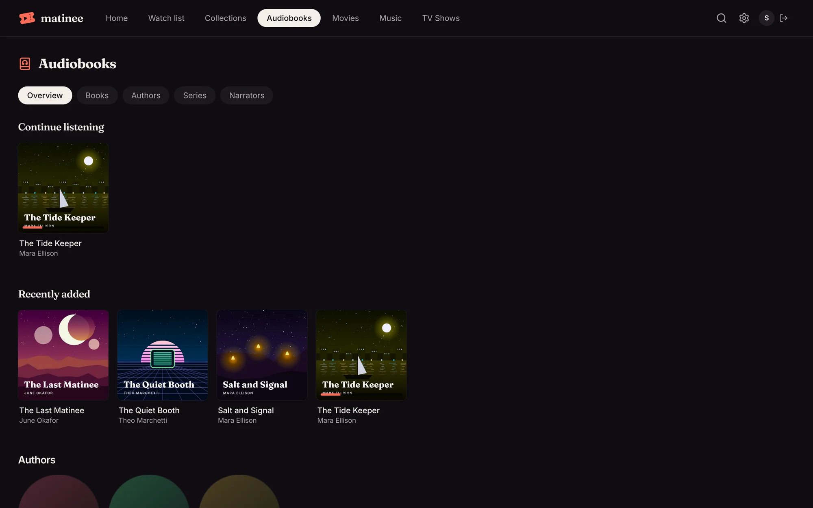
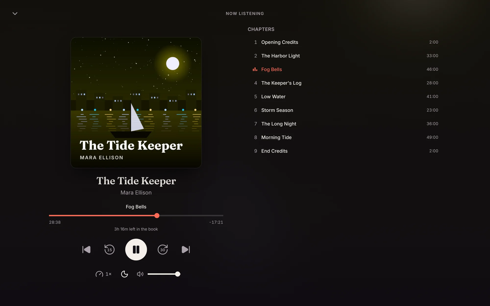

Audiobooks get a library of their own. Once an admin adds one, everyone in the house can browse their books by author, series and narrator, and listen with the controls a long book needs: chapters, skipping back and ahead, the speed, and a sleep timer. Matinee remembers where each person is in every book.

## Adding an audiobook library

An admin adds it like any other library: **Settings → Libraries → Add a library**, pick **Audiobooks**, and choose the folder your books are in. Matinee reads books in either form:

- **One file per book**, such as an `.m4b` with its chapters marked inside. The chapters come from the file.
- **A folder per book** with a file per chapter or per disc (`.mp3`, `.m4a`, `.flac` and the other audio files Matinee plays). Each file is a chapter, in the order of their track numbers or file names.

See [Organizing your media](/docs/getting-started/organizing-media/#audiobooks) for the folder layout.

## Browsing

An audiobook library opens on an overview: books you're in the middle of, books added lately, and the authors. The tabs along the top list every **Book** and **Author**, every **Series**, with its books in reading order, and every **Narrator**.

A book's page has its cover, the author, its place in a series, who reads it, how long it is, and its chapters. Click **Play**, or **Resume** to pick up where you stopped, or any chapter to start there. **Mark as finished** moves a book you're done with out of the way; **Mark as not finished** brings it back. Below the chapters are the other books in the series and by the same author.

An author's page lists their books, series by series, each in reading order.

## Listening

The player sits along the bottom of every page, so the book keeps playing while you look around. It shows the chapter, how much of it is left, and the buttons you'll use most:

- **Back 15 seconds** and **Ahead 30 seconds**.
- **Previous chapter** goes to the start of this chapter, or to the one before if it only just began. **Next chapter** goes to the next one.
- **Speed** plays the book from 0.75× up to 3×, and is remembered for the next book. The time left counts the speed in.

Click the cover for the full player: the cover large, the chapter's progress, how long until the end of the book, the speed and the sleep timer, and the list of chapters to jump to.

The media keys on your keyboard and headphones work too, and on a phone's lock screen, back and ahead skip within the book.

## Picking up where you left off

Matinee saves your place in a book while it plays, when you pause, and when you close the page, so you can start in the browser and carry on from the apps. Books you're listening to show in **Continue listening** at the top of Home and of the library. Each profile has its own place in each book.

A book counts as finished when you reach its last minute. Playing a finished book again starts it from the beginning.

## The sleep timer

The moon button in the full player stops the book after 15, 30, 45, 60 or 90 minutes, or at the **End of this chapter**. The sound fades out over the last 30 seconds. Your place is saved, so the book starts again where you dozed off.

## In the apps

The phone and tablet apps have the same audiobook library and pages, and a player made for books. Tap **Play** or **Resume** and the book keeps going above the tabs while you browse, with the screen locked and with the app in the background; the lock screen shows the book and its cover. Tap the player for the full one, with the chapter's progress, back 15 and ahead 30 seconds, previous and next chapter, the list of chapters, the speed and the sleep timer. The speed is kept for each profile on the device.

On a TV, a book's page has **Play** or **Resume** and **Start over**. The TV plays a book a part at a time, keeps your place in the book as it goes, and moves on to the next part by itself. Downloads on a phone work for books too, a part at a time.

## Series and narrators

Matinee reads who wrote and who reads a book, and the series it's in, from the tags in its files:

| Tag | Used for |
| --- | --- |
| `album` | the book's title |
| `album_artist` or `artist` | the author |
| `composer` or `narrator` | the narrators; several can be separated with commas or `&` |
| `series` and `series-part` | the series, and the book's place in it |
| `description` | the book's description |

Without tags, the folder names work: `Author/Series/Book 2 - Title/` puts the book second in its series. A `desc.txt` in a book's folder gives its description, and a `reader.txt` its narrators. Covers come from `cover.jpg` or `folder.jpg` in the book's folder, or from a cover embedded in the files, and an author's photo from `author.jpg` in their folder.
