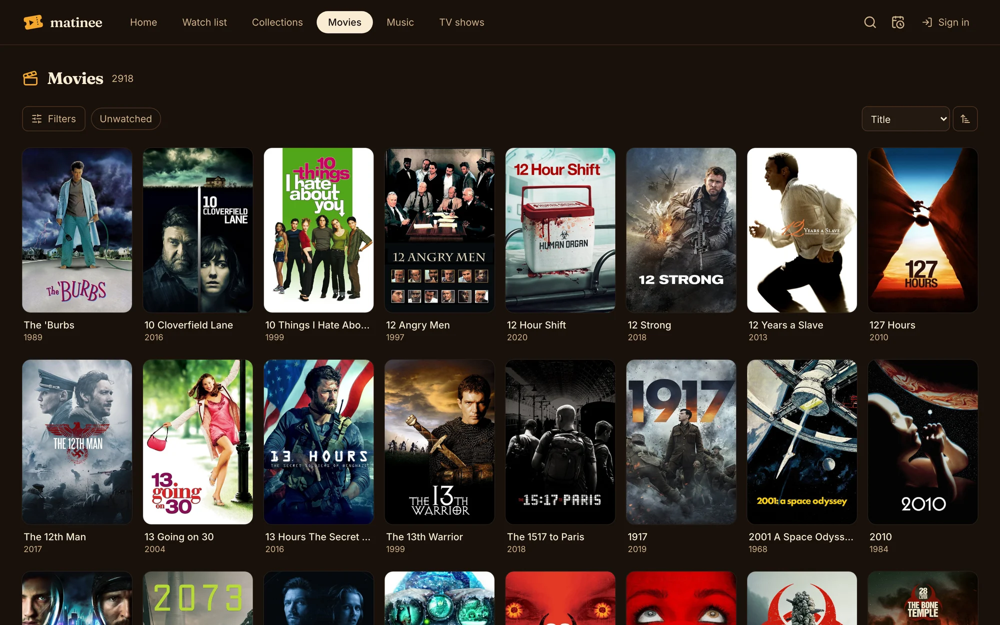
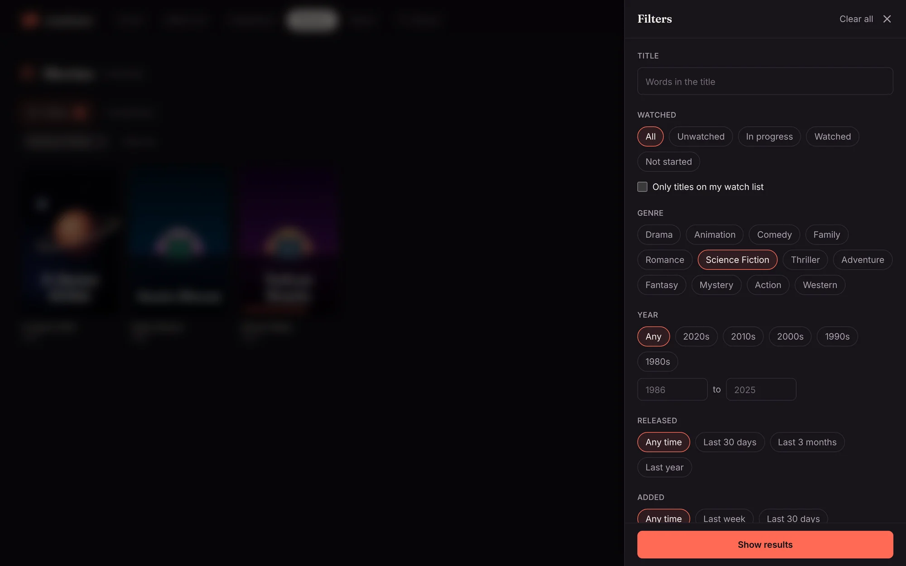
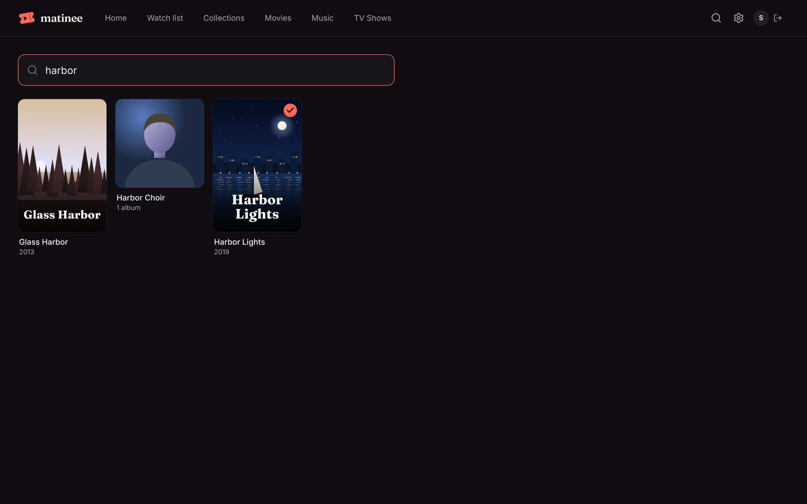
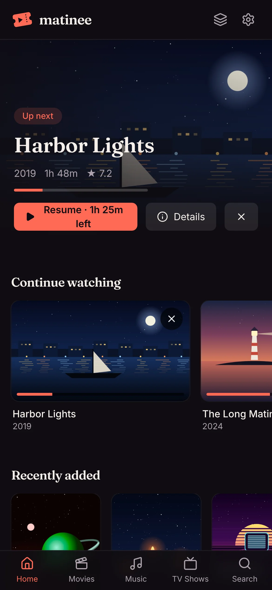
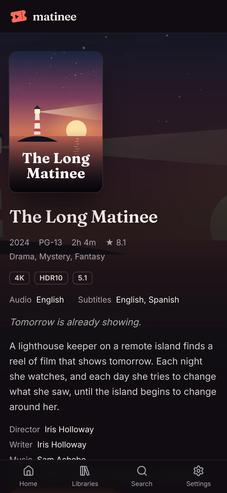

Each library has its own page in the top bar: **Movies**, **TV Shows**, **Music**, or whatever you named them.

A tick on a poster means you've watched it; a coral bar along the bottom shows how far you got. Click a poster to open its [page](/docs/watching/title-pages/).

## Sorting

The menu at the top right sorts by **Title**, **Date added**, **Release date**, **Year**, **Rating**, **Runtime** or **Last watched**. The arrow next to it flips the order.

## Filters

**Unwatched** next to **Filters** is a one-click filter for what you haven't seen. **Filters** opens everything else:

| Filter | Picks titles by |
| --- | --- |
| Title | words in the title |
| Watched | all, unwatched, in progress, watched, or not started; and only titles on your watch list |
| Genre | one or more genres |
| Year, Released, Added | a decade or a range of years; released or added recently |
| Rating | TMDB's rating |
| Runtime | how long a movie, or a show's episodes, run |
| Quality | what [media analysis](/docs/server/media-analysis/) found: 4K, HDR, Dolby Vision, Dolby Atmos, 5.1… |
| Studio, Country, Original language, Age rating | the title's details |
| Collection | box sets, such as a trilogy |
| Director, Cast and crew | anyone who worked on it |

Pick as many as you like; **Show results** applies them. The filters in use show as chips above the posters, each with an **×** to take it off. Matinee remembers each library's filters, and they're part of the page's address, so you can bookmark or share a filtered view.

:::tip
Like a set of filters? **Save as collection** turns it into a [smart collection](/docs/watching/collections/) that keeps itself up to date and can be pinned to Home.
:::

## Search

Click the magnifying glass at the top (or **Search** in the apps) and start typing. Results come up as you type, matching titles across every library: movies, shows, episodes, artists, albums and songs.

## On a phone

The web player works on phones and tablets too. The libraries move into a menu, and everything else is the same.

For the best experience on a phone or TV, get the [Matinee apps](/docs/apps/phone-and-tv/).
