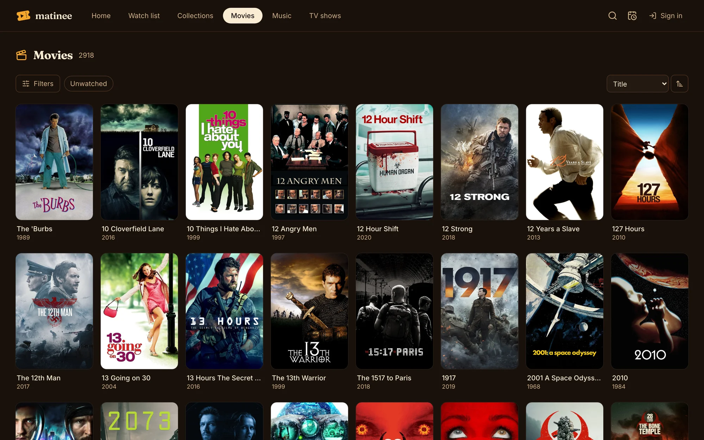
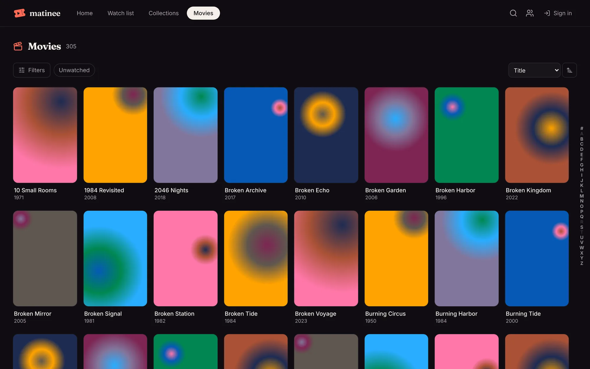
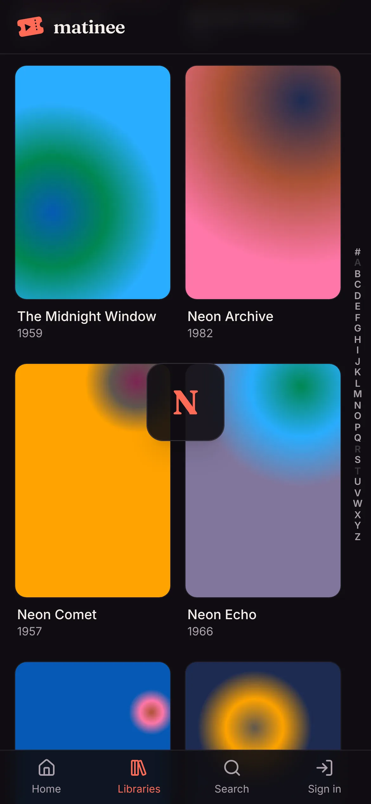
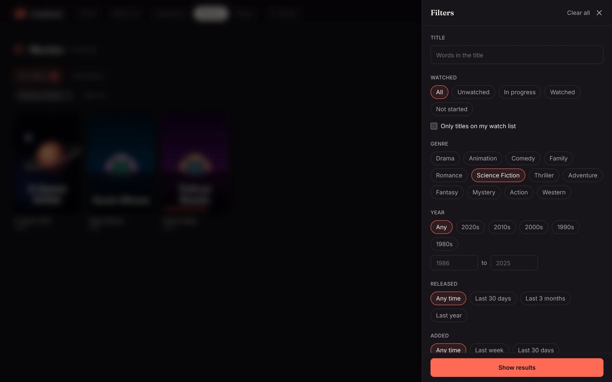
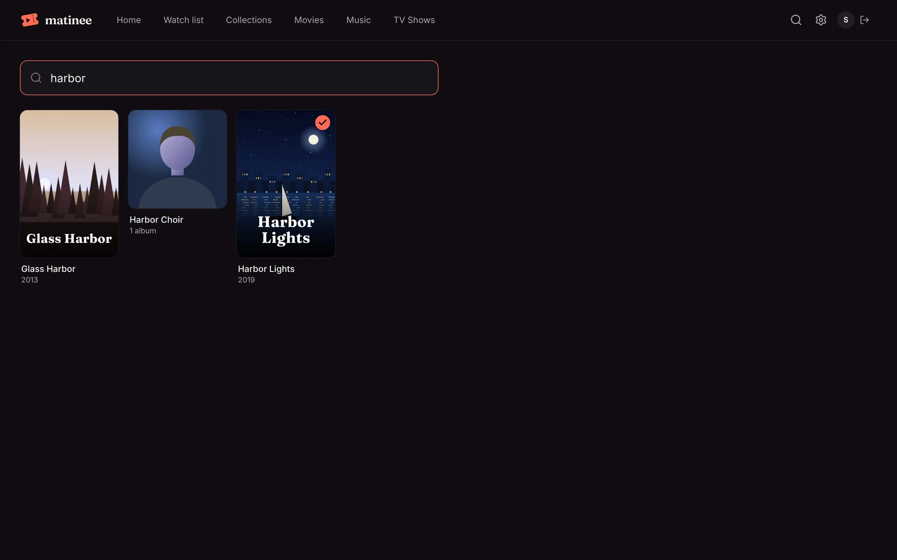
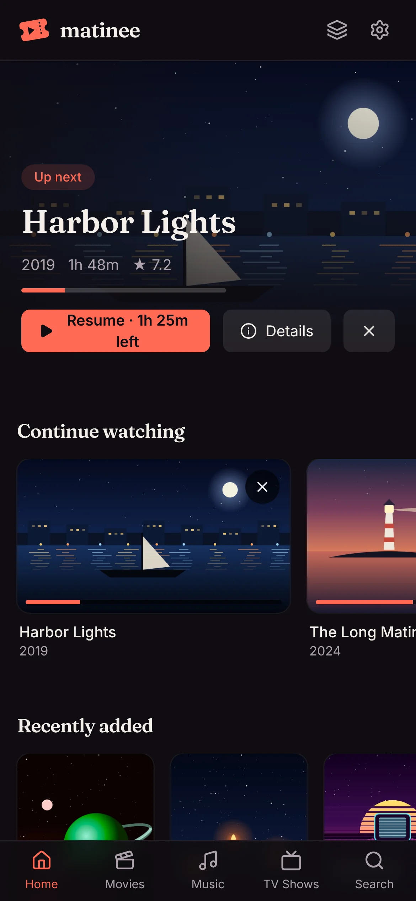
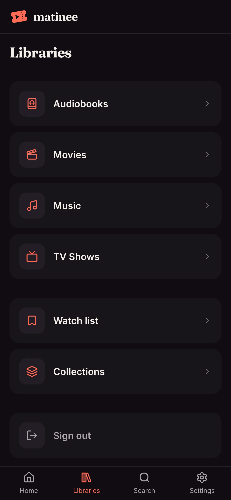
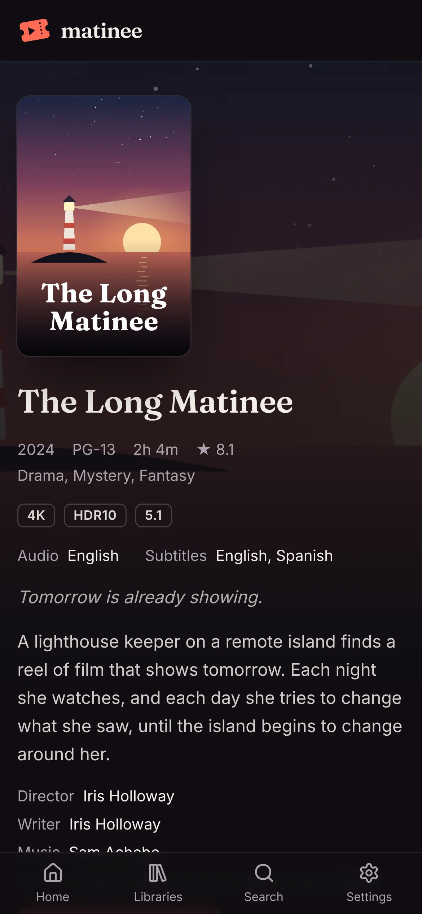

Each library has its own page in the top bar (under **Libraries** on a phone): **Movies**, **TV Shows**, **Music**, or whatever you named them.

A tick on a poster means you've watched it; a coral bar along the bottom shows how far you got. Click a poster to open its [page](/docs/watching/title-pages/).

## Sorting

The menu at the top right sorts by **Title**, **Date added**, **Release date**, **Year**, **Rating**, **Runtime** or **Last watched**. The arrow next to it flips the order.

<!-- since: v0.1.9 -->
**My rating** sorts by your own [ratings](/docs/watching/title-pages/#your-ratings), highest first. From app version 1.0.21, the apps have it under **Filter & sort** too.
<!-- /since -->

## Jumping to a letter

<!-- since: v0.2.4 -->
A library with 60 or more titles, sorted by **Title**, has the letters **#** and **A** to **Z** down the right edge of the screen. Click a letter to jump to the titles that start with it. On a phone, slide your finger along the letters and the grid follows, with the letter you're on shown large in the middle. **#** is for titles that start with a number or a symbol, and letters with accents count as the plain letter, so *Élan* is under **E**. Letters the library has no titles for are dimmed.

The letters follow your filters: with only unwatched titles showing, they jump between those. Sorted any other way, the letters go away, since the list isn't in letter order. From app version 1.0.33, the phone, tablet and TV apps have them too; on a TV, press left from the first poster in a row to reach the letters, then up and down to pick one.
<!-- /since -->

## Filters

**Unwatched** next to **Filters** is a one-click filter for what you haven't seen. **Filters** opens everything else:

| Filter | Picks titles by |
| --- | --- |
| Title | words in the title |
| Watched | all, unwatched, in progress, watched, or not started; and only titles on your watch list |
| Genre | one or more genres |
| Year, Released, Added | a decade or a range of years; released or added recently |
| Rating | TMDB's rating |
| Runtime | how long a movie, or a show's episodes, run |
| Quality | what [media analysis](/docs/server/media-analysis/) found: 4K, HDR, Dolby Vision, Dolby Atmos, 5.1… |
| Studio, Country, Original language, Age rating | the title's details |
| Collection | box sets, such as a trilogy |
| Director, Cast and crew | anyone who worked on it |

Pick as many as you like; **Show results** applies them. The filters in use show as chips above the posters, each with an **×** to take it off. Matinee remembers each library's filters, and they're part of the page's address, so you can bookmark or share a filtered view.

:::tip
Like a set of filters? **Save as collection** turns it into a [smart collection](/docs/watching/collections/) that keeps itself up to date and can be pinned to Home.
:::

## Search

Click the magnifying glass at the top (or **Search** in the apps) and start typing. Results come up as you type, matching titles across every library: movies, shows, episodes, artists, albums and songs.

Search finds people too. Type an actor's name, or the start of it ("keanu", "sigourney wea"), and the movies and shows they're in come up after any titles named like it, with the matching cast members in a **People** row above that lead to their pages. In the apps, the same search finds what an actor is in.

## On a phone

The web player works on phones and tablets too. On a narrow screen it's laid out like the phone app, with tabs along the bottom: **Home**, **Libraries**, **Discover** (when [Overseerr](/docs/server/overseerr/) is connected), **Search** and **Settings**.

<!-- since: v0.1.5 -->
**Libraries** lists every library, then your **Watch list**, **Collections**, **Coming soon** and **Requests**, and **Sign out** at the end. In a music or audiobook library, the views along the top (**Overview**, **Artists**, **Albums** and so on) share the width so they all fit.
<!-- /since -->

For the best experience on a phone or TV, get the [Matinee apps](/docs/apps/phone-and-tv/).
