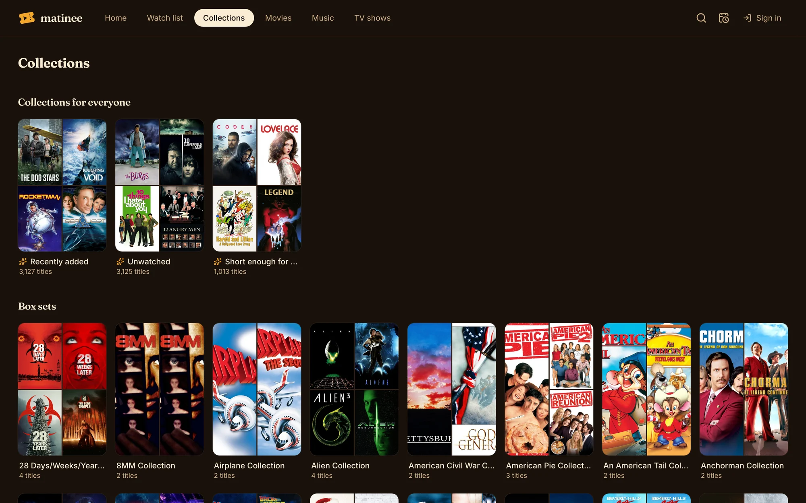
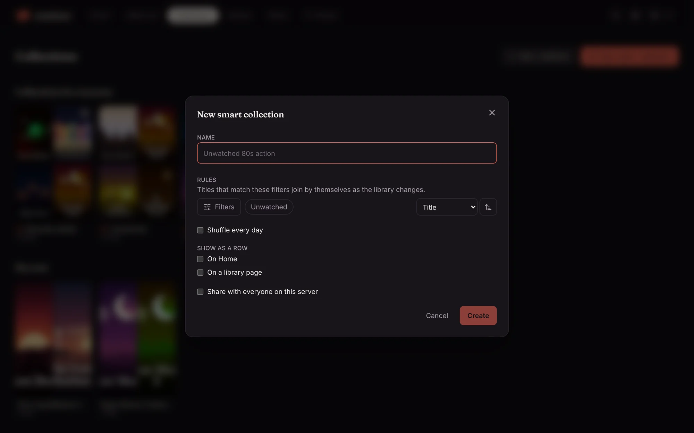

A collection is a set of titles with a name. **Collections** in the top bar (under **Libraries** on a phone) lists them.

There are three kinds:

| Kind | What it is |
| --- | --- |
| **Smart** | Rules, such as "unwatched 80s action" or "kids movies under 90 minutes". Titles join and leave by themselves as your library and your watching change. |
| **Hand-picked** | Titles you add one by one, such as "Movie night" or "Dad's favorites". |
| **Box sets** | Series of films from TMDB, such as a trilogy. Matinee makes these by itself from what's in your library. |

New servers start with three smart collections for everyone: **Recently added**, **Unwatched** and **Short enough for tonight**.

## Make a smart collection

1. Click **New smart collection**.
2. Name it, then set its rules with **Filters**. These are the same [filters](/docs/watching/browsing/#filters) as on the library pages.
3. Pick an **Order**, or **Shuffle every day** for a fresh pick each day.
4. Choose where it shows as a row: **On Home** and **On a library page**.
5. Admins can tick **Share with everyone on this server**.
6. Click **Create**.

<!-- since: v0.1.11 -->
A new smart collection is movies only, like Home's genre rows. Tick **Include TV shows** to let shows in too. The box shows up when the collection covers both a movie library and a TV library. Collections made before keep what they had until you change it.
<!-- /since -->

You can also start from a library page: set the filters you want, then click **Save as collection**.

Smart collections follow each person's own watching. An "Unwatched" collection shows each person what *they* haven't seen.

## Make a hand-picked collection

Click **New collection**, give it a name, and create it. Then, on any movie or show, click **Collections** and tick the ones it belongs in.

## Rows on Home

A collection set to show **On Home** becomes a row there, after Continue watching, Recently added and your watch list. Set to **On a library page**, it shows at the top of that library instead. Pinning is a quick way to give everyone a "Friday night" or "Kids' picks" row.

## Who sees what

Your own collections are yours. Collections shared by an admin show for everyone, under **Collections for everyone**; only admins can change those. [Kids profiles](/docs/household/profiles/#kids-mode) only see titles they're allowed, in collections too.
