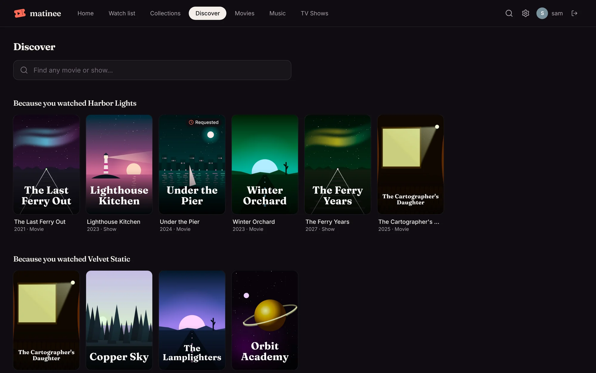
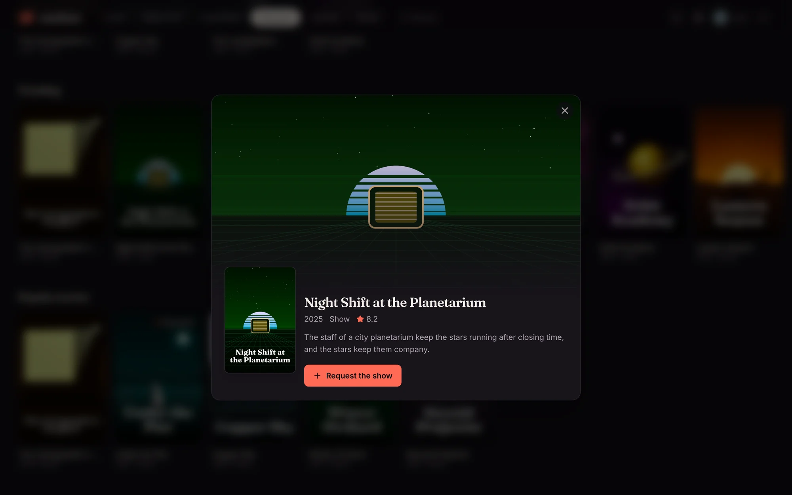
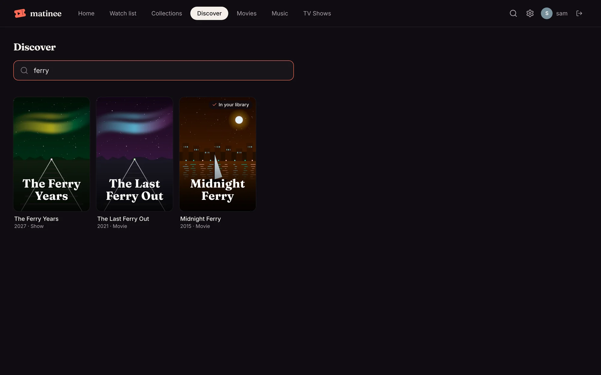

When an admin has [connected Overseerr](/docs/server/overseerr/), a **Discover** tab appears next to your libraries, on the web and in the apps. It's for finding things you don't have yet.

## The rows

- **Because you watched …**: titles like the two you watched most recently. Each person (and each [profile](/docs/household/profiles/)) gets their own.
- **Trending**, **Popular movies** and **Popular shows**: what people are watching right now.
- **Coming to cinemas** and **New shows coming up**: what's on its way.

The **Because you watched** rows leave out titles you already have. Elsewhere, a badge on a poster says when a title is **In your library**, has been **Requested**, or is **On its way**.

## Asking for a title

Click a poster to read about it. If you can ask for titles on this server, **Request** (or **Request the show**, which asks for every season) sends it to Overseerr.

What happens next is up to Overseerr. If your Overseerr account can add titles straight away, it starts downloading; otherwise it waits for an admin to approve it there. Either way, it shows up in your library by itself once it's downloaded, and [Recently added](/docs/watching/home/) puts it at the front of Home.

## Searching

The search box at the top finds any movie or show, not only what's in your libraries. Titles you have show **In your library**, with an **Open** button that takes you to them.

## Who sees Discover

- Everyone with an account, while Overseerr is connected.
- Devices at home that haven't signed in can browse Discover but not ask for anything.
- [Kids profiles](/docs/household/profiles/) don't see Discover at all.
- Who can ask follows the same setting as [Radarr and Sonarr](/docs/server/radarr-and-sonarr/#who-can-add-titles): with **Only admins add titles**, everyone else can browse but not request.
