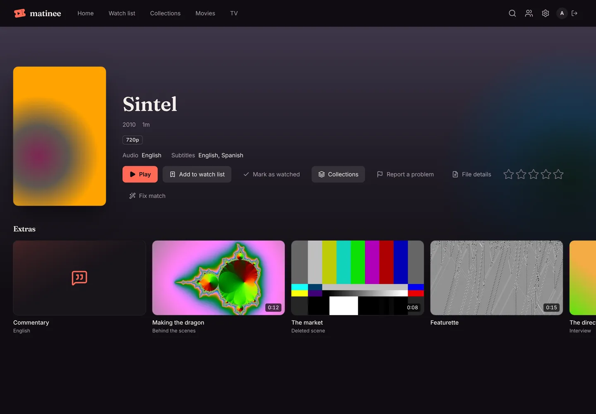
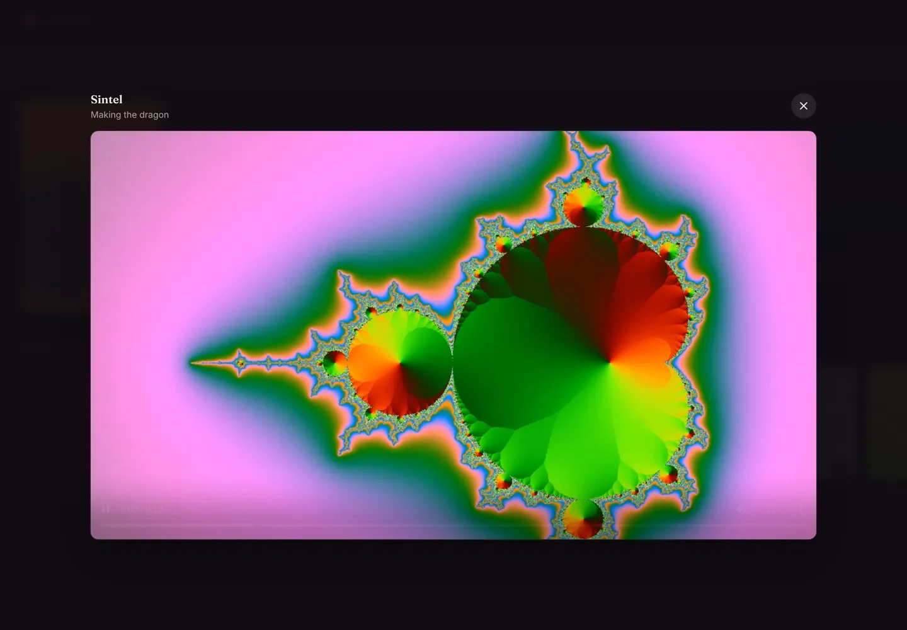
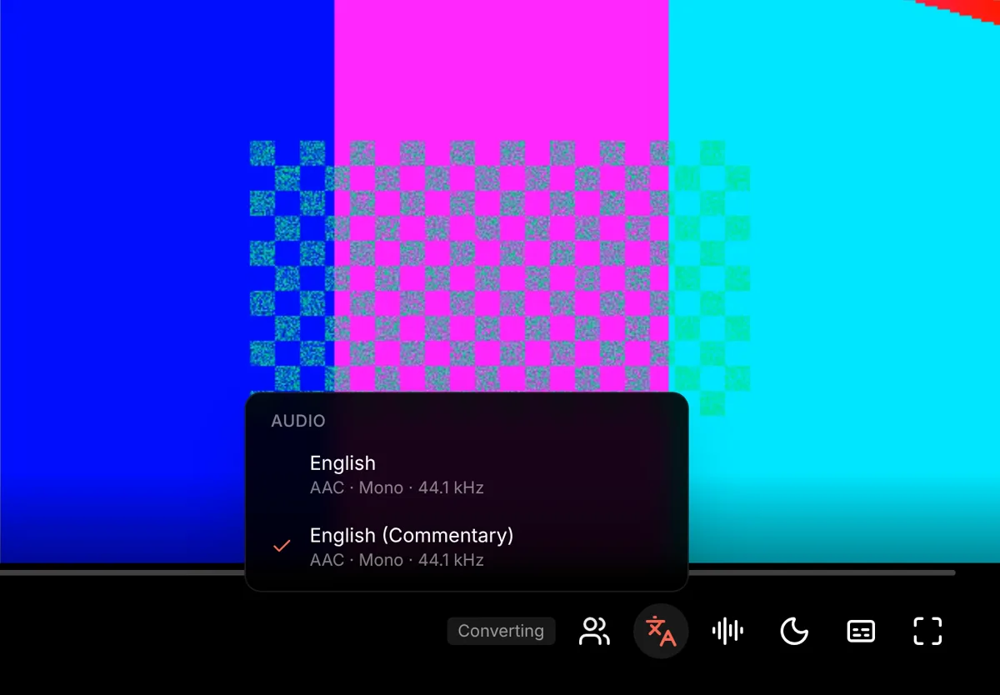
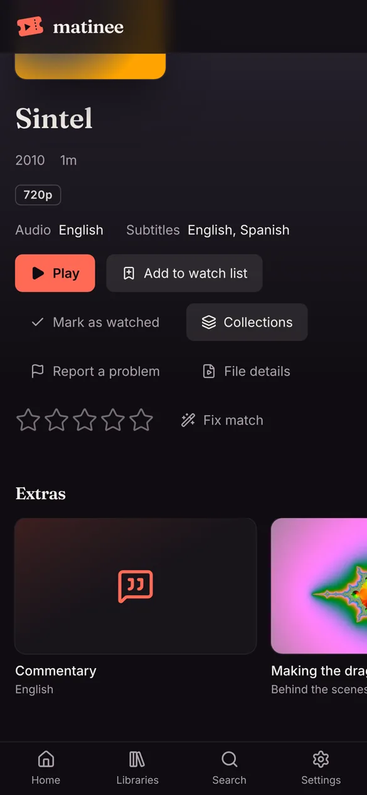

A movie or show page lists its special features in an **Extras** row, under the buttons: commentary tracks inside the movie's own file, then behind-the-scenes videos, deleted scenes, featurettes, interviews, scenes, shorts and trailers kept next to it. Everything comes from your own files. See [Organizing your media](/docs/getting-started/organizing-media/#extras) for how to name them.

## Watching an extra

Click an extra to play it over the page. It plays straight from the file when your browser can, and converted by the server when it can't, like the title itself. An extra doesn't count as watching the title, so it leaves your place and **Continue watching** as they were. Press <kbd>Esc</kbd> or the close button to go back to the page.

Each extra shows a picture from partway in, its length, and what kind it is. A file named only after the movie, such as `Harbor Lights (2019)-featurette.mkv`, is simply called **Featurette**.

## Commentaries

Many discs come with a commentary from the director or cast as an extra audio track. When the movie's file has one marked as a commentary, or with "commentary" in its name, it shows first in **Extras**. Click it to play the movie with that track. Matinee finds these tracks with [media analysis](/docs/server/media-analysis/), so a new file shows its commentaries once it has been looked at.

You can also switch tracks while you watch: the **Audio** button (the letters next to Watch together) lists every audio track in the file, such as other languages and commentaries. Another track plays through the server, which sends just that track, so playback starts again from the same spot.

## On phones and TVs

From version 1.0.27 the phone and TV apps show the same **Extras** row on a title's page. Pick an extra to play it, or a commentary to play the movie with it; the player's audio menu lists commentaries too.

