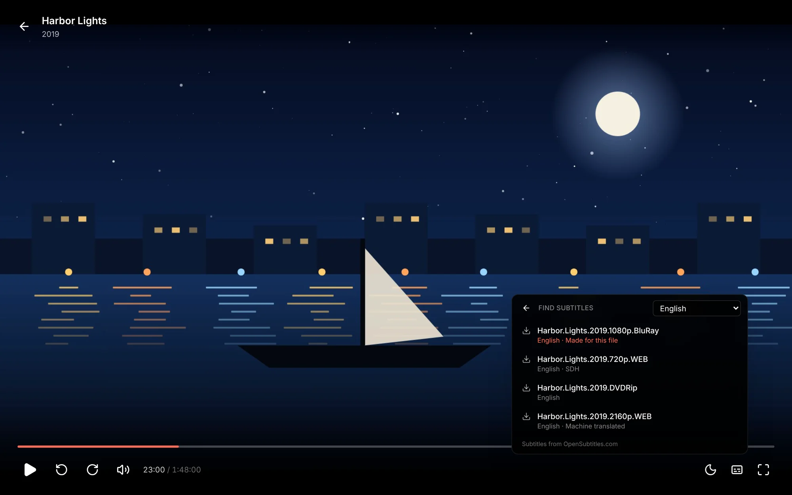
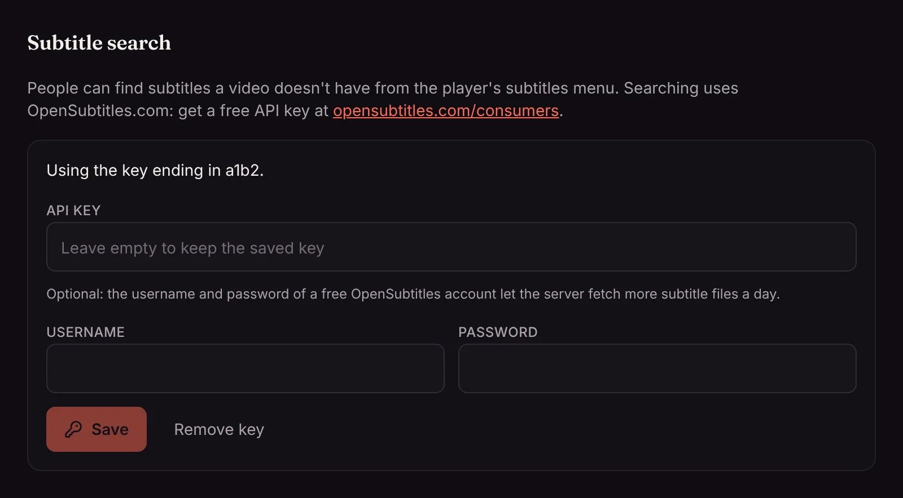

When a film or episode has no subtitles in your language, you can find some from inside the player, without leaving the couch. Matinee looks them up on [OpenSubtitles.com](https://www.opensubtitles.com), a large library of subtitles that people share, and adds the one you pick to the video.

An admin turns this on once with a free key; see [Setting up subtitle search](#setting-up-subtitle-search).

## Finding subtitles in the player

1. Open the subtitles menu in the player.
2. Pick **Find subtitles…** at the bottom of the list.
3. Matinee looks right away, in the language you last watched subtitles in (or the language Matinee is in). Pick another language at the top to look in that one.
4. Pick a result. Matinee fetches it, adds it to the video and turns it on.

The results come best first:

- **Made for this file** marks subtitles made for this very copy of the film, so they line up with the picture. Matinee recognizes the file by a fingerprint of its size and contents, so these come first.
- Then the subtitles most people have downloaded.
- Subtitles that are **Machine translated** come last, since they read less naturally.

Each result shows the release it was made for (such as a Blu-ray or a web release), and whether it's **SDH** (with sound descriptions for people who are deaf or hard of hearing) or **Forced** (only the lines in another language). If the timing of one is off, try another made for a release like yours.

Subtitles you add are there for everyone in the house from then on, on every device, marked **Online** in the subtitles menu. Matinee keeps them itself, so your media folders stay as they are, even when they're read-only.

Kids profiles don't see **Find subtitles…**.

### On phones and TVs

In the [phone and TV apps](/docs/apps/phone-and-tv/#watching-on-a-tv), **Find subtitles…** is at the bottom of the subtitles list too. On a TV, press down on the remote while something plays, go to **Subtitles** and pick **Find subtitles…**. The first line says which language Matinee is looking in; select it to pick another. Select a result to add it and turn it on.

### Removing subtitles you added

If subtitles turn out to be wrong, remove them: in the browser, open the subtitles menu and click the **×** next to them. Admins can remove any subtitles found online; everyone else can remove the ones they added. Subtitles inside the file or next to it can't be removed this way.

## Setting up subtitle search

Subtitle search needs a free API key from OpenSubtitles:

1. Make a free account at [opensubtitles.com](https://www.opensubtitles.com), then create an API consumer at [opensubtitles.com/consumers](https://www.opensubtitles.com/consumers). Its page shows the **API key**.
2. In Matinee, open **Settings → Content → Subtitle search**.
3. Paste the **API key**.
4. Optionally, enter the **Username** and **Password** of your OpenSubtitles account. OpenSubtitles lets a signed-in account fetch more subtitle files a day than a key on its own.
5. Click **Save**.

Matinee checks the key, and the account, with OpenSubtitles before saving them. They stay on your server, which does the searching and fetching; your phones and TVs never talk to OpenSubtitles themselves. To change the account later, enter the new details and leave the key empty to keep the one you saved. **Remove key** turns subtitle search off again; subtitles already added stay.

OpenSubtitles limits how many files an account fetches a day. When today's are used up, the player says so: try again the next day. Looking costs nothing, and Matinee remembers each search for a few minutes, so opening the menu again doesn't look again. Adding subtitles someone already added doesn't fetch them again.
