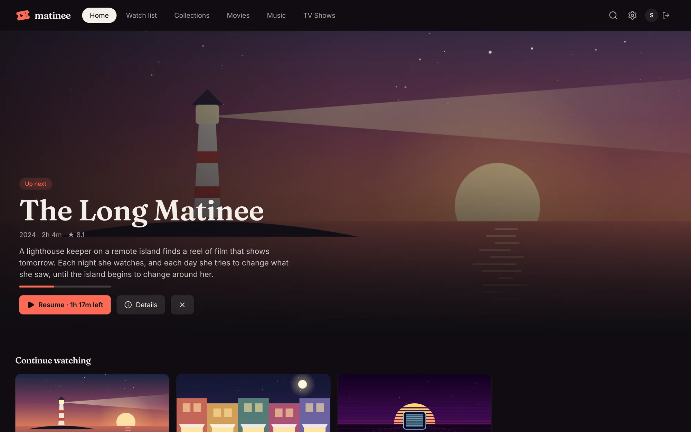
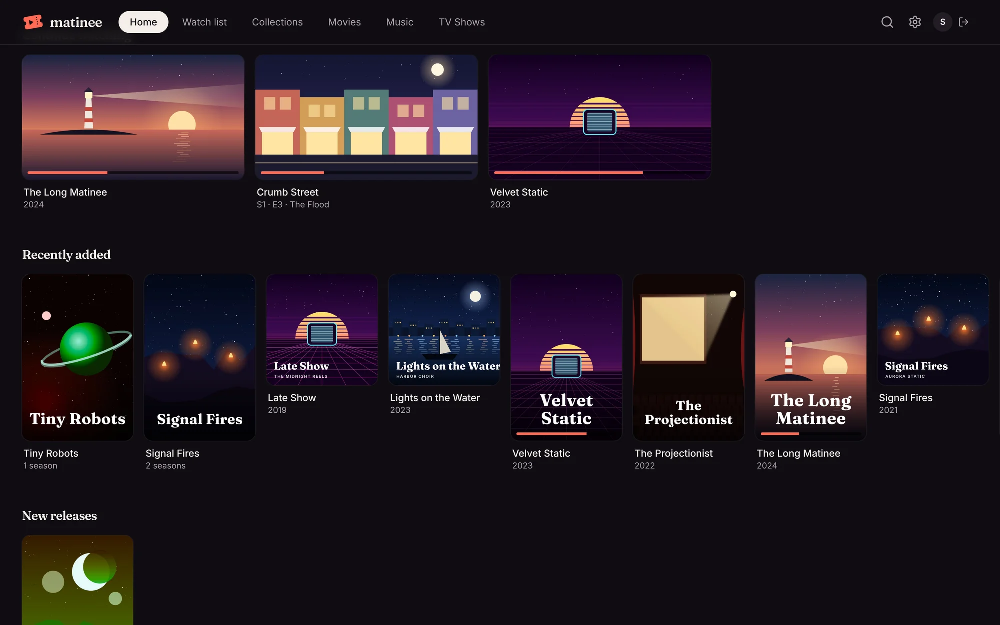
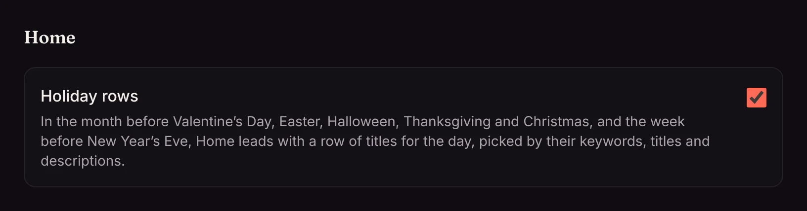

Home is where Matinee opens. It's built for the person (or [profile](/docs/household/profiles/)) watching, so everyone in the house sees their own.

## The big picture at the top

The top of Home features the first thing in your **Continue watching**, with how much is left and a **Resume** button. If you have nothing in progress, it features something just added instead. The **×** next to the buttons takes the title off Continue watching (your place is kept for when you come back to it).

## The rows

Scroll down for rows of posters. Each row scrolls sideways, and a row with a **›** next to its name opens as a full page.

| Row | What's in it |
| --- | --- |
| **Continue watching** | Movies you've started and the next episode of shows you're watching, most recent first. Finishing an episode puts the next one here. |
| **Recently added** | The newest titles in your libraries. A new episode brings its show to the front. |
| **New releases** | Titles in your libraries that came out recently. |
| **Watch list** | What you've saved to [watch later](/docs/watching/watch-list/). |
| **Pinned collections** | Any [collection](/docs/watching/collections/) pinned to Home, such as "Short enough for tonight". |
| **Genres** | A few genres from your library, different each day. |
| **Coming soon** | With [Radarr or Sonarr](/docs/server/radarr-and-sonarr/) connected: new episodes and movies due in the next two months. |

## Removing something from Continue watching

Hover over a card in **Continue watching** and click **×**. It disappears from the row but keeps its place, so playing it again picks up where you stopped.

<!-- since: v0.1.1 -->
## Holiday rows

In the month before Valentine's Day, Easter, Halloween, Thanksgiving and Christmas, and the week before New Year's Eve, Home leads with a row for the occasion, picked from your library by keywords, titles and descriptions. Halloween fills up with horror and Valentine's Day with romance when there aren't enough matches. An admin can turn holiday rows off under **Settings → Home**.

<!-- /since -->
