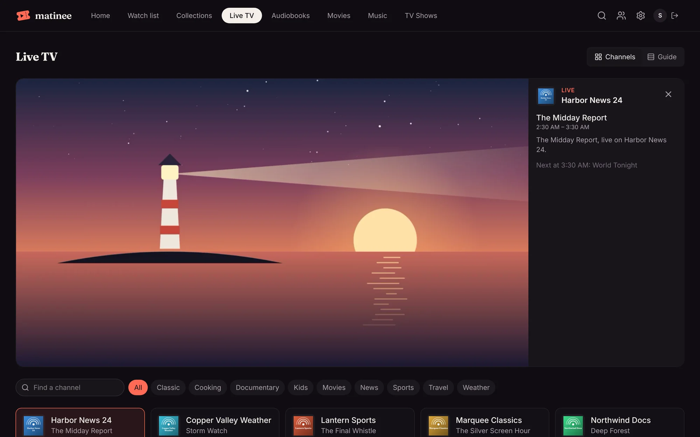
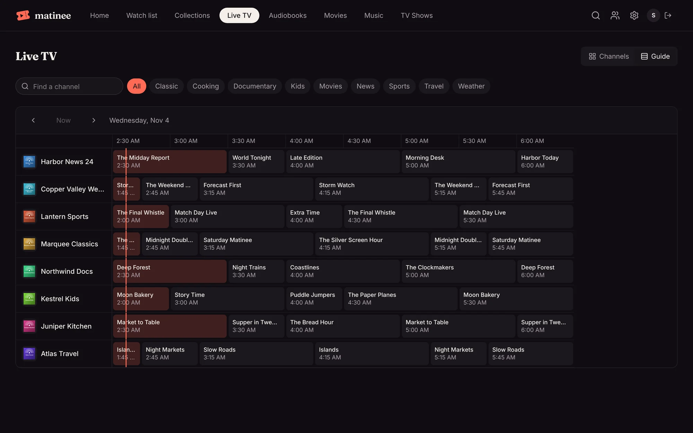
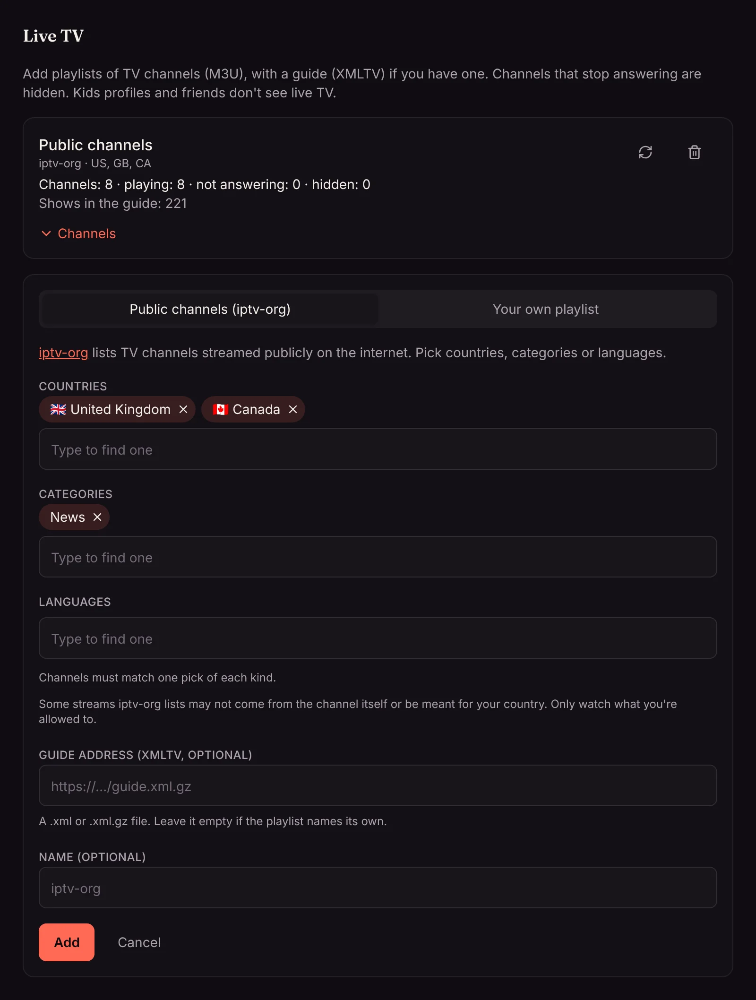

**Live TV** in the top bar (under **Libraries** on a phone) lists the TV channels your server has, with what's on now and what's next. Click a channel to watch it live at the top of the page. Find a channel by name or number, or pick a category such as News or Sports.

**Guide** shows the next four hours on every channel, a row per channel. The line marks now. Use the arrows to look further ahead, and **Now** to come back. Click a channel or a show to watch the channel.

Live TV is for grown-ups at home: kids profiles and [friends](../household/friends/) don't see it, since channels aren't rated.

The Matinee apps for phones and TVs have Live TV too, with the same channels and guide, from app version 1.0.26.

## Adding channels

Admins add channels in **Settings → Live TV** with **Add channels**. There are two ways:

- **Public channels (iptv-org).** [iptv-org](https://github.com/iptv-org/iptv) keeps lists of TV channels that are streamed publicly on the internet. Pick countries, categories or languages, and Matinee adds the channels that match one pick of each kind: **United States** and **News** adds the US news channels. Leave everything empty for every channel on the list, which is thousands.
- **Your own playlist.** Any M3U playlist of channels, by its web address: one a TV provider gives you, one your own tuner software makes, or one you keep yourself. It can be on your home network.

Either way you can add a **guide**: the web address of an XMLTV file (`.xml` or `.xml.gz`) that says what's on. Matinee matches the guide's channels to the playlist's by their `tvg-id`, or by name when a playlist has no ids. A playlist that names its own guide in its first line (`x-tvg-url`) uses that one when you leave it empty. iptv-org's lists don't come with a guide.

iptv-org lists streams it finds in public. Some come straight from the channel; others may not, or may only be meant for viewers in one country. Only add and watch what you're allowed to where you live, and hide anything you don't want.

## Channels that stop working

Matinee checks every channel's stream every six hours, and right after you add a playlist. A channel that fails two checks in a row is hidden from everyone until a check finds it working again. In **Settings → Live TV**, each playlist says how many of its channels play, how many aren't answering and how many you hid.

Open **Channels** under a playlist to see all of them, with how each one's last check went. Hide a channel nobody wants with the eye button, and show it again the same way. **Refresh now** reads the playlist and guide again; Matinee also does that by itself twice a day.

## How channels play

Players never connect to a channel themselves: the server fetches the stream and passes it on. So channels on plain `http`, on your home network, or that only answer one kind of player still play in a browser, on a phone and through [remote access](../server/remote-access/). Channels that stream as HLS, which is most of them, are passed through as they are. Others, such as MPEG-TS from a tuner, are repackaged as HLS without converting the picture.

Matinee only plays the streams a playlist points at. It doesn't look for streams on websites, record, or get around ads or copy protection.
