A music library opens on an overview: albums you played lately, albums added lately, and your artists. The tabs along the top list every **Artist**, **Album** or **Song**, and **Shuffle all** plays the whole library in a random order.

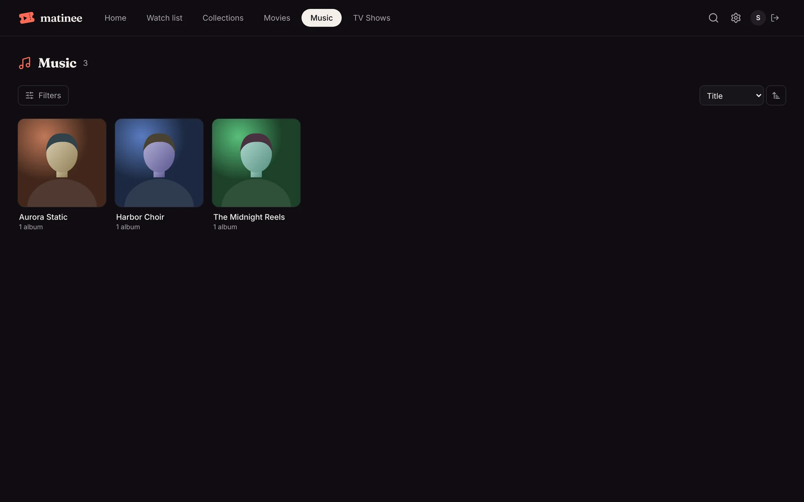

## Albums and artists

An album's page lists its songs. Click the big **Play** button to play it from the top, **Shuffle** to mix it up, or any song to play from there. The song that's playing has moving bars beside it. Below the songs are the artist's other albums.

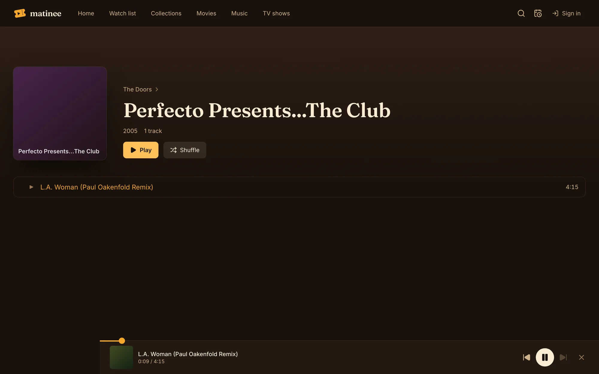

An artist's page has their albums, newest first, and plays or shuffles every song they have.

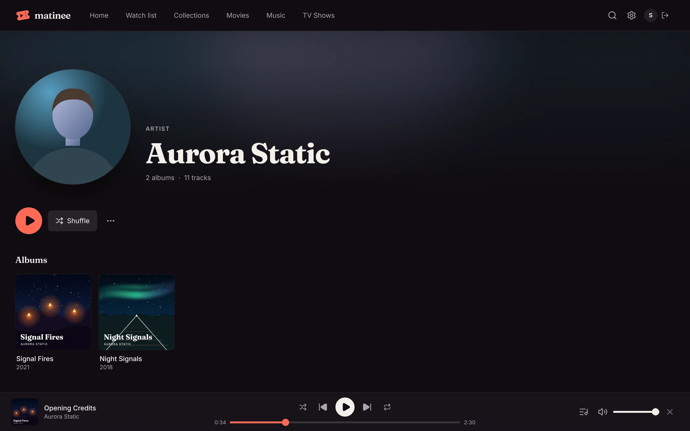

<!-- since: v0.1.1 -->
## Music keeps playing while you browse

The player sits along the bottom of every page, so you can look around Matinee, or pick the next album, without stopping the song. It has shuffle, back, play, next, repeat, the volume, and a bar to move around the song. Repeat goes from off, to the whole queue, to just this song.

On a phone, the player sits above the tabs with the song, play and next. Tap it for the full player.

The media keys on your keyboard, headphones and lock screen work too, and show the song and its cover. Matinee remembers what you were listening to: come back later and it's ready where you stopped.

## The full player and the queue

Click the cover in the player (or the queue button beside the volume) for the full player: the cover large, the controls, and the queue of what's playing next. Drag songs in the queue to change the order, click one to jump to it, or remove it with **×**. **Clear** empties the rest of the queue. Press **Esc** or the arrow at the top to go back.

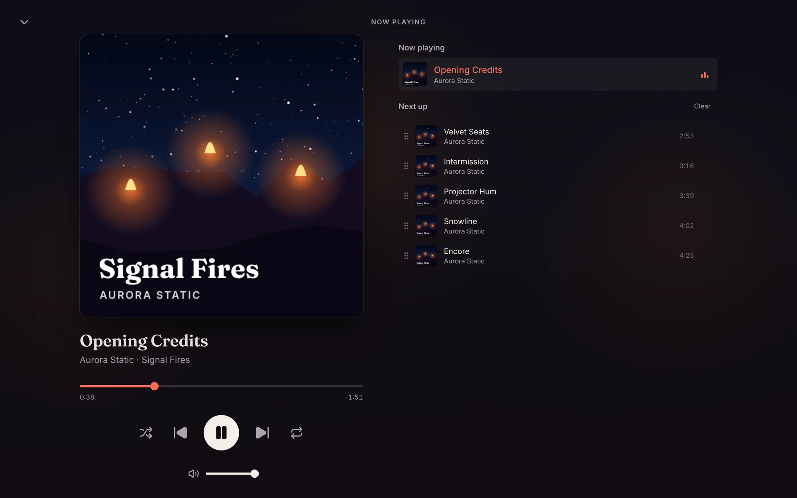

On a phone, the button at the top right switches between the cover and the queue.

## Play next and Add to queue

The **⋯** button on any song, album or artist has:

- **Play next**, which puts it right after the song that's playing.
- **Add to queue**, which puts it at the end.
- **Go to album** and **Go to artist**.

Shuffle mixes what's left in the queue and keeps the song that's playing; turning it off puts the queue back in order.

<!-- since: v0.1.7 -->
## Playlists

Playlists are songs you put together in your own order. They're yours alone: everyone who signs in, and each [profile](/docs/household/profiles/), has their own. Devices at home that haven't signed in share one set for the household.

The **Playlists** tab in a music library lists them, and the overview shows them too. Click **New playlist** to make an empty one, then add songs to it.

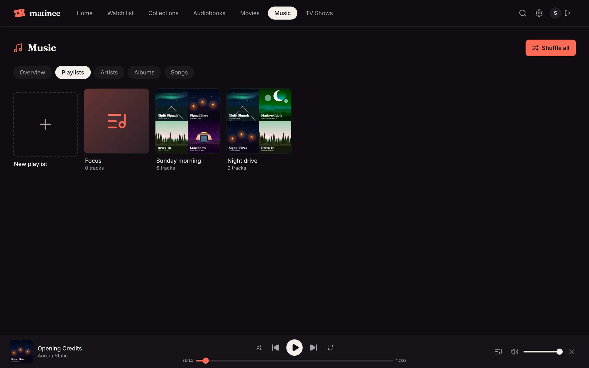

To add to a playlist, pick **Add to playlist** in the **⋯** menu of any song, album or artist, then pick the playlist, or **New playlist** to make one with them on it. An album adds all its songs in order, and an artist adds every song they have. A song can be on a playlist more than once.

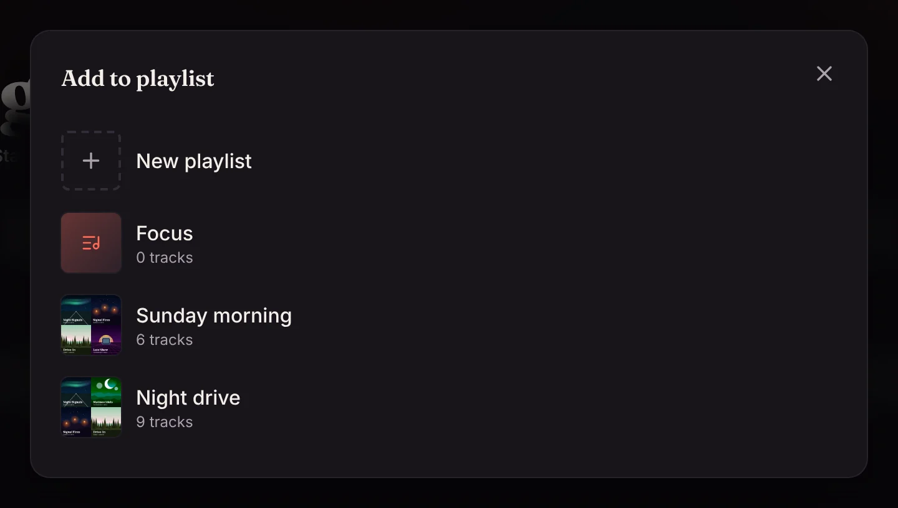

A playlist's page has **Play** and **Shuffle**, **Rename** and **Delete playlist**. Drag songs by the handle at their left to change the order, or use **Move up** and **Move down** in a song's **⋯** menu. **Remove from playlist** takes a song off; it stays in your library. Deleting a playlist doesn't delete any music either.

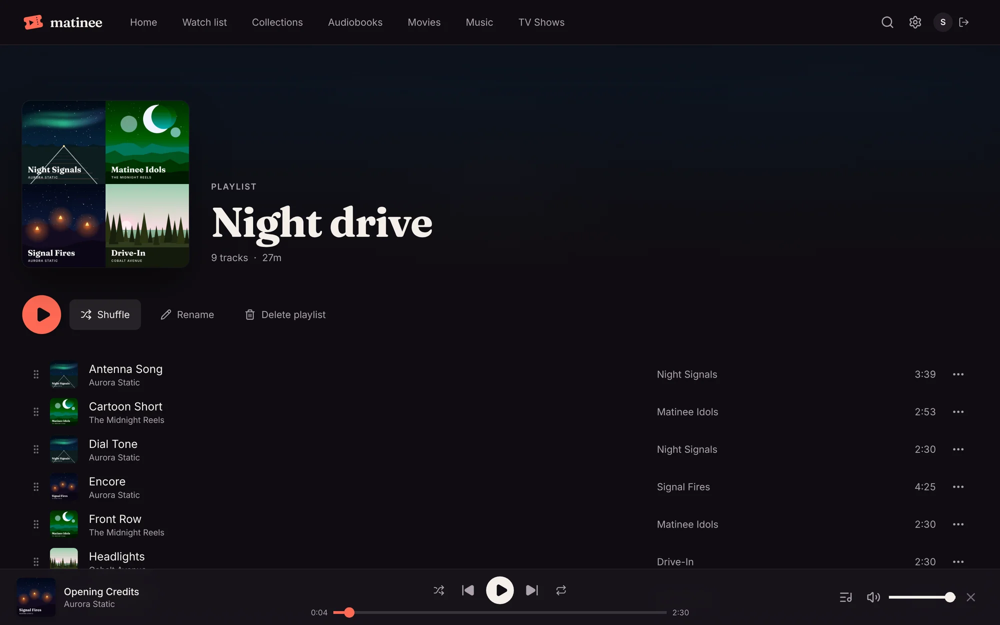

**Save as playlist** above the queue in the full player keeps what's playing and what's up next as a new playlist.

Songs your profile can't see, such as in a library a kids profile doesn't have, don't show or play from a playlist.

<!-- /since -->

## On the phone apps

The [phone apps](/docs/apps/phone-and-tv/) have the same library, album and artist pages, a player above the tabs, and a full player with the queue. Music keeps playing when you lock the phone or switch apps, with the song on the lock screen, and downloaded albums play offline.

<!-- /since -->

<!-- since: v0.1.7 -->
From version 1.0.19 the phone apps have playlists too: the **Playlists** tab, **Add to playlist** in the menu of any song, album or artist (tap **⋯** or hold a song), and **Save as playlist** above the queue. On a playlist's page, **⋯** renames or deletes it, and each song's menu moves it up or down or removes it.
<!-- /since -->

<!-- since: v0.1.3 -->
## The visualizer

The visualizer fills the screen with the song that's playing: bars that jump with it, a halo round the cover, or rings that pulse with the beat. Open it with the visualizer button at the top of the full player. The left and right arrow keys, or the button at the top right, change the look, and Matinee remembers the one you pick. **Space** pauses, and **Esc** closes it. The buttons and the song's name fade away after a few seconds; move the mouse to bring them back.

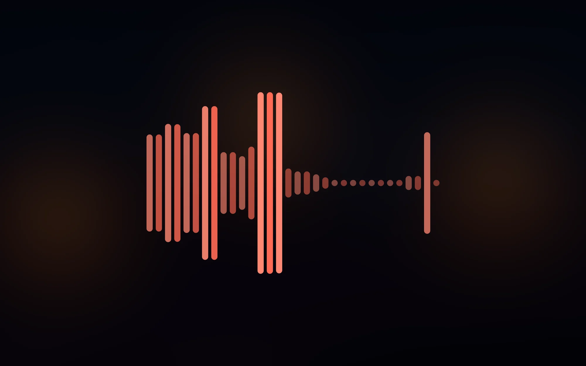

On a phone, tap the visualizer button at the top of the full player. Tap the look's name to change it, and tap anywhere to show or hide the buttons.

The visualizer moves in time with the music on every device, even a TV, because the server listens to each song and works out how loud its bass, middle and treble are, moment by moment. It does that the first time anyone opens the visualizer on a song (and for the next song in the queue while it's open), which takes a moment, then keeps the result. Until it's ready, and for songs a phone plays offline, a slow wave fills in.

## On a TV

Apple TV and Android TV have the same music library as the browser, with **Overview**, **Artists**, **Albums** and **Songs** along the top and **Shuffle all**. An album or artist page has **Play** and **Shuffle**, and selecting a song plays the album from there. Hold select on a song for **Play next**, **Add to queue**, **Go to album** and **Go to artist**.

<!-- since: v0.1.7 -->
From version 1.0.19 a **Playlists** tab lists your playlists, and a playlist's page has **Play**, **Shuffle** and its songs. Make and change playlists on the web or a phone; the TV plays them.

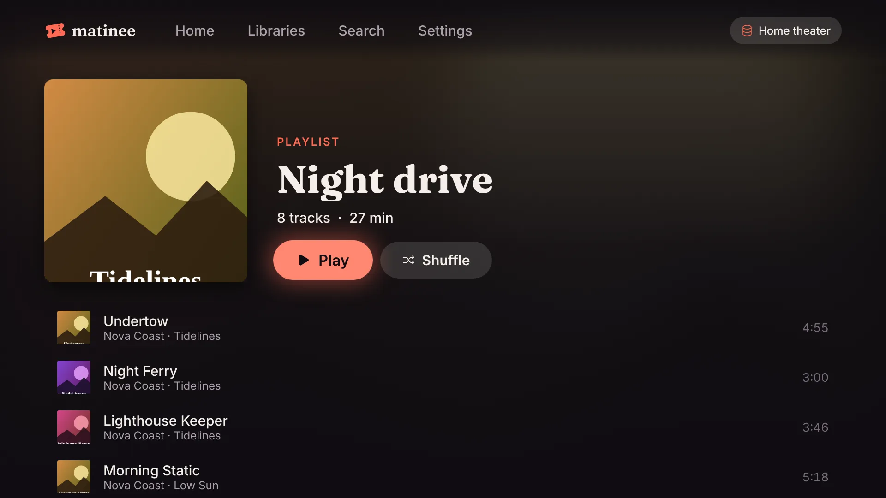
<!-- /since -->

The music keeps playing while you browse. What's playing shows at the top of the screen, next to the server's name; select it for the player. The player has the cover, how far along the song is, shuffle, back, play, next and repeat, and the queue in a row below it, where selecting a song plays it now. The play/pause button on the remote plays and pauses the music from any screen.

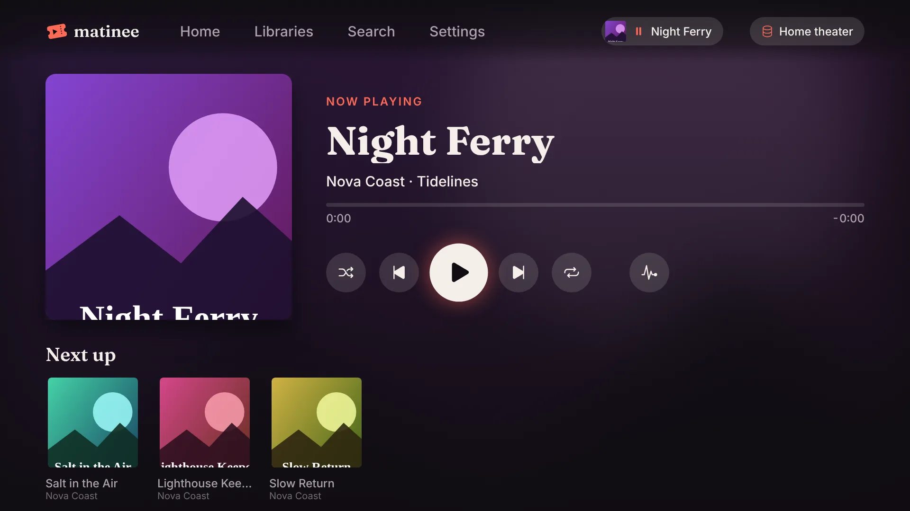

<!-- since: v0.1.7 -->
From version 1.0.19 you can scrub through the song with the remote. Press up from the player's buttons to reach the bar under the song's name; a dot shows on it. Then left and right go back or ahead 10 seconds (hold to go faster), and a swipe on the Siri Remote does the same. Presses in a row add up: the time under the bar shows where you'll land, and the song moves there once you stop pressing. Select on the bar plays or pauses, and down goes back to the buttons. The rewind and fast forward buttons on remotes that have them skip 10 seconds from anywhere in the player. This works on Apple TV, Android TV, and Samsung and LG TVs.

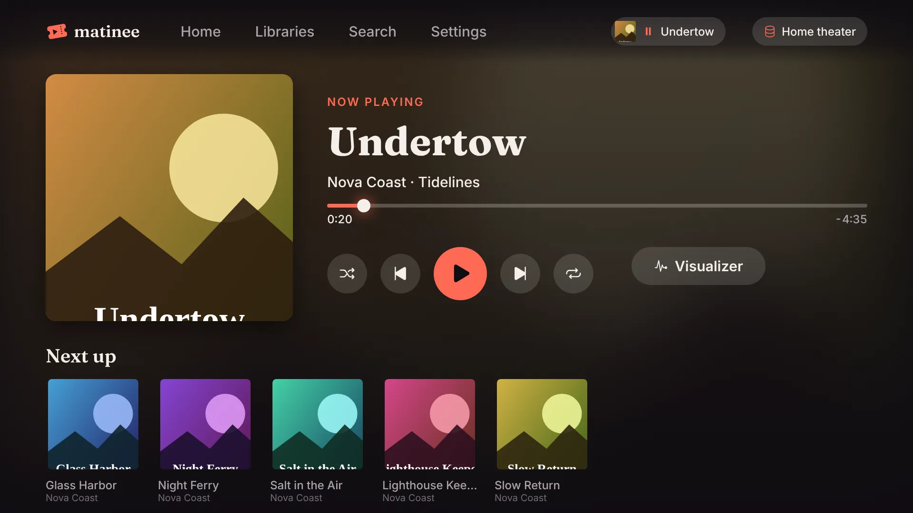
<!-- /since -->

**Visualizer** in the player opens the visualizer; left and right on the remote change its look, and play/pause or select pauses.

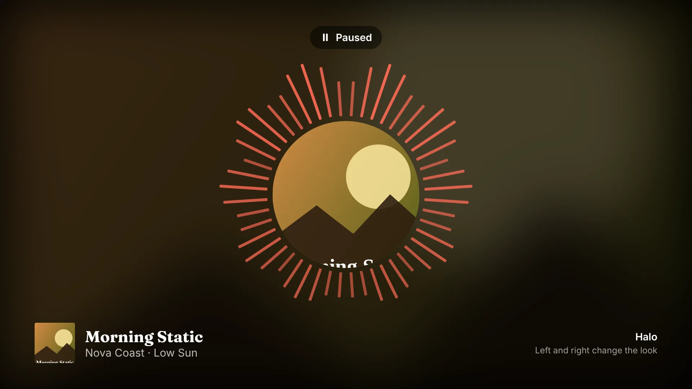

<!-- /since -->

<!-- since: v0.1.5 -->
## When the server restarts

Updating or restarting the server doesn't lose your music. What's already loaded keeps playing, and if the song runs out before the server is back, a card at the top of the screen says **The server is restarting** or **Can't reach the server**. Once it answers, the song carries on from the same moment, with the rest of the queue as it was, and a short note says whether the server was updated or restarted. After three minutes the player offers **Try again**. The phone and TV apps do the same.

<!-- /since -->

## Covers and artist photos

Matinee uses `cover.jpg` or `folder.jpg` in an album's folder, or a cover embedded in the music files, and `artist.jpg` in an artist's folder. Anything missing comes from MusicBrainz, the Cover Art Archive and Wikidata, which need no key. To use only your own files, set `MATINEE_MUSICBRAINZ=false`.

<!-- since: v0.1.3 -->

Cover names can be in any case and can be `.jpg`, `.jpeg`, `.png` or `.webp`: `Folder.JPG`, `front.png`, `AlbumArt_…_Large.jpg` and an image with "cover" or "front" in its name all count, and so does the only image in a folder. Back covers, disc scans and booklet pages don't. For an album split into `CD 1` and `CD 2` folders, put the cover in the album's folder above them.

Albums tagged as a compilation without an album artist are filed under **Various Artists**, so their songs stay on one album with one cover.

### Finding missing covers

When covers are missing, check the album's folder first: a cover added after the album was scanned is picked up on the next scan. To look again for everything that's missing, an admin opens **Settings**, finds the music library under **Libraries**, and clicks **Find artwork**. Matinee scans the library's folders and looks up every artist and album without a picture of its own on MusicBrainz again, even ones it couldn't match before. Covers show up as they're found; with a big library that takes a while, since MusicBrainz answers about one question a second.

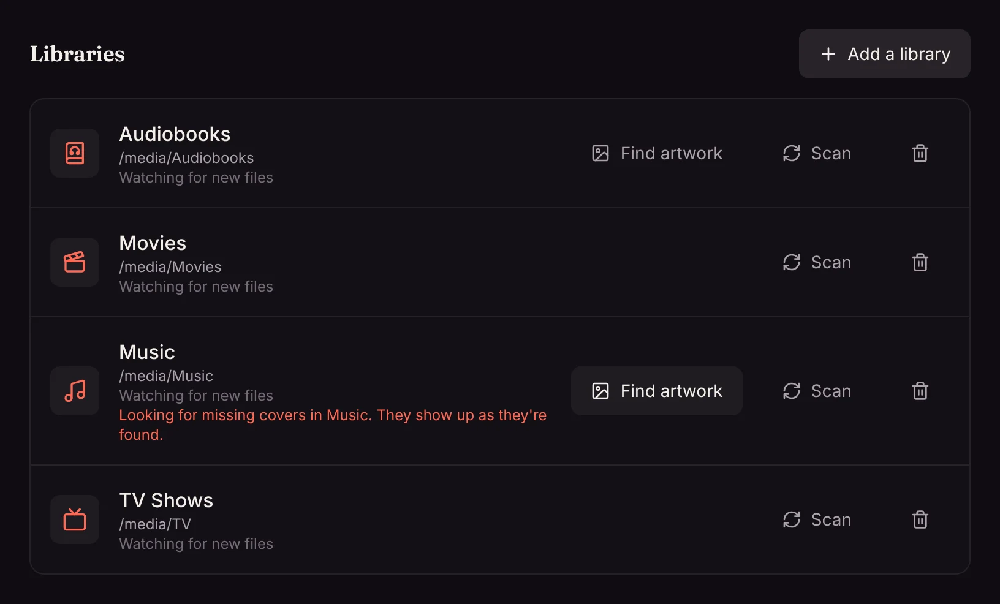

Online lookups go by the album and artist names in your tags. An edition note like "(Deluxe Edition)" or "[2011 Remaster]" is tried with and without, and an album without a cover of its own in the Cover Art Archive takes the cover of one of its releases. If an album still has none, fix its tags, or add a `cover.jpg`.

<!-- /since -->

<!-- since: v0.1.7 -->
### How albums are matched online

Files tagged with MusicBrainz Picard, Lidarr or beets carry the MusicBrainz id of their album, and Matinee uses it to find the exact album, and the cover of the very release you have. That's the surest way to get every cover: tag your music with one of them, or turn on tag writing in Lidarr.

Without ids, Matinee goes by the names in your tags and copes with messy ones:

- Notes about the copy, like "(CD 2)", "- Disk 1", "(SAMPLE)", "(Promo)" or "[FLAC]", come off the title.
- The artist's name comes off the start or end, so "Perfecto Fluoro- Oakenfold" is found as "Perfecto Fluoro".
- A title a letter or two off, like "Fluro", is matched to the artist's album that's closest to it, and to one with a longer title only when the year agrees.
- A DJ mix or compilation filed under its DJ, like "Cream Anthems 2001", is matched to the Various Artists album of that name and year.

Albums still without a cover are looked up again every month, as the online databases keep growing. Updating to this version looks again for every album without a cover, and reads the ids from the files of albums scanned before, once, on the next scan.

<!-- /since -->

## Tags

Artist, album, track number and title come from the tags in your files, so tag them with your favorite tagger before adding them. Without tags, Matinee uses the [folder and file names](/docs/getting-started/organizing-media/#music).

<!-- since: v0.1.7 -->
### Soundtracks and compilations

An album is filed under its album artist tag. A soundtrack or compilation whose files don't have one still shows as one album: songs in the same folder with the same album name stay together. The album goes under the artist the folder is named for, such as `Some Composer/Some Film (2001)`, when that artist has songs on it, and under **Various Artists** otherwise. Each song keeps its own artist, which the album page shows under the song's title, and the player names while it plays.

Albums split up by an older version join up again on the next scan of the library, with nothing to do on your part.
<!-- /since -->
