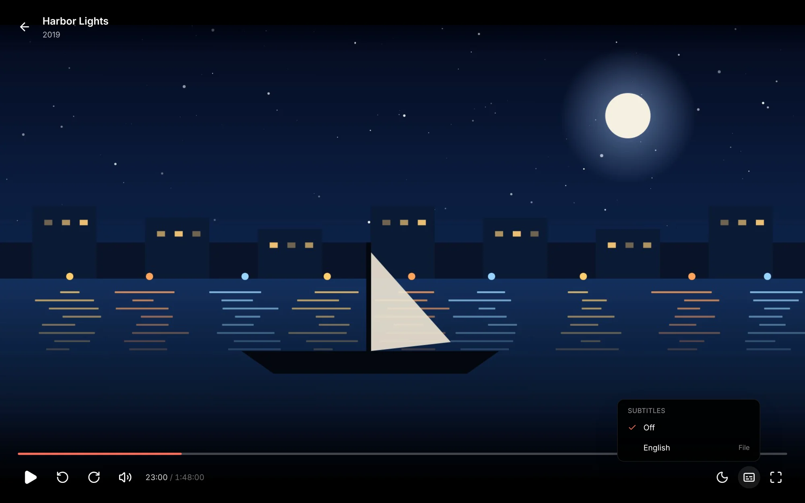
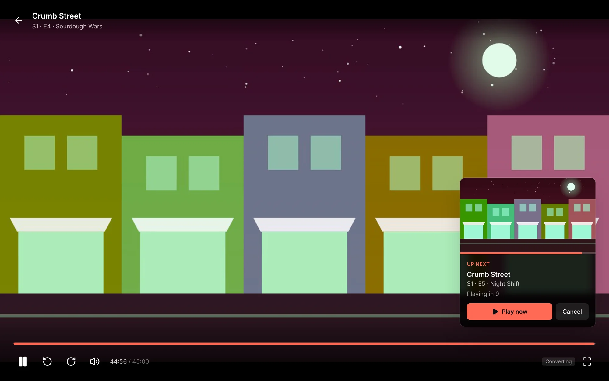
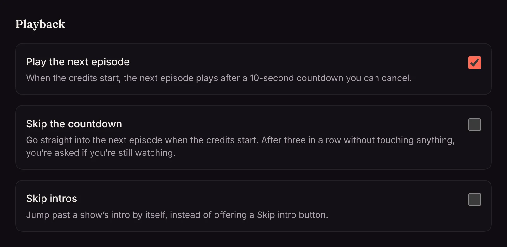
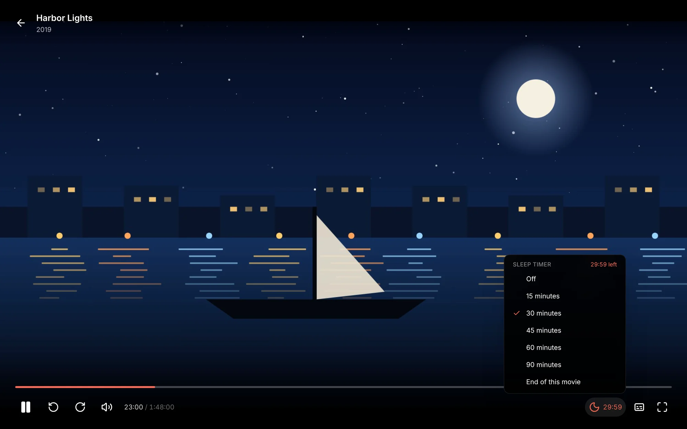

Press **Play** on any movie or episode. The player fills the window; move the mouse or press a key to bring up the controls.

## Controls and shortcuts

| | Button | Key |
| --- | --- | --- |
| Play or pause | ▶ | <kbd>Space</kbd> or <kbd>K</kbd> |
| Back or forward 10 seconds | ↺ ↻ | <kbd>←</kbd> <kbd>→</kbd> |
| Mute | 🔈 | <kbd>M</kbd> |
| Subtitles on or off | CC | <kbd>C</kbd> |
| Fullscreen | ⛶ | <kbd>F</kbd> |
| Leave the player | ← at the top left | <kbd>Esc</kbd> |

Drag along the bar at the bottom, or click anywhere on it, to jump.

<!-- since: v0.1.11 -->
Hover over the bar, or drag it, to see a picture of that moment above it before you jump. See [Seek bar previews](/docs/watching/seek-previews/).
<!-- /since -->

## Subtitles

The subtitles button lists every subtitle track: the ones inside the file and the [files next to it](/docs/getting-started/organizing-media/#subtitles). Pick one, or **Off**.

Matinee remembers the language you pick and uses it again for the next episode and the next film. Text subtitles (SRT, WebVTT, ASS) are drawn by the player, so they stay sharp at any size. Picture subtitles from Blu-rays and DVDs can't be drawn that way, so Matinee burns them into the picture while it converts the video.

<!-- since: v0.1.4 -->
In the [phone and TV apps](/docs/apps/phone-and-tv/#watching-on-a-tv), subtitles and the sound track are in the player too: on a TV, press down on the remote while something plays.
<!-- /since -->

<!-- since: v0.1.10 -->
No subtitles in your language? Once an admin sets up subtitle search, **Find subtitles…** at the bottom of the menu looks for them online. See [Finding subtitles](/docs/watching/finding-subtitles/).
<!-- /since -->

## Picking up where you left off

Matinee saves your place as you watch, for you alone (or your [profile](/docs/household/profiles/)). Stop on the TV and carry on in the browser, or the other way round. A title counts as watched once you're past the credits, or past 92% if Matinee can't tell where the credits start.

<!-- since: v0.1.10 -->
## Skip intro

While a TV episode's intro plays, **Skip intro** in the bottom corner jumps past it. Matinee finds intros by itself, and can skip them for you too. See [Skipping intros](/docs/watching/skipping-intros/).
<!-- /since -->

## Up next

When an episode's closing credits start, a card offers the next episode with a 10-second countdown. **Play now** starts it straight away and **Cancel** goes back to the episode's page. The countdown waits while the video is paused.

After three episodes in a row with nobody touching anything, Matinee asks **Still watching?** instead of counting down. At the end of a show's last episode, it suggests a related show you haven't finished.

Matinee finds where the credits start from the file's chapters (a chapter called *Credits*, *End Credits* or *Outro* in the second half of the file). Without one, the card shows 30 seconds before the end.

You choose how this works for you under **Settings → You → Playback**: turn off **Play the next episode**, or turn on **Skip the countdown** to go straight on when the credits start. Your choice follows you to the apps.

<!-- since: v0.1.1 -->
## Sleep timer

The moon button in the player's controls sets a sleep timer: **15**, **30**, **45**, **60** or **90 minutes**, or the **end of this episode** (or movie). The button shows the time left while it runs. Pick **Off** to cancel it, or pick a time again to start over from now.

Over its last 30 seconds the sound fades out, then the player pauses where you are, so you pick up from there next time. A timer keeps running into the next episode when [Up next](#up-next) plays it. Set to the end of an episode, it plays no next episode: the episode counts as watched and the player closes. Leaving the player turns the timer off.

The [phone and TV apps](/docs/apps/phone-and-tv/#sleep-timer) have the same timer.

<!-- /since -->
<!-- since: v0.1.1 -->
## Controlled from another device

The player can be paused, moved or started from [Home Assistant](/docs/server/home-assistant/). When that happens it says so for a moment, such as **Controlled from Home Assistant**. Each browser counts as one player; the tab with a video open, or with music playing, is the one that listens. [Who signs in, and when](/docs/household/signing-in/#who-can-control-which-player) says who may control it.

<!-- /since -->
<!-- since: v0.1.5 -->
A [Wear OS watch](/docs/apps/wear-os/) or an [Apple Watch](/docs/apps/apple-watch/) can control the player too: it says **Controlled from** with the watch's name.

<!-- /since -->
<!-- since: v0.1.4 -->
## When the server restarts or updates

If the server goes away while you watch, for an update, a restart or a network hiccup, the player doesn't give up. It says what's going on and picks up where you were once the server is back:

- **The server is restarting** when the server said it was shutting down, which usually means an update. Matinee says so the moment it starts, and what's already loaded often carries the picture through.
- **Can't reach the server** when it went quiet without saying why: it crashed, lost power, or this device lost its connection.

Once the server answers again, playback carries on from the same spot. A short note says what happened: **The server was updated to** a new version, or **The server restarted**. A connection that only dropped for a moment just carries on.

After three minutes without the server, the player stops trying and offers **Try again**. The [phone and TV apps](/docs/apps/phone-and-tv/) do the same.

<!-- /since -->
<!-- since: v0.1.5 -->
Music and audiobooks do it too, in the browser and in the apps. A card at the top of the screen says why the song or book stopped, and once the server is back it carries on from the same moment, with the same queue, or the same place in the book. See [Music](/docs/watching/music/#when-the-server-restarts) and [Audiobooks](/docs/watching/audiobooks/#when-the-server-restarts).

<!-- /since -->

## How any file gets to play

Browsers and devices can't play every kind of video file, so Matinee does whatever is cheapest for each one:

1. **Plays it as it is**, when the device can. Seeking is instant and the server does no work.
2. **Repackages it**, when the video is H.264 but the container isn't one the device takes (an MKV in a browser, for example). This costs almost nothing.
3. **Converts it while you watch** with FFmpeg, for everything else, such as HEVC a browser can't decode or picture subtitles to burn in. Matinee uses the server's GPU if it has one. See [Hardware transcoding](/docs/server/transcoding/).

<!-- since: v0.1.5 -->
When an admin turns on [adaptive quality](/docs/server/streaming-quality/), the player also has a **Quality** button. **Auto** plays the file as it is and moves to a lighter stream if the connection can't keep up; you can also pick a fixed quality such as **480p**, or **Original**.

<!-- /since -->
You don't pick any of this; it happens on its own. The [File details](/docs/watching/title-pages/#file-details) show a file's codecs if you want to know which it'll be.
