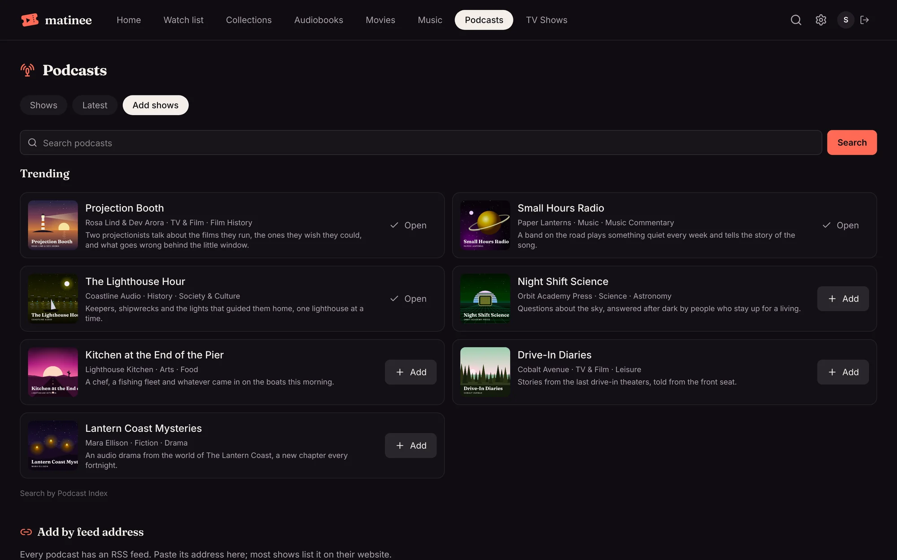
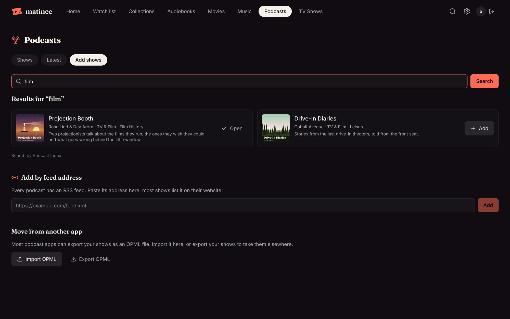
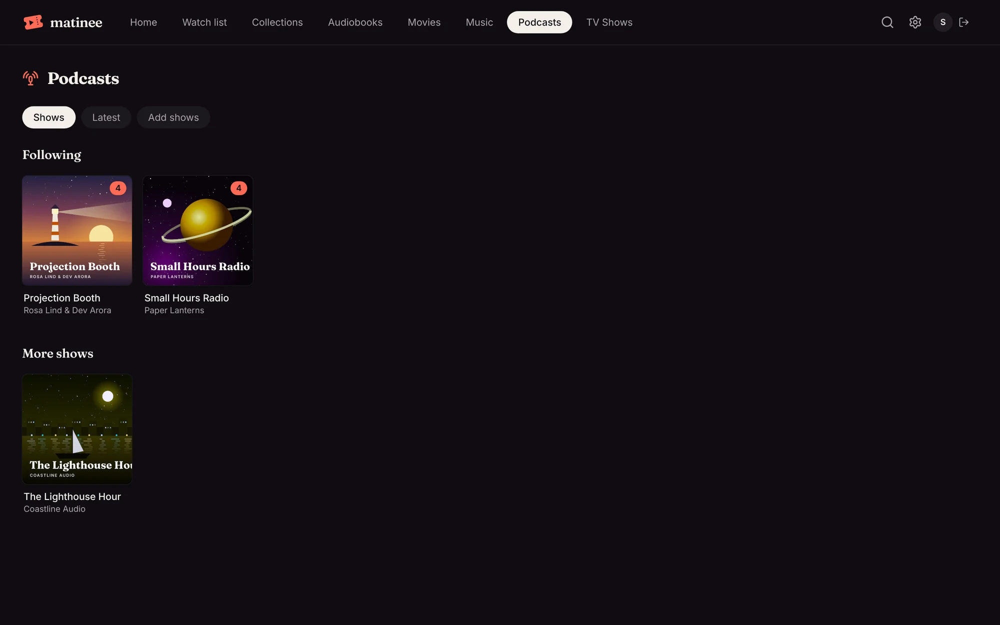
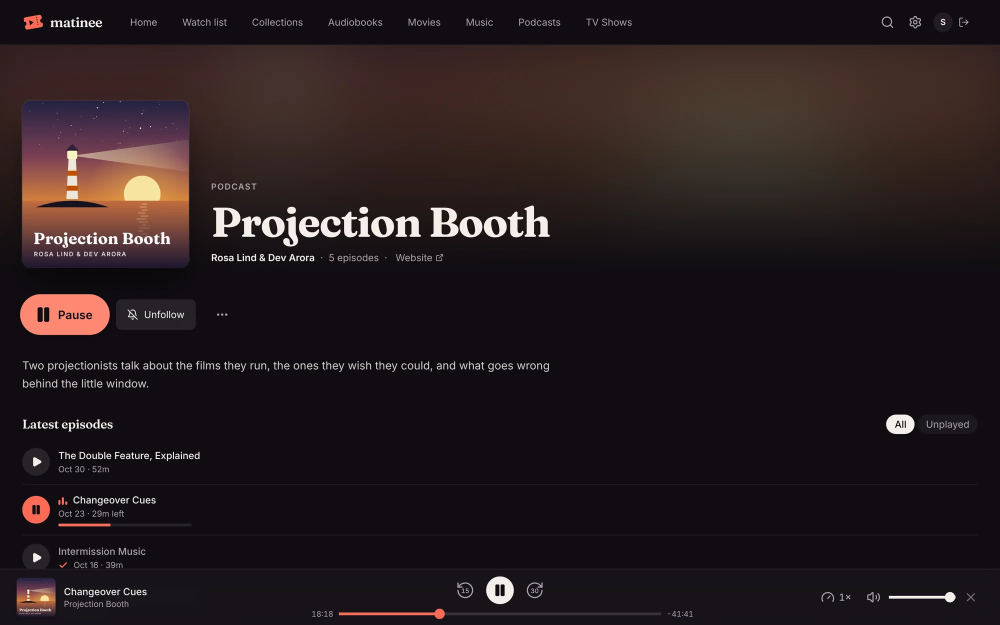
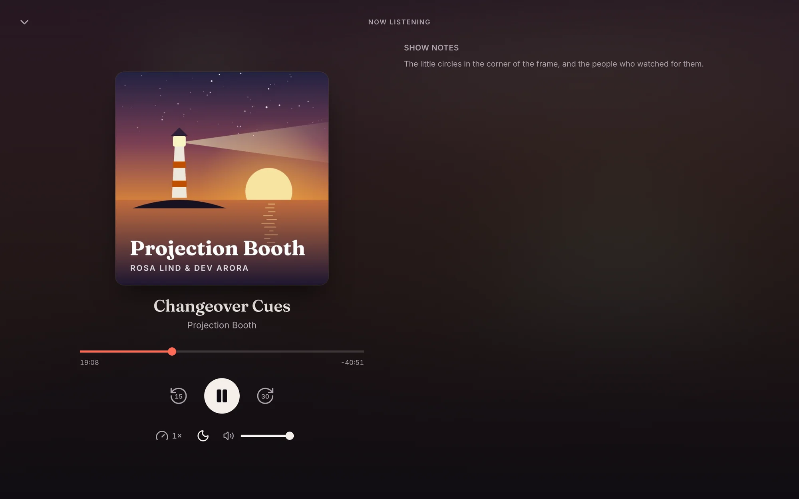

Matinee can keep your podcasts next to your movies, music and books. Shows come straight from their own feeds, so there's no account to sign up for and nothing in between: Matinee checks each feed for new episodes every hour and plays them through your server.

## Adding a podcast library

An admin adds it like any other library: **Settings → Libraries → Add a library**, pick **Podcasts** and give it a name. A podcast library doesn't need a folder. Everyone who can see the library shares its shows, and each person follows the ones they want.

## Adding shows

Open the library and pick **Add shows**. There are three ways in:

- **Search.** Type a show's name, a host or a subject. Before you search, the list shows what's trending. Searching needs a free Podcast Index key; see [Setting up podcast search](#setting-up-podcast-search).
- **By feed address.** Every podcast has an RSS feed, and most shows list its address on their website. Paste it under **Add by feed address**. This always works, with or without a key.
- **From another app.** Most podcast apps can export your shows as an OPML file. Pick **Import OPML** and Matinee adds and follows every show in it. **Export OPML** does the opposite, so you can take your shows with you.

Adding a show follows it for you. Kids profiles can listen to shows that are already in the library, but can't add new ones. Only an admin can remove a show, which removes it for everyone.

## Following and new episodes

The library opens on your shows: the ones you follow first, with a count of episodes you haven't played, then **More shows** that others in the house added. **Latest** lists the newest episodes across every show.

A show's page has its cover, its description and a link to its website, then its episodes, newest first. **All** and **Unplayed** switch between every episode and the ones you haven't heard. **Follow** and **Unfollow** decide whether the show is in your list and on Home. The **⋯** button can check the feed for new episodes now, and mark every episode played or unplayed.

New episodes of the shows you follow from the last two weeks show up in a **New episodes** row on Home. Trailers aren't included, and episodes you've started or finished drop out of it.

## Listening

Click an episode, or **Play latest** on a show's page. Episodes play in the same player as [audiobooks](/docs/watching/audiobooks/), along the bottom of every page:

- **Back 15 seconds** and **Ahead 30 seconds**.
- **Speed**, from 0.75× up to 3×, remembered for next time.
- The **sleep timer** in the full player, which can stop at the **End of this episode**.

Click the cover for the full player. Where a book has its chapters, an episode has its show notes.

Matinee saves your place while you listen. Episodes you're part-way through show in **Continue listening**, and an episode counts as played once you reach its last minute.

## In the apps

The [phone and TV apps](/docs/apps/phone-and-tv/) have podcasts too.

- **On a phone or tablet**, a podcast library opens on **Shows**, **Latest** and **Add shows**, like the browser. A show's page has Play latest, Follow, Mark all played, Check for new episodes and its episodes, with **Unplayed** to hide the ones you've heard. An episode's page can mark it played or [download it](/docs/apps/downloads/) to listen offline.
- **On a TV**, a show's page has Play latest and Follow, and its episodes in a list below. Select one to play it.

Episodes play in the apps' audiobook player, with the same skips, speed and sleep timer, and the show notes where a book shows its chapters. Your place carries over between the apps and the browser.

Android Auto, CarPlay and the watches don't list podcasts yet, but a watch can still pause and skip an episode playing on your phone.

## Setting up podcast search

Search uses [Podcast Index](https://podcastindex.org), a free and open directory of podcasts. It needs an API key and secret, which are free:

1. Sign up at [api.podcastindex.org](https://api.podcastindex.org/) with your email address. The key and secret arrive by email.
2. In Matinee, open **Settings → Content → Podcast search**.
3. Enter the **API key** and **API secret**, and click **Save key**.

Matinee checks the key with Podcast Index before saving it. The key stays on your server, which does the searching; only the covers in the results load from each show's own host. Podcast Index is only used to find shows. Once a show is added, its episodes come from the show's own feed.

## Feeds on your home network

To keep a podcast feed from reaching into your home network, Matinee only fetches feeds and episodes from addresses on the internet. If you host a podcast yourself, on the same network as the server, set `MATINEE_PODCASTS_HOME_NETWORK=true` (see [Configuration](/docs/server/configuration/)).

## If a show stops updating

If a feed can't be read, the show's page says so to admins, with the reason, and Matinee tries again on the next hourly check. A show that moved to a new address usually says so in its old feed, and Matinee follows it. If it didn't, add the show again by its new feed address.
