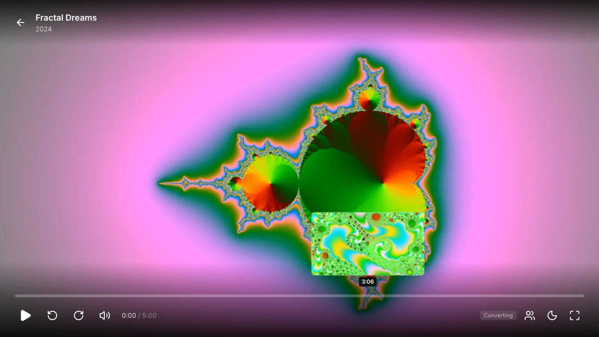
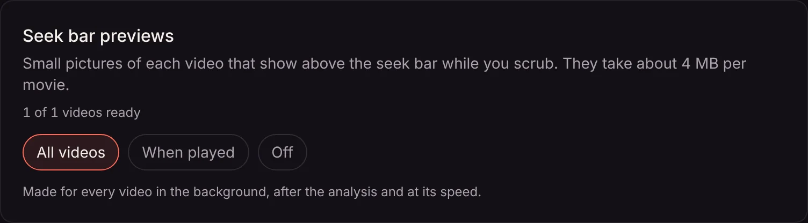

Move the mouse over the seek bar, or drag it, and a small picture of that moment shows above the bar with its time. Let go where you want to be. No more jumping back and forth to find the start of a scene.

## In the browser

- **With a mouse**, the picture follows the pointer before you click, so you can look along the whole movie without leaving your spot.
- **On a touch screen**, drag along the bar with your finger. The bar is taller on phones, so it's easy to catch.
- **With the keyboard**, tab to the bar and use the arrow keys: the picture shows where each press takes you.

## On phones and TVs

In the [phone and TV apps](/docs/apps/phone-and-tv/) (from app version 1.0.23):

- **On a phone or tablet**, drag along the bar. The picture rides above your finger, and the video jumps there when you let go.
- **On a TV**, press left or right on the remote, or rewind and fast forward. The picture shows where the presses add up to, and the video jumps there a moment after you stop.

## Where the pictures come from

Matinee makes the pictures itself, a small frame every few seconds of each movie and episode (every 10 seconds for anything over half an hour). It does that in the background once every file is [analyzed](/docs/server/media-analysis/), at the same gentle pace and lowest priority, and only once per file. A replaced file gets new pictures. HDR videos get pictures in their true colours rather than washed out.

A video someone plays before its turn comes gets its pictures right away, so they're ready a minute or two in, or the next time it plays. Until a video has them, the bar shows just the time.

The pictures take about 4 MB per movie, in the server's data folder (under `thumbnails`). On [Kubernetes](/docs/server/kubernetes/) they go on their own volume, so a restart doesn't make Matinee start over.

## Turning them off or down

Admins choose under **Settings → Libraries → Media analysis**, on the **Seek bar previews** card:

| Choice | |
| --- | --- |
| **All videos** (default) | Pictures of every video, made in the background. The card shows how many are ready. |
| **When played** | Pictures of a video only the first time someone plays it. Saves time and disk space on a big library you mostly don't rewatch. |
| **Off** | No pictures. Players show just the time. Pictures already made stay until a file changes. |

If a video's pictures look wrong, an admin can open its **File details** and choose **Analyze again**: Matinee reads the file once more and makes new ones.
